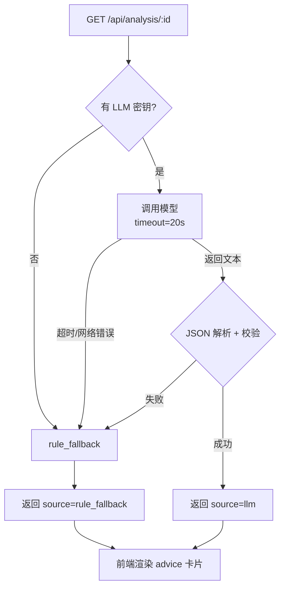

# AI 智能体设计：Prompt 与输出契约

> **负责人**：D ｜ **截止**：第 2 天出原型，第 3 天接入，第 6 天定稿 ｜ **状态**：⬜ 待填写
> **对应交付物**：LLM Prompt 设计、输出 JSON 格式约定；答辩要能解释"为什么这么写提示词"

## 1. 设计目标

| 目标 | 做法 |
| --- | --- |
| 输出可直接渲染 | 强制 JSON，字段固定，前端不做二次解析 |
| 建议可解释 | 要求 reason 必须引用具体数值，禁止空泛 |
| 不越权 | AI 只给建议，**不执行交易、不改余额** |
| 不阻塞系统 | 无密钥/超时/非法输出 → 规则版兜底，交易照常 |
| 密钥安全 | 密钥只在后端环境变量，前端永远拿不到 |

## 2. 输入上下文（由 B 组装）

```json
{
  "player_id": 1,
  "name": "Shadow",
  "current_price": 103.5,
  "change_pct": 3.5,
  "rating": 82,
  "recent_prices": [
    { "ts": "2026-01-01T10:00:00", "price": 100.0 },
    { "ts": "2026-01-01T10:05:00", "price": 103.5 }
  ],
  "recent_reasons": ["模拟比赛表现提升", "买盘集中"],
  "position": { "quantity": 10, "avg_cost": 98.0 }
}
```

## 3. 输出 JSON 契约（固定，不可随意改）

```json
{
  "player_id": 1,
  "action": "BUY",
  "reason": "近 3 场表现评分由 74 升至 82，价格上涨 3.5% 但低于表现提升幅度",
  "risk_level": "MEDIUM",
  "suggested_price_band": { "low": 100.0, "high": 108.0 },
  "source": "llm",
  "disclaimer": "仅为分析建议，不构成投资建议；AI 不会自动交易"
}
```

| 字段 | 类型 | 约束 |
| --- | --- | --- |
| `action` | enum | 只能是 `BUY` / `SELL` / `HOLD`，大写 |
| `reason` | string | 1–3 句中文，必须提到具体数值，长度 ≤ 120 字 |
| `risk_level` | enum | `LOW` / `MEDIUM` / `HIGH` |
| `suggested_price_band` | object | `low` ≤ `high`，可缺省 |
| `source` | enum | `llm` / `rule_fallback` |
| `disclaimer` | string | 固定文案，前端必显示 |

## 4. Prompt 结构

提示词模板在 `backend/ai/prompts.py`：

| 部分 | 作用 | 迭代要点 |
| --- | --- | --- |
| `SYSTEM_PROMPT` | 角色、任务、输出格式、规则 | 强调"只输出 JSON"；枚举用 `|` 明确列出 |
| `USER_PROMPT_TEMPLATE` | 注入行情数据 | 数值统一保留 2 位小数，避免模型读到浮点噪声 |

### 迭代记录（每次改提示词都要记）

| 版本 | 改动 | 问题 | 结果 |
| --- | --- | --- | --- |
| v0 | 初版，只要求给建议 | 模型返回大段解释文字，无法解析 | ❌ 失败 |
| v1 | 强制 JSON + 枚举 | 偶尔返回 `"buy"` 小写 | ⚠️ 需后端兜底 |
| v2 | 明确大写 + 校验失败回退 | ______ | ______ |

## 5. 失败处理链路（与 B 一起实现）



**规则版兜底规则**（`backend/ai/fallback.py`，D 实现并写进文档）：

| 条件 | 建议 | 风险 |
| --- | --- | --- |
| 近 N 点涨幅 > +5% 且 rating < 60 | SELL | HIGH |
| 近 N 点跌幅 < -5% 且 rating ≥ 75 | BUY | MEDIUM |
| 其他 | HOLD | LOW |

## 6. 成本与限流（加分项）

- 单次分析 token 上限：______
- 是否缓存：同一选手 5 分钟内复用上次结果（建议做，演示时省钱且更快）
- 失败重试：最多 1 次，超时即兜底

## 7. 答辩要点

- 为什么 AI 只做建议、不做执行？→ 确定性骨架 + 智能体肌肉，交易正确性由代码保证
- 模型不可用时怎么办？→ 现场拔掉密钥演示一次降级（效果很好）
- 为什么 action 要用枚举？→ 前端渲染和测试都需要稳定契约

## 8. TODO

- [ ] D 第 2 天：填第 4 节迭代记录（至少 2 版）
- [ ] D 第 3 天：与 B 确认 `/api/analysis/{player_id}` 的错误码
- [ ] D 第 6 天：把最差一次模型输出做成答辩"翻车→兜底"演示素材
