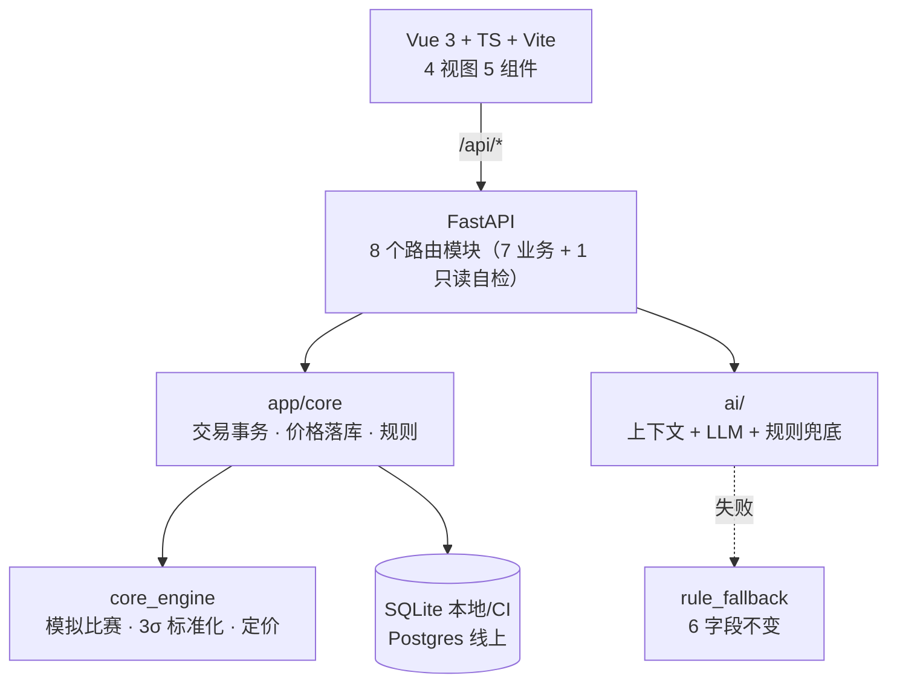

# PlayerStock

## 虚拟选手股交易模拟

<div class="pt-8 text-sm opacity-70">

CS2 选手 · 模拟行情 · 规则化定价 · 只给建议不自动交易的 AI

</div>

<div class="abs-br m-6 text-xs opacity-60">

课程作品答辩 ｜ A 倪颢容 · B 胡德昊 · C 刘宏 · D 王泽棠

</div>

<!--
【0:00–0:10｜10 秒｜D】
一句话开场：我们做的是一个用虚拟币"炒股"CS2 职业选手的模拟交易系统。
先声明合规：全程虚拟币，不可充值、不可提现、不可兑换，不构成任何投资建议。
-->

---
layout: default
---

# 01 我们解决的问题

<div class="grid grid-cols-2 gap-8 pt-4">

<div>

**用户痛点**

- 想"体验交易"，但真实金融市场门槛高、风险真实
- 赛事数据分散，**涨跌没有解释**，只能看热闹
- 已有的模拟炒股产品，标的是公司和财报，**不是自己关心的选手**

</div>

<div>

**目标用户**

- CS2 观众 / 校园赛参与者
- 想验证"我对选手状态的判断准不准"

**我们给的答案**

- 16 名真实 CS2 选手、8 支战队各 2 人（身份公开、价格与评分为**模拟数据**）
- 每一分钱变化都能回答"**为什么**"

</div>

</div>

<div class="pt-6 text-xs opacity-60">

对应需求：`docs/requirements/problem_definition.md`（5W1H）· `user_stories.md`（7 条 INVEST）

</div>

<!--
【0:10–0:50｜40 秒｜D】
痛点三句话：一，想体验交易但没有安全的沙盒；二，赛事数据看着热闹但没人解释涨跌；
三，现有模拟盘标的是公司，不是你在看的这些选手。
目标用户：看 CS2、并且愿意为"我觉得他能打得更好"付判断的人。
注意措辞：选手身份是真的、公开的；价格和评分是我们自己设的模拟数据——这一句必须说清楚。
-->

---
layout: default
---

# 01B 使命 · 口号 · 为什么是我们

<div class="grid grid-cols-2 gap-8 pt-2">

<div>

**使命**

> 让每一位电竞观众，都能把自己的判断，<br>变成一条**看得懂、可验证、零风险**的价格曲线。

**口号**

> **看懂比赛，从持有起。**

<div class="text-xs opacity-60 pt-2">

不含"赚 / 赢 / 翻倍"，与博彩切割；8 个字、动词开头、可传播。

</div>

</div>

<div>

**目标用户（三类）**

- CS2 电竞爱好者：有判断、没地方验证
- 虚拟交易体验用户：想体验交易，不想担真钱风险
- 计算机 / 数据分析学习者：要一个能跑通的工程范本

**明确不做**：想靠它赚钱的人 / 未成年人 / 真钱竞猜用户

**如何获得用户（无推广预算，只靠三件事）**

- **赛事节点**：Major/IEM 开赛前 3 天「新股上市」预告，赛后 10 分钟出涨跌日报
- **内容与社群**：B 站/贴吧/校园电竞社群分发；答辩现场即首批种子用户
- **产品自带传播**：持仓卡（标注"虚拟"）可分享，AI 复盘卡可截图

</div>

</div>

**团队优势：四个人刚好覆盖一条完整链路，且没有重叠**

| 人 | 负责 | 不可替代的点 |
| --- | --- | --- |
| A 倪颢容 | 前端 4 视图 + 交互与无障碍 | 能在 375px 上把表格改成卡片而不丢信息 |
| B 胡德昊 | 后端交易事务 + 落库 + 部署 | 并发超卖那条 P0 是他用「判断写进 SQL WHERE」一次性根治的 |
| C 刘宏 | 模拟器 + 定价引擎 + 回测 | 100 seed 稳定性与「长期温和下行」是主动交代出来的 |
| D 王泽棠 | AI + 测试 + 质量 + CI/文档 | 把 AI 做成可降级、把质量做成可复跑（216 条 / 97%） |

**差异化（同行在比什么，我们在比什么）**

| 维度 | 赛事竞猜 | 电竞养成 | 模拟炒股 | **PlayerStock** |
| --- | :-: | :-: | :-: | :-: |
| 标的 | 比赛结果 | 策划定数值 | 公司与财报 | **单个选手的身价** |
| 价格形成 | 盘口赔率 | 数值表 | 真实行情 | **表现驱动 · 连续 · 可回测** |
| 涨跌可解释 | ❌ | ❌ | ◐ | **✅ 每条都带 reason** |
| 资金风险 | 真钱 | 虚拟 | 虚拟 | **全程虚拟币，无出口** |

<!--
【0:50–2:00｜70 秒｜D】
先念使命，停半秒再念口号——口号是全场的记忆点，别赶。
三类用户只说"各自痛在哪"，不念表。
差异化只讲最后两行：别人比"猜得准"，我们比"讲得清"。
若评委问"和预测市场有什么区别"：机制相近，但我们零真实资金、价格由表现驱动而不是订单簿。
-->

---
layout: default
---

# 01C 产品定义：我们在做什么

**一句话定义（课程模板）**

> 对于 **关注 CS2 选手表现、又想体验数据分析与虚拟交易的观众**，
> 他们希望知道**选手表现如何变成价格**、并亲手验证自己的判断；
> **PlayerStock** 是一个**以 CS2 职业选手为标的的虚拟股交易模拟平台**，
> 它能把**比赛表现转成可解释的价格变动**，提供行情、买卖、持仓、走势与 AI 建议；
> 不同于**只给结果的赛事资讯站**和**只交易金融标的的模拟盘**，
> 我们把"**选手表现 → 价格 → 你的判断**"这条因果链显式做出来。

<div class="grid grid-cols-2 gap-8 pt-4">

<div>

**一条用户故事（业务语言）**

> 作为一个**关注 CS2 赛事的观众**，
> 我想在看完一场比赛后**马上买入我认为被低估的选手**，
> 以便于**验证我的判断是不是比解说更早**。

</div>

<div>

**形态与边界**

- 形态：**Web 网页应用**（桌面优先，≤960px 响应式）
- 规模：16 名选手 / 5000 虚拟币 / 单选手上限 50 股
- 账号：演示账户（`demo`）免登录；可注册私人账号（口令加盐散列、令牌可撤销）
- 边界：**不充值、不提现、不兑换、不给赔率、不自动交易**

</div>

</div>

<div class="pt-2 text-xs opacity-60">

不做清单来源：`docs/requirements/problem_definition.md`（第 3 天范围冻结）

</div>

<!--
【2:00–2:45｜45 秒｜D】
定义那段必须完整念（评委按模板打分），语速可以快一点但不要漏"不同于"这句。
用户故事只念一条，念完补一句"我们 7 条故事都有 Given-When-Then 验收条件，见 user_stories.md"。
最后那四个"不"一定要说，它是合规分。
-->

---
layout: default
---

# 01D 产品设计原则：五条自我约束

<div class="text-sm opacity-70 pb-2">

不是抄教科书——**每条原则都能指到我们做过的一个真实决定**。

</div>

| 原则 | 我们怎么用它 | 落点（可核查） |
| --- | --- | --- |
| **需求原则**：先解决真痛点，再加信息 | 只做"看得懂 + 能验证"，砍掉注册、充值、多用户、撮合盘口 | `problem_definition.md` 的"不做什么"清单 |
| **收敛与优化**：让选择收敛，不发散 | 定价一条公式五个参数；AI 只输出六个字段，不给价格区间 | `pricing_model.md` §2、`api_contract.md` §4.10 |
| **继承与效益**：复用成熟方案 | 不写图表库（自绘 SVG）、不写 ORM、不写鉴权 | `architecture.md` §4.1 |
| **定量与简化**：能度量才叫验收 | 216 条测试、97% 覆盖率、单次涨跌 ≤20%、P95 有时限 | `test_report.md`、`CodeReview.md` §3 |
| **审核原则**：先机器、后人 | CI 三 job 卡门禁；评审看设计不看格式 | `CodeReview.md` §4、`docs/reviews/` |

<!--
【2:45–3:25｜40 秒｜D】
这页最容易被追问"你们真按原则做了吗"——所以每行右侧都写了落点，被问就翻文档。
只讲第 1 行和第 4 行：收敛（公式只有一条）、定量（数字都能跑出来）。其余一行带过。
-->

---
layout: default
---

# 02 产品长什么样

<div class="grid grid-cols-2 gap-6">

<div>

**四条路由 = 一条完整链路**

- `/` 市场：16 名选手，现价 / 涨跌 / 模拟评分 / 状态
- `/players/:id` 详情：折线图 + 涨跌原因 + AI 建议卡 + 交易面板
- `/positions` 持仓：数量 / 均价 / 市值 / 浮盈
- `/trades` 流水：倒序、每笔带交易后余额

</div>

<div>


<div class="text-xs opacity-60 pt-2">市场页（真实浏览器截图）</div>

</div>

</div>

<div class="pt-4 text-xs opacity-60">

截图证据：`docs/acceptance/evidence/01~16`（16 张真实浏览器验收图）

</div>

<!--
【3:25–4:00｜35 秒｜A 或 D】
强调这不是原型图，是真实跑通的页面：后端 uvicorn + 真实 SQLite/Postgres，
截图全部来自 1280×900 的实机验收。
一句话带过链路：看行情 → 详情看走势和 AI 建议 → 买入 → 持仓 → 卖出 → 流水。
-->

---
layout: default
---

# 03 需求与取舍：做了什么 / 不做什么

| 做了 | 刻意不做（及原因） |
| --- | --- |
| **账号体系**：演示账户免登录即用；也可注册私人账号（PBKDF2-HMAC-SHA256 加盐 10 万次、不透明令牌 30 天、可退出/删号） | 第三方登录 / 找回密码 / 邮箱验证：**与课程无关，会稀释工期**，本期不做 |
| 16 名选手、价格由比赛表现驱动 | 接入真实赛事 API：接口可用性未知，用固定 seed 的模拟数据保证演示稳定 |
| 交易闭环：买入/卖出/持仓/流水 | 充值、提现、兑换：**合规红线**，一律不做 |
| AI 只给建议，不自动交易 | 多用户 / 撮合盘口：6 天工期做不完，且不影响核心机制 |

<div class="pt-4 text-sm">

**可测量的非功能指标（节选）**：行情 P95 ≤ 300ms（实测 **24ms**）· 交易 P95 ≤ 500ms（实测 **36ms**）· AI 超时 20s 必定降级 · 核心逻辑覆盖率 ≥60%（实测 **97%**）

</div>

<!--
【4:00–4:30｜30 秒｜D】
这一页是答辩的"可信度锚点"：不是我们做不完，是**主动砍**，每条都给了理由。
重点讲"AI 只给建议不自动交易"——这是设计边界，不是能力不足；
以及合规红线（不充值不提现）。
-->

---
layout: default
---

# 04 系统架构



<div class="grid grid-cols-3 gap-4 pt-4 text-sm">

| 层 | 技术 | 版本 |
| --- | --- | --- |
| 前端 | Vue + TypeScript + Vite | **3.5 / 6.0 / 8.2** |
| 后端 | FastAPI + Pydantic | **0.161 / 2.14** |
| 数据 | SQLAlchemy + SQLite/Postgres | **2.1 / PG 18** |

</div>

<!--
【4:30–5:00｜30 秒｜B】
讲三层边界：接口层只管路由和错误码；core 管事务；core_engine 是纯计算、不碰数据库；
ai 只读、永不改余额。
两个设计点必说：
1）定价引擎和后端同仓库但可独立 pip 安装 → C 可以单独跑、单独测；
2）本地 SQLite、线上 Postgres，一套 SQLAlchemy 模型双环境复用 → 免费实例没有持久盘，纯 SQLite 重新部署就丢数据。
-->

---
layout: default
---

# 05 交易正确性：不靠"先查后写"

<div class="grid grid-cols-2 gap-8">

<div>

**问题**：先 `SELECT` 判断余额够不够、再 `UPDATE` 扣款，两条并发请求会同时通过判断 → **超卖**

**做法**：把判断写进 SQL 的 `WHERE`

```sql
UPDATE users SET balance = balance - :amount
 WHERE user_id = :uid AND balance >= :amount;
-- rowcount = 0 → 400 INSUFFICIENT_BALANCE
```

- 加仓：`... AND quantity + :n <= 50`
- 减仓：`... AND quantity > :n`
- 清仓：`DELETE ... AND quantity = :n`（写 0 会违反 CHECK）

</div>

<div>

**实测（BUG-01 修复前）**

两条连接各卖 2 股、实际只持 3 股：

- 卖出 **4 股**，余额 5000.00 → **5504.00**，还剩 1 股
- 凭空多卖一股、多入账

修复后：`test_trades_concurrency.py` 3 条用例，
并发两笔"卖 1"→ `[200, 400]`，只入账一次。

<div class="pt-4 text-xs opacity-60">

两次修复记录：`docs/acceptance/test_report.md` §9 · 机制：`database_design.md` §3.1

</div>

</div>

</div>

<!--
【5:00–5:30｜30 秒｜B】
先讲 bug 现场：5000 变 5504，凭空多卖一股——这是我们第 2 天真实跑出来的。
再讲修法：判断交给数据库，条件更新 + rowcount。
关键一句：这个写法 SQLite 和 Postgres 行为一致，不依赖 SELECT FOR UPDATE（SQLite 会静默忽略它）。
-->

---
layout: default
---

# 06 定价：一条价格是怎么来的

<div class="grid grid-cols-2 gap-8">

<div>

**公式**

```
P(t+1) = max( floor , P(t) × (1 + α·S(t) + β·D(t)) )
S(t)   = clamp( z(t) / 3 , -1 , +1 )     z = 得分相对近 5 场均值的 z-score
```

| 参数 | 值 | 含义 |
| --- | --- | --- |
| α | **0.15** | 表现权重：满格 S=±1 → 单次 ±15% |
| β | 0 | 需求项（本期不用） |
| floor | 1.0 | 价格下限 |
| clamp | **±20%** | 单次涨跌对称上限 |
| 3σ 满格 | `Z_FULL_SCALE=3` | 1σ 记 1/3，避免二值跳动 |

</div>

<div>

**真实一次调价（第 9 轮，2026-11-09）**

- ZywOo：本轮得分 **81.3**，近 5 场均分约 97 → S = **−0.92**
- 126.27 × (1 + 0.15 × −0.92) ≈ **108.75**（−13.88%）；满格也只有 ±15%，**clamp ±20% 从未触发**
- 落库 reason：`本场表现下滑（本轮得分 81.3，S=-0.92），价格下跌 13.88%`

**同一轮对照（页面可点）**：flameZ 只有 **79.9** 分（窗口均值约 71）→ S = **+1.00**，64.74 → **74.45（+15.00%）**
→ **分数更低反而涨**：价格比的是「和自己近 5 场比」

**可解释性**：`price_history.reason` 必须带 S 和得分，**每条历史价格都能追溯到哪一场、什么得分**

</div>

</div>

<!--
【5:30–6:00｜30 秒｜C】
先说公式三项：当前价 × 表现信号 × clamp，floor 兜底。
重点解释"为什么 z/3 而不是 clamp(z)"：直接用 z 时 1σ 就满格，约 32% 的场次顶格，
价格会二值跳动；除以 3 之后只有真爆发/崩盘才满格，α 的语义也固定成"满格 ±15%"。
然后念第 9 轮那条 reason（ZywOo 81.3 分跌 13.88%）——接着点 flameZ 详情页，
79.9 分却涨 15%：同一轮、分数更低反而涨，这是"可解释性"最硬的一对证据。
（两个详情页折线最后一点点开就是这两条，3 秒内能定位。）
-->

---
layout: default
---

# 07 定价的诚实部分：它会长期温和下行

<div class="grid grid-cols-2 gap-8">

<div>

**100 个 seed × 30 轮的稳定性**

| 指标 | 结果 |
| --- | --- |
| 区间收益 | 中位数 **−7.40%**，均值 −6.46% |
| 方向一致率 | **99.99%**（涨跌次数接近 1:1，公式无偏） |
| 单次最大变动 | ≤ **15.01%**，clamp 触发 0 次 |
| ≥4 人盈利的 seed | 17% |

**根因**：① 得分在 100 处被截断，高分段右尾削平 → E[S] 略小于 0；② 乘性更新的波动拖累。

**不是 bug，是机制特性** —— α 调小可收敛（报告里有 α=0.15/0.08/0.05 对比）。

</div>

<div>

**智能体回测（seed 42 / 20 轮）**

| 策略 | 收益率 | 最大回撤 |
| --- | ---: | ---: |
| 规则版 AI | −3.52% | **5.90%** |
| 随机 | −0.59% | 2.59% |
| 买入持有 | −10.78% | 14.88% |

**结论只说一条**：规则版 AI **回撤明显低于买入持有**（3 seed 中 2 次跑赢收益），
但 20 轮样本下不能宣称"稳定跑赢"——LLM 版待有密钥后补跑。

</div>

</div>

<!--
【6:00–6:30｜30 秒｜C + D】
这一页是主动交底：我们自己测出"长期下行"，并且能解释根因。
答辩策略：抢在老师问之前说，可信度比藏起来高得多。
回测结论只讲"回撤优势"这一条，不吹收益——因为随机策略在主 seed 上就跑赢我们。
-->

---
layout: default
---

# 08 AI 智能体：只给建议，永不改余额

<div class="grid grid-cols-2 gap-8">

<div>

**固定 6 字段契约**

```json
{
  "player_id": 1,
  "action": "HOLD",
  "reason": "近 5 个价格点累计变动 +25.5%…",
  "risk_level": "LOW",
  "source": "rule_fallback",
  "disclaimer": "仅为分析建议，不构成投资建议…"
}
```

**降级是设计的一部分**：无密钥 / 超时（20s）/ 非 JSON / 枚举非法
→ **一律 HTTP 200 + `source=rule_fallback`**，绝不 4xx/5xx 阻塞交易

> 线上现已接真模型（DeepSeek `deepseek-flash`）：`source=llm`、中位 **2461ms**；
> 上图是降级路径的示意（真实响应里 `source` 为 `llm`、`reason` 为模型生成的整段理由）

</div>

<div>

**四层测试守住它**

- `test_llm_agent.py` 13 条：注入假 client，不碰网络
- `test_ai_fallback.py` 6 条：阈值规则
- `test_api_ai.py` 7 条：接口契约 / 只读 / 降级
- e2e：调用前后余额与持仓**完全不变**

<div class="pt-4 text-sm">

**为什么规则版也够用**：阈值规则（涨 5% 且评分 <60 → SELL）在演示环境与 LLM 同源可解释，
LLM 是"增量"，不是"命门"。

</div>

</div>

</div>

<!--
【6:30–7:00｜30 秒｜D】
两句核心：6 字段冻结成契约（前端只按这 6 个渲染）；AI 任何故障都返回 200 + 兜底，
"AI 挂了也能交易"。
补一句测试方式：我们的测试全部注入假 client，不依赖网络，CI 上稳定绿。
-->

---
layout: default
---

# 09 工程实践与线上验证

<div class="grid grid-cols-3 gap-6 text-sm">

<div>

**测试**

- **216** 条用例（单元 203 / 集成 13），CI + 本机全绿
- 核心逻辑覆盖率 **97%**（课程要求 ≥60%）
- 已修 **14** 条真实缺陷（含 3 个 P0：并发超卖、部署驱动、线上 CORS）

</div>

<div>

**质量与 CI**

- ruff 分档门槛（业务/测试 / 脚本 / 复杂度）
- 14 条缺陷全部带可复跑用例
- 前端 lint + build + 真机 16 张验收图

</div>

<div>

**线上**

- 前端/后端/Postgres 三服务（Render）
- **TC-401~406 全部通过**
- 重新部署后流水仍 3 条、价格点仍 11 个 → **Postgres 真的生效**

</div>

</div>

<div class="pt-6 text-xs opacity-70">

线上：`playerstock-frontend-mdlk.onrender.com` ／ `playerstock-backend-mdlk.onrender.com`

</div>

<!--
【7:00–7:40｜40 秒｜D】
数字只念三个：216 条、97%、14 条缺陷。
然后一句杀手锏：我们故意重新部署了一次后端，交易流水和 11 个价格点一条没丢——
这证明线上用的是 Postgres，不是临时盘。
-->

---
layout: default
---

# 10 分工、复盘与下一步

<div class="grid grid-cols-2 gap-8">

<div>

**四人分工（按边界）**

| 人 | 负责 |
| --- | --- |
| A 倪颢容 | 前端 4 视图 + 组件 + 真机验收 |
| B 胡德昊 | 后端接口 / 交易事务 / 落库 / 部署 |
| C 刘宏 | 模拟器 + 定价引擎 + 回测 |
| D 王泽棠 | AI / 测试 / 代码质量 / CI / 文档 |

</div>

<div>

**踩过的坑（真话）**

- 并发超卖：先查后写 → 条件更新
- SQLAlchemy 2.1 默认 psycopg3，线上起不来 → 显式 `+psycopg2`
- reason"得分"被拼两遍 → 幂等标记
- 外部交叉测试**没约到组**，我们如实标注延期，用内部互测 + 16 张证据替代

**如果重做**：先定契约再写代码；把定价的下行风险在文档里前移（这次是回测才发现）。

</div>

</div>

<!--
【7:40–8:00｜20 秒｜D 收尾】
最后一页留两个记忆点：一是"所有坑都写进了缺陷清单，每条都有用例"，
二是"没做到的（外部交叉测试）我们直说，不伪造"。
然后交棒演示：接下来 2 分钟，A 给大家走一遍真实交易闭环。
-->

---
layout: center
class: text-center
---

# 演示环节

<div class="pt-6 text-lg">

查行情 → 看走势与原因 → 买入 → 持仓 → 卖出 → 流水

</div>

<div class="pt-10 text-sm opacity-60">

线上地址（演示前 10 分钟已预热）

</div>

<!--
【8:00–10:00｜2 分钟｜A】切换到 docs/presentation/demo-script.md 的步骤执行。
-->
