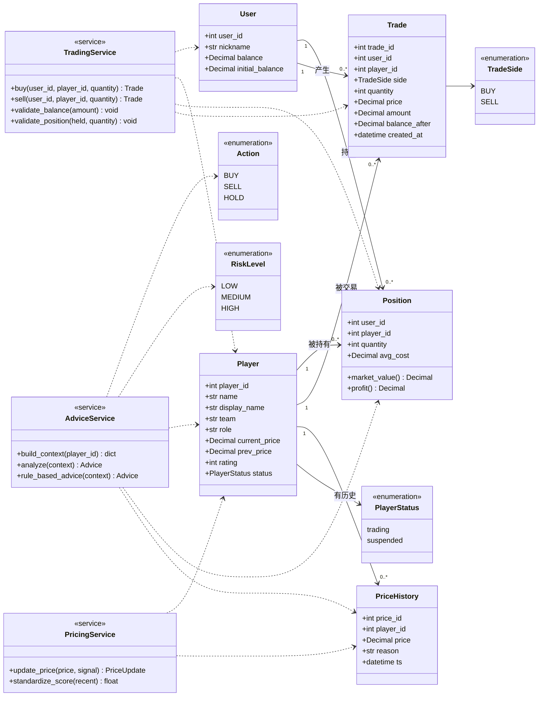

# 软件功能规范书（SRS · 功能需求）

> **负责人**：D 牵头，B 补接口条目，A 补页面条目 ｜ **截止**：第 2 天结束 ｜ **状态**：✅ 已填写（2026-10-24 补 §3 UML 领域类图；各模块异常分支第 6 天统一核对）
> **对应课程指标**：#2 需求分析、#7 各阶段交付物、#9 规范工程文档

## 1. 系统范围

三个模块 + 一个稳定层：

| 编号 | 模块 | 说明 | 负责人 |
| --- | --- | --- | --- |
| M1 | 交易平台 | 行情列表、选手详情、买入卖出、余额、持仓、流水 | A + B |
| M2 | 定价引擎 | 模拟比赛 → 表现信号 → 价格更新 → 价格历史与归因 | C |
| M3 | 智能体分析 | 基于行情生成 BUY/SELL/HOLD 建议 + 理由 + 风险 | D |
| M4 | 稳定层（兜底） | 虚拟币、交易规则、事务一致性；AI 不可用也不影响交易 | B |

## 2. 功能需求清单

> 编号规则 `FR-Mx-nn`；每条必须有：输入、处理、输出、验收方式。
> 表格里的"实现状态"在第 6 天统一核对。

### M1 交易平台

| 编号 | 功能 | 输入 | 处理 | 输出 | 验收 | 状态 |
| --- | --- | --- | --- | --- | --- | --- |
| FR-M1-01 | 行情列表 | — | 查询全部选手 | 名称、当前价、涨跌幅、表现评分 | 页面能看到 ≥5 名选手 | ⬜ |
| FR-M1-02 | 选手详情 | player_id | 查询选手 + 最近价格变化原因 | 价格、评分、reason | 打开详情能看到原因文案 | ⬜ |
| FR-M1-03 | 买入 | player_id, quantity | 校验 → 扣款 → 加持仓 → 写流水（同事务） | success/message/balance | 余额与持仓同步变化 | ⬜ |
| FR-M1-04 | 卖出 | player_id, quantity | 校验 → 加款 → 减持仓 → 写流水（同事务） | success/message/balance | 卖空被拒绝 | ⬜ |
| FR-M1-05 | 账户余额 | — | 查余额与总资产 | balance / total_asset | 初始 5000 | ⬜ |
| FR-M1-06 | 持仓列表 | — | 聚合持仓 + 最新价 | 数量、均价、当前估值 | 空持仓不显示 0 行 | ⬜ |
| FR-M1-07 | 交易流水 | — | 按时间倒序 | side/quantity/price/time | 每笔买卖都能追溯 | ⬜ |
| FR-M1-08 | 历史价格图 | player_id | 取价格序列 | 折线图 | 至少 10 个点 | ⬜ |

### M2 定价引擎

| 编号 | 功能 | 输入 | 处理 | 输出 | 验收 | 状态 |
| --- | --- | --- | --- | --- | --- | --- |
| FR-M2-01 | 模拟比赛数据 | seed | 生成得分/胜负/评级 | MatchResult | 固定 seed 结果可复现 | ⬜ |
| FR-M2-02 | 表现信号 | 最近 N 局数据 | 标准化到 [-1,1] | S(t) | 不同表现得分不同 | ⬜ |
| FR-M2-03 | 价格更新 | P(t), S(t), D(t) | 方案 A 公式 | 新价格 + reason | 价格不跌破下限 | ⬜ |
| FR-M2-04 | 价格历史落库 | 新价格 | 写 price_history | 可查询序列 | 时间升序 | ⬜ |
| FR-M2-05 | 涨跌归因 | 价格变动 | 生成自然语言原因 | reason | 至少 1 升 1 降案例 | ⬜ |

### M3 智能体分析

| 编号 | 功能 | 输入 | 处理 | 输出 | 验收 | 状态 |
| --- | --- | --- | --- | --- | --- | --- |
| FR-M3-01 | 生成建议 | player_id | 取行情 → 调模型 → 校验 JSON | action/reason/risk | 三者之一 | ⬜ |
| FR-M3-02 | 非法输出兜底 | 模型异常输出 | 校验失败 → fallback | source=rule_fallback | 不返回 500 | ⬜ |
| FR-M3-03 | 无密钥降级 | 空密钥 | 跳过模型直接规则版 | 合法结构 | 交易不受影响 | ⬜ |
| FR-M3-04 | 超时保护 | — | 超时中断 | 友好错误或兜底 | 前端不挂死 | ⬜ |

## 3. 领域模型（UML 领域类图）

> 对应课程第 1 天第 2 部分要求："提交 `functional_spec.md` / `nonfunctional_spec.md`，第二周用 3 分钟展示**领域类图与功能分解**"。
> 功能分解见 §2 的 M1/M2/M3 功能需求清单；本节给领域类图（与 `docs/software/database_design.md` §1 的 ER 图同源，字段口径以 `docs/software/api_contract.md` 为准）。

**类到实现的映射（3 分钟汇报可直接照这张表讲）**

| 领域类 / 服务 | 代码 / 数据表 | 说明 |
| --- | --- | --- |
| `User` / `Player` / `Position` / `Trade` / `PriceHistory` | `app/models/*.py` ↔ `users` / `players` / `positions` / `trades` / `price_history` 5 张表 | 实体类与表一一对应，关系见 `database_design.md` §1 |
| `TradingService` | `app/api/trades.py` + `app/core/rules.py` | 事务边界：余额/持仓/流水同事务；失败整体回滚，余额不会扣成负数 |
| `PricingService` | `code/core_engine/pricing.py` | 纯计算，不写库；返回新价格 + 归因 `reason`，由调用方落 `price_history` |
| `AdviceService` | `code/backend/ai/context.py` + `llm_agent.py` + `fallback.py` | **只读**：只 SELECT，不 commit；模型不可用时规则版返回同一结构 |
| `TradeSide` / `PlayerStatus` / `Action` / `RiskLevel` | 常量与枚举校验 | 契约冻结的枚举值；非法值一律拒绝或回落 |

**设计边界**：AI 只产出 `Action` 建议，不进入 `TradingService`；交易正确性由 `TradingService` 的规则与事务保证（见 `docs/software/architecture.md` §5 ADR）。

## 4. 非核心/可选功能（有余力再做）

- 每日签到补虚拟币
- 收益率排行榜
- 赛季结算奖励
- 资产净值时间序列图
- LMSR 做市商（方案 C 彩蛋）

## 5. 需求 ↔ 测试 追溯

每个 FR 编号必须能在 `docs/acceptance/test_plan.md` 找到至少一条对应用例，验收时逐条勾选。

## 6. TODO

- [ ] B 补全 M1 的异常分支（余额不足/持仓不足/非法数量/无效选手/暂停交易）
- [ ] C 补全 M2 的参数范围与 clamp 策略
- [ ] D 补全 M3 的降级链路时序
