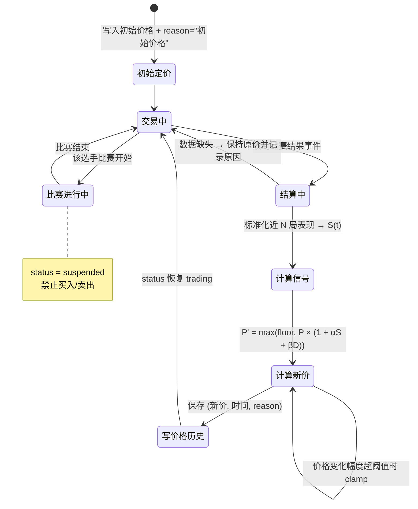

# 机制设计文档（交易规则 + 价格更新状态机）

> **负责人**：B（交易规则） + C（价格机制） ｜ **截止**：第 2 天 ｜ **状态**：✅ 已填写（4 项待定已于第 1 天定稿）
> **对应课程要求**：交付物"需求规格说明书 + **机制设计文档**"；第 3–4 周"画出价格更新状态机"

> 这份文档是答辩时最容易被追问的地方：**规则边界到底怎么定的？并发下会不会超卖？**
> 写的时候每个规则都要有"为什么"和"违反了会怎样"。

## 1. 虚拟资产与交易规则

| 规则 | 取值 | 依据 | 边界情况处理 |
| --- | --- | --- | --- |
| 初始虚拟币 | 5000 | 课程方案 2.1 | 新用户创建时一次性发放 |
| 单选手持仓上限 | 50 股 | 课程方案 2.1 | 买入后总量 > 50 拒绝 |
| 数量 | 正整数 | 合理性 | 0 / 负数 / 小数 / 非数字 → 422 |
| 成交价 | 最新 `current_price` | 一致性 | 不得使用缓存价或前端传入价 |
| 交易时间 | 允许 09:00–23:00 | 第 1 天决议：**不启用**（保留字段） | 非交易时段 → 400 |
| 比赛暂停 | 该选手暂停交易 | 课程方案 2.1 | status=suspended → 400 |
| 手续费 | 不启用（0） | 第 1 天决议：避免均价计算复杂化 | 若启用，需在均价计算中体现 |
| 每笔交易落库 | 必记 | 可追溯性 | 余额/持仓/流水同事务 |

**资金记账口径**（必须写死，避免 A/B 各算各的）：

```
买入：新余额 = 旧余额 - 成交价 × 数量      （启用手续费时再减手续费）
      新持仓 = 旧持仓 + 数量
      新均价 = (旧均价 × 旧数量 + 成交价 × 数量) / 新持仓
卖出：新余额 = 旧余额 + 成交价 × 数量
      新持仓 = 旧持仓 - 数量；新持仓 = 0 时删除持仓行
      均价不变（实现卖出盈亏）
新用户：余额 = INITIAL_BALANCE = 5000，持仓为空
```

## 2. 价格更新状态机



**状态字段**：`players.status ∈ {trading, suspended}`；价格更新只写 `players.current_price / prev_price / price_history`，**绝不改 `users.balance` 与 `positions`**（这是 C 与 B 的边界，违反就是事故）。

## 3. 价格变动归因（可解释性）

每次更新必须能拆成三项并写进 `reason`：

| 分项 | 符号 | 数据来源 | 示例 |
| --- | --- | --- | --- |
| 表现项 | α × S(t) | 最近 N 局得分/胜负/评级 | "近 3 场表现提升（S=+0.42）" |
| 需求项 | β × D(t) | 净买入量占比 | "买盘占比 62%（初版 β=0 不启用）" |
| 兜底 | floor 截断 | 价格下限 | "触及价格下限，停止下跌" |

## 4. 并发与事务

| 场景 | 风险 | 处理 |
| --- | --- | --- |
| 同一用户连点买入 | 重复扣款 / 余额变负 | 事务内先读校验再写，SQLite 下串行写 |
| 买卖与价格更新同时发生 | 用了过期价格 | 成交前在同一事务内重读 `current_price` |
| 卖出与买入交错 | 超卖 | 校验"持仓 ≥ 数量"在最靠近写入处执行 |
| 中途异常 | 余额扣了但持仓没加 | 整体回滚，任何部分失败都不提交 |

## 5. 第 1 天决议（原"待定项"，现已定稿）

| # | 待定项 | 决议 | 责任人 | 状态 |
| --- | --- | --- | --- | --- |
| 1 | 是否启用交易时段限制 | **不启用**（`09:00–23:00` 仅保留字段，不做时段校验），避免演示时给自己制造 400 | B | ✅ 第 1 天定 |
| 2 | 是否启用手续费 | **不启用**（0），否则均价与盈亏计算要多一套口径，收益低于成本 | B | ✅ 第 1 天定 |
| 3 | 暂停交易用 `status` 还是独立表字段 | **用 `players.status`**（`trading` / `suspended`），不建独立表：状态只有两种，独立表会多一次 join | B | ✅ 第 1 天定 |
| 4 | 价格更新的触发方式 | **第 1 天：手动脚本** `python scripts/simulate_match.py --seed 42`；**第 3 天起：赛后事件** `POST /api/prices/recalc`；**本期不做定时任务**。同一 `(player_id, round_no)` 只允许定价一次，重复调用返回 409 | C（算价）/ B（落库） | ✅ 第 1 天定 |

**与价格相关的三条硬约束**（C 与 B 的共同责任）：

1. 价格只写 `players.current_price / prev_price` 与 `price_history`，**不碰 `users.balance` / `positions` / `trades`**；
2. `price_history` 每条必须带 `reason` 与 `ts`（ISO 8601 UTC），按 `ts` 升序返回；
3. 成交价 = 下单时读库的 `current_price`，与 `price_history` 最新一条的 `price` 一致。

## 6. 评审记录

| 日期 | 参与人 | 结论 |
| --- | --- | --- |
| 第 1 天 | A/B/C/D | 字段与接口口径确认；上述 4 项决议通过（C 提出"触发方式与去重键"，B 确认落库边界） |
