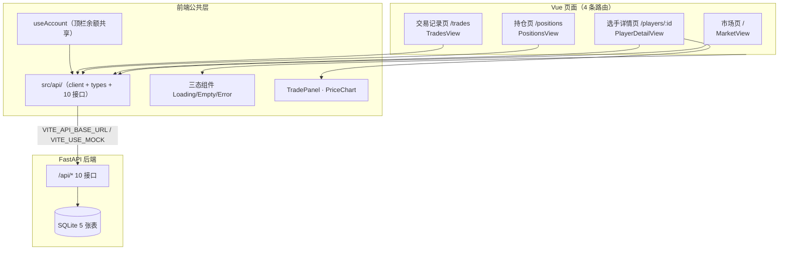

# 线框图 / 交互原型

> **负责人**：A ｜ **截止**：第 2 天 ｜ **状态**：✅ 已产出（文字版线框 + Mermaid 信息架构；截图按团队决定不落盘，验收以实机演示为准）
> **对应课程指标**：#4 产出产品设计文档（需求说明、用户故事、信息架构、**交互原型/线框图**）
> 实现代码见 `code/frontend/`（路由与组件对照表在文末），页面要素与 `docs/software/api_contract.md` §4 字段一一对应。

## 信息架构（页面 → API 层 → 后端）



## 页面线框（ASCII，与实现一致）

### 市场页 `/`（`MarketView.vue`）

```text
┌──────────────────────────────────────────────────────────────┐
│ PlayerStock 虚拟选手股   市场 持仓 交易记录  [连接成功：…] 余额 5000.00 │
├──────────────────────────────────────────────────────────────┤
│ 选手市场                                                [刷新] │
│ ┌────────────┐ ┌────────────┐ ┌────────────┐ ┌────────────  │
│ │ ZywOo 交易中│ │ donk 交易中 │ │ …          │ │ sh1ro 暂停  │  │
│ │ Vitality   │ │ Spirit     │ │            │ │ (整卡置灰)   │  │
│ │ AWPer      │ │ Rifler     │ │            │ │            │  │
│ │ 126.00 +5% │ │ 143.50+2.5%│ │            │ │ 136.50 +5% │  │
│ │ 模拟表现分⑧│8│ 模拟表现分⑨0│ │            │ │ 模拟表现分⑧5│  │
│ └────────────┘ └────────────┘ └────────────┘ └────────────  │
│  红涨绿跌 · change_pct 用后端值 · rating 必带「模拟数据」标注    │
├──────────────────────────────────────────────────────────────┤
│ 合规声明页脚（虚拟币 / 非官方 / 不构成投资建议）                  │
└──────────────────────────────────────────────────────────────┘
```

### 选手详情页 `/players/:id`（`PlayerDetailView.vue`）

```text
← 返回市场        ZywOo [交易中]        Vitality · AWPer   126.00
                                                       +5.00%（前价 120.00）
模拟表现分 88/100 [模拟数据，非官方统计]
最近变动：模拟比赛表现提升（…）              ← latest_reason（§4.3）
── 价格历史 ──────────────────────────────
│ 126.00 ┤                          ●     ← PriceChart（SVG 折线，
│ 123.00 ┤      ……/‾‾‾‾‾‾‾‾‾‾/       ≤10+ 点，升序，红涨绿跌）
│ 120.00 ┤●‾‾…/                             空数据显示"暂无价格历史"
│        └────── ts 首点 ──────── ts 末点 ─
── AI 建议 ──────────────────────────────
│ [持有] 风险：低  规则兜底（AI 暂不可用）    ← source 区分 llm/rule_fallback
│ 近 5 个价格点累计变动 +5.0%…（≤120 字）    ← reason
│ 仅为分析建议，不构成投资建议；AI 不会自动交易 ← disclaimer（必须展示）
── 交易 ─────────────────────────────────
│ 数量 [__2__] 现价 126.00 币，约需 252.00 币
│ 当前持仓：1 股        该选手比赛进行中，暂停交易（仅 suspended）
│ [买入]  [卖出]       ← 提交中/暂停/非法输入时禁用
│ ▓ 交易结果提示条（成功绿 / 失败红，后端 message 原样展示）
```

### 持仓页 `/positions`（`PositionsView.vue`）

```text
我的持仓                                          [刷新]
┌ 余额 4874.00 │ 持仓市值 126.00 │ 总资产 5000.00 │ 总收益 0.00 ┐
| 选手   | 持仓 | 买入均价 | 现价  | 市值   | 盈亏  | 盈亏率 | 交易 |
| ZywOo |  1  | 126.00 | 126.00| 126.00 | 0.00 | 0.00% | →详情 |
（空态："暂无持仓，去 市场 看看。"；盈亏/盈亏率用后端 profit/profit_pct）
```

### 交易记录页 `/trades`（`TradesView.vue`）

```text
交易记录                                          [刷新]
| 时间(本地)        | 方向 | 选手  | 数量 | 成交价 | 金额   | 交易后余额 |
| 2026-10-24 09:38 | 卖出 | ZywOo |  1  | 126.00| 126.00 | 4874.00   |
| 2026-10-24 09:37 | 买入 | ZywOo |  2  | 252.00…          | 4748.00   |
（后端已时间倒序，前端不再排序；空态："暂无交易记录。"）
```

## 交易区域交互状态（TradePanel）

| 状态 | 表现 | 触发 |
| --- | --- | --- |
| 默认 | 数量 1，按钮可用，显示现价与预估花费 | 页面加载完成 |
| 输入非法 | 红字提示（"数量必须是正整数"/"单选手持仓上限 50 股"），**按钮禁用不发请求** | 本地体验校验 |
| 暂停交易 | 黄字"该选手比赛进行中，暂停交易"，按钮禁用 | status=suspended |
| 提交中 | 按钮禁用防连点（不自动重试，重试=第二笔真实交易） | 点击买入/卖出 |
| 成功 | 绿条展示后端 `message`（"买入成功"），**余额/持仓/流水/行情全部重拉后端** | 200 响应 |
| 失败 | 红条展示后端中文 `message`（余额不足/持仓不足/超上限/422 等） | 400/404/422 |

## 空状态与异常状态（三态组件，全页复用）

| 状态 | 组件 | 表现 |
| --- | --- | --- |
| 加载中 | `LoadingState.vue` | 转圈 + "加载中…" |
| 无数据 | `EmptyState.vue` | "市场暂无选手 / 暂无持仓，去市场看看 / 暂无交易记录 / AI 建议暂不可用（不影响交易）" |
| 请求失败 | `ErrorState.vue` | 后端中文 message + [重试]（只重发 GET，不重放交易）；顶栏徽标同步显示"后端未连接" |

## 字段对照（页面 ↔ 契约 §4）

| 页面元素 | 字段 | 来源接口 |
| --- | --- | --- |
| 卡片/详情大字价格 | `current_price` / `prev_price` | §4.2 / §4.3 |
| 涨跌幅 | `change_pct`（后端算好，前端不重算） | §4.2 |
| 模拟表现分 | `rating` + 强制「模拟数据」标注 | §4.2 |
| 折线图 | `points[]`（`ts`/`price`/`reason`，升序） | §4.4 |
| 余额/总资产 | `balance`/`position_value`/`total_asset` | §4.5 |
| 持仓行 | `quantity`/`avg_cost`/`market_value`/`profit`/`profit_pct` | §4.6 |
| 流水行 | `side`/`quantity`/`price`/`amount`/`balance_after`/`created_at` | §4.9 |
| AI 卡 | `action`/`reason`/`risk_level`/`source`/`disclaimer` | §4.10 |

## TODO

- [x] A 产出 4 页面线框 + IA 图（本文件文字版；PNG 截图按团队决定不落盘，答辩现场实机演示）
- [ ] 第 2 天站会用 5 分钟过一遍，B 确认字段都能对上接口（字段对照表已备好，等 B 勾）
