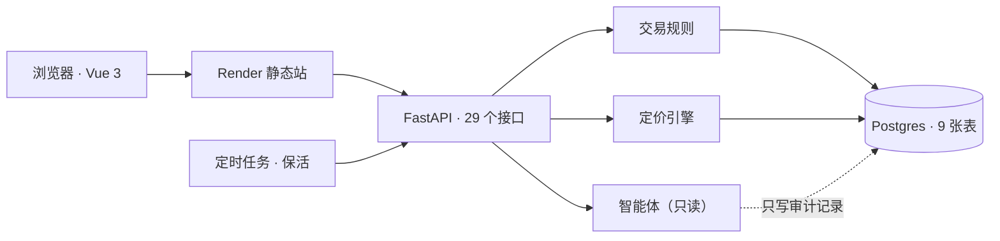
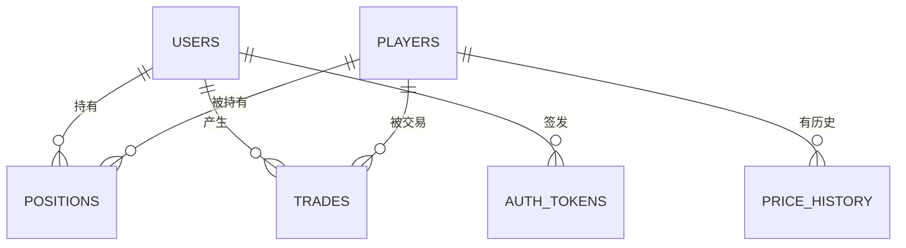

软件新技术创新实践课程 · 结课项目审查 · 2026 年 11 月

  
PlayerStock

  
用信用点买卖 CS2 选手， 价格跟着比赛走。

<dl class="dl rule-top" style="max-width:44rem">
  <dt>小组</dt><dd>有请下一组</dd>
  <dt>成员</dt><dd>王泽棠（D）· 倪颢容（A）· 胡德昊（B）· 刘宏（C）</dd>
  <dt>说明</dt><dd>只用信用点，不能充值、提现或兑换；智能体只给建议，下单由用户确认。<a href="./playerstock_defense.pdf">PDF 版</a></dd>
</dl>

<!--
【10 秒】老师们好，我们是「有请下一组」。我们做的叫 PlayerStock：用信用点买卖 CS2 职业选手，选手比赛打得好，价格就涨。
-->

---

<b>01</b> 产品设计 · 1.1 使命、口号和目标用户

# 看比赛时的判断，可以拿价格来验证

  

    
使命

    
看比赛时觉得某位选手状态好，就用信用点买一点；过几轮再看价格，就知道自己看得准不准。

    
口号

    
看懂比赛，从持有起。

    
口号里刻意不出现赚钱、输赢、翻倍。

  

  

    
写给谁

    <dl class="dl" style="grid-template-columns:6.4rem 1fr">
      <dt>CS2 观众</dt><dd>对选手有看法，没处验证</dd>
      <dt>想练交易的人</dt><dd>想练买卖，不担真钱风险</dd>
      <dt>学编程的同学</dt><dd>想看一个完整跑通的项目</dd>
    </dl>
    
不面向：想靠它赚钱的人、未成年人、真钱竞猜用户。

  

<!--
【30 秒】看比赛的时候，我们常会觉得「这个选手今天状态真好」，但这种判断没处验证。在我们的网站上，你可以用信用点买一点这个选手，过几轮再看价格，就知道自己看得准不准。口号是「看懂比赛，从持有起」，里面特意没用赚钱、翻倍这种词。用户主要是三类：CS2 观众、想练交易又不想花真钱的人，还有学编程的同学。
-->

---

<b>01</b> 产品设计 · 1.1 差异化、获客与团队

# 买的是选手身价，不是比赛结果

| | 赛事竞猜 | 模拟炒股 | PlayerStock |
| --- | --- | --- | --- |
| 买的是什么 | 一场比赛的输赢 | 公司股票 | 一位选手的身价 |
| 价格从哪来 | 盘口赔率 | 真实行情 | 按每轮比赛表现计算，可以回测 |
| 涨跌有没有原因 | 没有 | 部分有 | 每次变价都写明原因 |
| 用不用真钱 | 用 | 不用 | 不用，信用点没有任何出口 |

  
获客　每轮比赛前后发涨跌复盘，先在校园电竞社群和 B 站找人试用。

  
分工　A 前端 · B 交易与部署 · C 定价与回测 · D 智能体与测试

<!--
【30 秒】和赛事竞猜比，我们买的不是一场比赛的输赢，而是一位选手的身价。和模拟炒股比，我们的价格来自比赛表现，而且每次涨跌都写了原因。全程只用信用点，没有任何兑换出口。推广方面，打算每轮比赛前后发涨跌复盘，先在校园电竞社群试用。分工是 A 做前端，B 做交易和部署，C 做定价，我做智能体和测试。
-->

---

<b>01</b> 产品设计 · 1.2 产品定义

# 给想验证自己眼光的 CS2 观众

  <dl class="dl" v-click>
    <dt>给谁</dt><dd>关注 CS2 选手、又想体验虚拟交易的观众，想亲手验证自己的判断。</dd>
    <dt>是什么</dt><dd>一个以 CS2 职业选手为标的的虚拟股网站，有行情、买卖、持仓、走势和智能体建议。</dd>
    <dt>不同在哪</dt><dd>资讯站只报比分，模拟盘交易公司股票；这里每一次价格变化，都能对应到选手某一轮的表现。</dd>
  </dl>
  

    
一条用户故事

    
看完比赛，我想马上买入我觉得被低估的选手，验证自己是不是比解说更早看出来。

    
共 7 条用户故事，每条写了验收条件（user_stories.md）

  

边界　网页应用，桌面和手机都能用；初始 5000 信用点，每位选手最多持有 50 股；不登录用公共演示账户，也可以注册私人账号。不充值、不提现、不给赔率、不自动交易。

<!--
【35 秒】产品定义按课程模板写了三句：给谁用、它是什么、和别的产品有什么不同。最关键的是第三句：每一次价格变化，都能对应到选手某一轮的表现。右边是一条用户故事：看完比赛，我想马上买入我觉得被低估的选手，看看自己是不是比解说更早看出来。下面是边界：不充值、不提现、不给赔率，智能体也不会自动下单。
-->

---

<b>02</b> 产品设计应用的原则

# 五条原则，每条都能在仓库里查到

  
01

先解决主要问题

只做看行情和验证判断；充值、撮合盘口、第三方登录都不做。problem_definition.md

  
02

让选择收敛

定价只有一条公式；智能体只输出 6 个固定字段。pricing_model.md · api_contract.md

  
03

能复用就不自己写

后端用成熟的 FastAPI 和 SQLAlchemy；图表简单，直接画 SVG，不引图表库。architecture.md

  
04

用数字验收

测试条数、覆盖率、单次涨跌上限、接口耗时，都写成具体数值。test_report.md

  
05

机器先查，人再看

每次提交先过 CI 的 4 项检查，人工评审只看设计。ci.yml · CodeReview.md

<!--
【35 秒】我们定了五条原则，每条后面小字是对应的文档，都能在仓库里查到。举两个例子：第二条「让选择收敛」，定价只用一条公式，智能体只能输出六个固定字段，这样好测、好查；第五条「机器先查，人再看」，格式、类型、测试这些交给 CI，组员评审时只讨论设计。
-->

---

<b>03</b> 产品实现 · 3.1 用户体验设计

# 一屏看完行情，三步完成下单

  

    
    
<b>图 1</b>市场页：顶部一行简报，下面 3 列选手卡，桌面一屏 6 张

  

  

    
    
<b>图 2</b>详情页：走势、智能体建议和下单面板在同一页

  

选手卡 → 详情页 → 下单面板，三步买入。手机端用底部 4 个标签切换；浅色、深色两套主题都检查过文字对比度；从详情页返回，筛选和排序保持原样。

<!--
【30 秒】左边是市场页：最上面一行简报告诉你今天谁涨得最多、谁停牌，下面是选手卡，桌面一屏能看到六张。右边是详情页：走势、智能体建议和下单面板放在同一页，不用来回跳。从选手卡点进去，在下单面板点一下，三步就买好了。手机上用底部四个标签切换，深浅两套主题都查过对比度。
-->

---

<b>03</b> 产品实现 · 3.2 技术选型

# 六天工期，只选组员用过的

| 层 | 选型 | 为什么 |
| --- | --- | --- |
| 前端 | Vue 3 · Vite · TypeScript · Vitest | 组员熟悉，构建快，有类型检查 |
| 后端 | Python · FastAPI · SQLAlchemy · Pydantic | 写接口快，自动生成接口文档 |
| 数据 | 本地 SQLite，线上 Postgres | 本地不用装数据库；线上必须能持久保存 |
| 智能体 | DeepSeek 接口 + 规则版备用 | 便宜；模型出问题就换规则版 |
| 部署 | Render：静态站 + 后端 + 定时任务 + 数据库 | 有免费额度，自带 HTTPS |
| 检查 | GitHub Actions · ruff · oxlint · eslint · pytest | 每次提交自动跑 |

具体版本号见仓库 README。线上必须用 Postgres：免费服务器的硬盘每次重新部署都会清空。

<!--
【20 秒】只有六天，所以我们只选组员用过的东西：前端 Vue 和 TypeScript，后端 FastAPI。本地用 SQLite，不用装数据库；线上必须用 Postgres，因为免费服务器每次重新部署硬盘都会清空。智能体接的是 DeepSeek，出问题就换规则版。全部部署在 Render 上。
-->

---

<b>03</b> 产品实现 · 3.3 代码仓库与协作

# 540 次提交，四个人都有份

  

    
每人提交次数（git shortlog，含合并提交）

    

      
D 王泽棠247

      
B 胡德昊116

      
C 刘宏103

      
A 倪颢容74

    

    
B 有两个提交身份（July75-bit 60 + Hu De Hao 56），合并计算。 统计至 2026-11-28：共 540 次提交，其中非合并提交 397 次。

  

  <dl class="dl" v-click style="grid-template-columns:4.5rem 1fr">
    <dt>仓库</dt><dd>github.com/July75-bit/Innovation 日常提交进 develop 分支</dd>
    <dt>任务</dt><dd>Issues 和看板管理，15 条缺陷全部关闭</dd>
    <dt>检查</dt><dd>每次 push 跑 4 项：冲突标记、后端、前端、交付物</dd>
  </dl>

<!--
【20 秒】代码在 GitHub 上，日常提交进 develop 分支，到现在一共五百四十次提交。左边是每个人的次数，B 有两个提交账号，这里合在一起算。任务和缺陷用 Issues 和看板管，十五条缺陷都已经关了。每次推送会自动跑四项检查。
-->

---

<b>03</b> 产品实现 · 3.4 生命周期中遇到的问题

# 上线前踩过六个坑，修完都补了测试

| 问题 | 原因 | 怎么解决 |
| --- | --- | --- |
| 重新部署后数据没了 | 免费服务器的硬盘是临时的，SQLite 文件跟着清空 | 线上改用 Postgres，启动时检查并告警 |
| 线上启动报找不到 psycopg | SQLAlchemy 2.1 换了默认数据库驱动 | 连接串统一改成 psycopg2，加测试守住 |
| 前端请求全被跨域拦下 | 后端没配前端地址，或地址多了个尾斜杠 | 自动去掉尾斜杠，漏配时告警 |
| 首页简报直接露出 JSON | 模型的输出没清洗就展示 | 后端清洗，前端再兜一次，加回归测试 |
| 第一次打开要等 33.6 秒 | 免费服务器闲置 15 分钟就休眠 | 定时任务保活，加骨架屏和自动重试 |
| 赛后结算接口没有口令 | 当初只当内部接口，没加校验 | 必须带运维口令，补了 4 条测试 |

<!--
【35 秒】这六个是开发和上线时真踩过的坑。第一个最典型：Render 免费服务器的硬盘是临时的，重新部署一次，SQLite 里的数据就没了，所以线上改用 Postgres。第五个是第一次打开要等三十多秒，因为免费服务器闲置十五分钟就会休眠，我们用定时任务保活。最后一个是结课前自查发现的：赛后结算接口没加口令，现在已经改成必须带口令。每个坑修完都补了测试。
-->

---

<b>03</b> 产品实现 · 3.5.1 系统架构与基础设施

# 价格由程序算，智能体只给建议

三个服务都在 Render 新加坡区：静态站、后端服务、定时任务。智能体到数据库那条是虚线：它只读业务数据，唯一会写的是自己的审计记录。

<!--
【30 秒】浏览器打开 Vue 页面，请求发到 FastAPI 后端。后端分三块：交易规则、定价引擎和智能体，数据都存在 Postgres 的九张表里。请注意智能体到数据库那条线是虚线：价格和交易都由程序按规则算，智能体只能读数据、给建议，唯一会写的是它自己的调用记录。
-->

---

<b>03</b> 产品实现 · 3.5.3 算法

# 打得比自己平时好，价格才涨

  
P′ = max(1, P × (1 + 0.15 × S))

  
新价格 = 原价格 ×（1 + 0.15 × 表现分），最低 1 个信用点

  <dl class="dl" v-click>
    <dt>表现分 S</dt><dd>本轮得分和自己近 5 场比，压到 −1～1</dd>
    <dt>上限</dt><dd>单次涨跌最多 ±20%</dd>
    <dt>停牌</dt><dd>本队这一轮在比赛，整队暂停买卖</dd>
  </dl>
  

    
为什么和自己比

    
如果和所有选手比，强队选手会一直涨。和自己平时比，只有超常发挥才涨。

    
每个价格点都记一句原因；同样的输入得到同样的价格，用 100 个随机种子回测过。

  

<!--
【30 秒】定价只有这一条公式：新价格等于原价格乘以一加零点一五倍的表现分，最低一个信用点。关键在表现分：它是拿选手这一轮的得分和他自己最近五场比。如果和所有人比，强队选手就会一直涨；和自己平时比，只有打得比平时好才涨。单次涨跌最多百分之二十，每个价格点都记了原因。
-->

---

<b>03</b> 产品实现 · 3.5.3 智能体

# 智能体只动嘴，不动钱

  

01

准备资料

读行情、最近价格和当前用户的持仓

  

02

分析

三个角色依次发言；或让模型自己调 3 个只读工具

  

03

检查

只认 6 个固定字段，动作只能是买、卖、不动

  

04

算股数

按余额和风险算建议股数与止损线，纯算术

  

05

留记录

每次调用写审计；用户点采纳或忽略也记下来

  <dl class="dl" style="grid-template-columns:6rem 1fr">
    <dt>不下单</dt><dd>工具全是只读的，买卖必须用户自己点</dd>
    <dt>坏了也能用</dt><dd>没密钥、超时、格式错、调用太频繁，都换规则版</dd>
  </dl>
  
说明：三个角色是同一个模型，每次换一段身份说明；后一位能看到前面的发言，结论取自交易员。数据量小，直接查库，没有接 RAG。

<!--
【40 秒】智能体分五步：先从数据库准备资料；再让分析师、风控、交易员依次发言，也可以让模型自己调用三个只读工具去查；然后检查回答，只认六个固定字段；接着按余额和风险算出建议买几股、止损在哪；最后把这次调用记下来。要说明一点：这三个角色是同一个模型，每次给它换一段身份说明。不管哪一步出错，都会换成规则版，页面照常显示。它从头到尾只给建议，买卖必须用户自己点。
-->

---

<b>03</b> 产品实现 · 3.5.4 数据库设计

# 九张表，一笔交易在一个事务里完成

  

  

  

    <dl class="dl" v-click style="grid-template-columns:5.5rem 1fr">
      <dt>账号</dt><dd>users · auth_tokens</dd>
      <dt>市场</dt><dd>players · price_history</dd>
      <dt>交易</dt><dd>positions · trades</dd>
      <dt>智能体</dt><dd>agent_traces 等 3 张，只存记录</dd>
    </dl>
    
扣钱、改持仓、写流水在同一个事务里。扣钱时用「余额够才扣」的条件更新，两笔订单同时到也不会超卖。

  

<!--
【25 秒】数据库一共九张表，分四组：账号、市场、交易和智能体记录。智能体那三张表只存记录，不碰业务数据。一笔交易里，扣钱、改持仓、写流水在同一个事务里完成；扣钱时数据库会先判断余额够不够，所以两笔订单同时到也不会超卖。这个坑我们开发时真遇到过，后来专门加了并发测试。
-->

---

<b>03</b> 产品实现 · 3.5.5 接口与 3.5.6 前端设计

# 29 个接口、8 个页面、一套设计令牌

  

| 分组 | 能做什么 | 例子 |
| --- | --- | --- |
| 行情 | 选手列表、详情、价格历史 | GET /api/players |
| 交易 | 买入、卖出、持仓、流水 | POST /api/trades/buy |
| 账号 | 注册、登录、退出、删号 | POST /api/auth/login |
| 智能体 | 建议、简报、决策卡、审计 | GET /api/analysis/\{id\} |
| 运维 | 健康检查、重灌数据 | GET /api/health |

  

  <dl class="dl" v-click style="grid-template-columns:4.5rem 1fr">
    <dt>页面</dt><dd>8 个，切换时有淡入过渡</dd>
    <dt>状态</dt><dd>不用状态库，放在组合函数里</dd>
    <dt>图表</dt><dd>价格曲线、资产曲线都是手画 SVG</dd>
    <dt>主题</dt><dd>设计令牌，深浅两套共用一份代码</dd>
    <dt>加载</dt><dd>缓存、失败重试、骨架屏</dd>
  </dl>

出错统一返回中文提示和错误码。在线接口文档：playerstock-backend-mdlk.onrender.com/docs

<!--
【25 秒】后端一共二十九个接口，分五组，左边每组举了一个例子，完整列表在线文档里能直接试。前端八个页面，没用状态库；价格曲线和资产曲线都是自己画的 SVG；颜色和间距统一用设计令牌，所以深色、浅色两套主题共用一份代码。
-->

---

<b>03</b> 产品实现 · 3.6 软件质量

# 后端 366 条测试，核心代码覆盖率 98%

  

366

后端测试

单元 311 · 集成 22 · 评测 33

  

187

前端测试

Vitest，23 个测试文件

  

98<small>%</small>

核心代码覆盖率

app + core_engine 含智能体模块为 95%

  

4

CI 检查

冲突标记 · 后端 前端 · 交付物

  

    
3.6.1 运行时

    
出错统一返回错误码和中文提示，不把报错细节露给用户；请求和返回都做格式校验；交易用条件更新防并发，有同时卖出的测试。

  

  

    
3.6.2 代码规范

    
Python 用 ruff，函数复杂度上限 10；前端 oxlint 加 eslint，零警告才算过，再加类型检查。CI 只检查，不自动改代码。

  

<!--
【30 秒】后端三百六十六条测试，前端一百八十七条，每次提交都自动跑。核心代码，也就是交易和定价部分，覆盖率百分之九十八；把智能体模块也算进去是百分之九十五。测试看的是结果对不对，比如余额对不对、会不会超卖，而不是页面有没有显示。代码规范由 ruff、oxlint 和 eslint 检查，零警告才算通过。
-->

---

<b>03</b> 产品实现 · 3.7 代码统计

# 约 3.5 万行代码，AI 写的初稿约占 39%

  

<table class="tight">
<thead><tr><th>类型</th><th style="text-align:right">文件</th><th style="text-align:right">行数</th></tr></thead>
<tbody>
<tr><td>Python</td><td style="text-align:right">116</td><td style="text-align:right">17,617</td></tr>
<tr><td>Vue</td><td style="text-align:right">21</td><td style="text-align:right">8,993</td></tr>
<tr><td>TypeScript</td><td style="text-align:right">49</td><td style="text-align:right">6,448</td></tr>
<tr><td>CSS / HTML</td><td style="text-align:right">7</td><td style="text-align:right">2,051</td></tr>
<tr><td>代码合计</td><td style="text-align:right">193</td><td style="text-align:right" class="hl">35,109</td></tr>
<tr><td>Markdown 文档</td><td style="text-align:right">76</td><td style="text-align:right">9,365</td></tr>
</tbody>
</table>

  

  

    

      
AI 参与了多少

      
前端业务代码和原型由 AI 出初稿，约占全部代码的 39%，组员逐行看过、改过。交易、定价和接口约定由组员自己写，互相评审。

    

    
模块：前端 8 个页面、12 个组件；后端 11 个路由模块、8 个智能体模块、1 个定价引擎。按 git 跟踪的文件统计，2026-11-28。

  

<!--
【15 秒】代码一共三万五千行左右，文档九千多行。我们如实说：前端业务代码和原型是 AI 先出初稿的，大约占全部代码的百分之三十九，组员一行行看过、改过。交易、定价和接口约定这些核心部分是我们自己写的，并且互相评审过。
-->

---

<b>04</b> 验收 · 测试与容量

# 真模型 16/16 通过，红队 11 条全部拦下

  

32<small>/33</small>

用户测试检查表

1 项部分通过 另与外组互测，各 33 题

  

16<small>/16</small>

线上真模型评测

输出全部合规 95% 请求在 3.39 秒内返回

  

11<small>/11</small>

红队测试

提示注入、越权 伪造来源

  

38<small>次/秒</small>

只读压测

约 190 人同时在线 全程 0 错误

没做的也说清楚：比赛数据是模拟的，所以没有评估真实比赛的预测准确率；外部用户测试样本还小。证据在 docs/acceptance/，共 147 张截图。

<!--
【25 秒】验收看四个数：用户测试检查表三十三项，三十二项通过，一项部分通过；线上用真模型测了十六个用例，全部合规，百分之九十五的请求三秒多返回；红队测试十一条全拦下；压测每秒三十八个请求，大约够一百九十人同时在线，瓶颈在免费服务器。没做的我们也说清楚：比赛数据是模拟的，所以没有评估预测准不准。
-->

---

<b>05</b> 现场演示

# 接下来两分钟：从看行情到买入

  

    
01

市场页

看简报、选手卡和停牌状态

    
02

详情页

看走势、每次涨跌的原因和智能体建议

    
03

买入 2 股

余额、持仓和流水跟着变

  

  

    
04

个人页

看资产曲线和交易统计

    
05

出状况时

停牌选手买不了；模型不可用时显示规则版建议

    
06

回到市场

演示结束

  

网络不稳时先刷新页面；还不行就放备用录屏。

<!--
【5 秒】下面现场演示：从市场页点进一位选手，看建议，买两股，再看持仓和流水怎么变。
-->

---

结课项目审查

谢谢，请老师指导。

<dl class="dl rule-top" style="max-width:46rem">
  <dt>在线演示</dt><dd class="mono">playerstock-frontend-mdlk.onrender.com</dd>
  <dt>源码</dt><dd class="mono">github.com/July75-bit/Innovation</dd>
  <dt>材料</dt><dd class="mono">july75-bit.github.io/Innovation/playerstock_defense.pdf</dd>
  <dt>小组</dt><dd>有请下一组 · 王泽棠（D）· 倪颢容（A）· 胡德昊（B）· 刘宏（C）</dd>
</dl>

<!--
【结束】我们的汇报就到这里。在线地址、源码和这份材料的 PDF 都在这一页。谢谢各位老师，请老师指导。
-->
