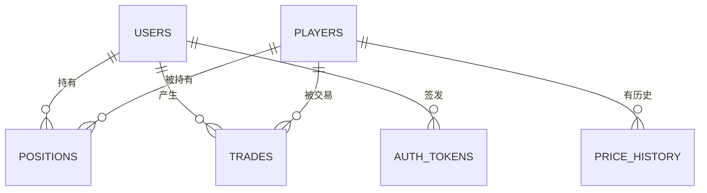

PlayerStock

CS2 虚拟选手股交易系统

看懂比赛，从持有起。

  只用信用点 · 不能充值 / 提现 / 兑换
  16 名选手 · 8 支战队
  智能体给建议，下单由用户确认

  有请下一组 ｜ 王泽棠（D）· 倪颢容（A）· 胡德昊（B）· 刘宏（C） 
  软件新技术创新实践课程 · 2026-11 · 结课项目审查

  <a class="pdf-link" href="./playerstock_defense.pdf">📄 下载完整材料 PDF</a>

<!--
【10 秒】老师们好，我们是「有请下一组」，项目叫 PlayerStock。这是一个用信用点买卖 CS2 选手股的网站，价格根据模拟比赛的表现调整。
-->

---

01 产品设计 · 1.1 使命、口号和目标用户

# 使命、口号和目标用户

  

    

      
使命

      
看比赛时觉得某位选手状态好，就能用信用点买一点，事后对照价格看自己判断得准不准。

    

    

      
口号

      
看懂比赛，从持有起。

      
口号里没有赚钱、输赢一类的说法。

    

  

  

    
目标用户

    <ul class="clean">
      <li><b>CS2 观众</b>：对选手有自己的看法，但没地方验证</li>
      <li><b>想体验交易的人</b>：想练手，不想担真钱的风险</li>
      <li><b>学编程和数据的同学</b>：想看一个能跑通的完整项目</li>
    </ul>
    
不面向：想靠它赚钱的人、未成年人、真钱竞猜用户

  

<!--
【30 秒】看比赛时，观众常会觉得某个选手状态好。在这个网站上，可以用信用点买入这个选手，过几轮再看价格，检验自己的判断。口号是「看懂比赛，从持有起」，口号里没有用赚钱、翻倍这类说法。目标用户主要有三类：CS2 观众、想体验交易的人，以及学编程的同学。
-->

---

01 产品设计 · 1.1 差异化、获客与团队

# 和同类产品的区别

| 维度     | 赛事竞猜     | 电竞养成游戏   | 模拟炒股       | PlayerStock           |
| ------ | -------- | -------- | ---------- | --------------------- |
| 买的是什么  | 比赛结果     | 策划定的数值   | 公司股票       | 单个选手的身价               |
| 价格怎么来  | 盘口赔率     | 数值表      | 真实行情       | 由比赛表现计算，可以回测         |
| 涨跌有没有原因 | 没有       | 没有       | 部分有        | 每次变价都写明原因             |
| 钱的风险   | 真钱       | 虚拟       | 虚拟         | 全程信用点，没有出口            |

  

获取用户

比赛前后发布涨跌复盘，先在校园电竞社群和 B 站找人试用。

  

团队分工

A 负责前端，B 负责交易和部署，C 负责定价和回测，D 负责智能体和测试。

<!--
【30 秒】和赛事竞猜不同，用户买的是某个选手的身价，而不是比赛结果。和模拟炒股不同，价格来自比赛表现，每次涨跌都记录了原因。整个过程只用信用点，不能充值和提现。获取用户方面，我们打算先在校园电竞社群试用。四个人分别负责前端、交易和部署、定价、智能体和测试。
-->

---

01 产品设计 · 1.2 产品定义

# 产品定义

对于<b>关注 CS2 选手、又想体验虚拟交易的观众</b>，他们想知道选手表现怎么变成价格，并亲手验证自己的判断。 
PlayerStock 是一个<b>以 CS2 职业选手为标的的虚拟股交易网站</b>，提供行情、买卖、持仓、走势和智能体建议。 
和只报比分的资讯站、交易公司股票的模拟盘不同，这里每次价格变化都能对应到选手某一轮的表现。

  

    
一条用户故事

    
作为一个看 CS2 比赛的观众，我想在比赛结束后马上买入我觉得被低估的选手，这样就能验证我是不是比解说更早看出来。

    
共 7 条，每条都写了验收条件（user_stories.md）

  

  

    
形态与边界

    <ul class="clean">
      <li>网页应用，桌面和手机都能用</li>
      <li>初始 5000 信用点，单个选手最多持有 50 股</li>
      <li>不登录就用公共演示账户，也能注册私人账号</li>
      <li>不充值、不提现、不兑换、不给赔率、不自动交易</li>
    </ul>
  

<!--
【35 秒】产品定义按课程模板写成了三句，说明给谁用、用户需要什么、和同类产品有什么不同。其中一条用户故事是：看完比赛后，我想买入一个我认为被低估的选手，看看自己的判断是否比解说更早。产品不支持充值、提现和赔率，智能体也不会自动下单。
-->

---

02 产品设计应用的原则

# 设计原则

| 原则       | 我们做的决定                              | 在哪里能核对                      |
| -------- | ----------------------------------- | --------------------------- |
| 先解决主要问题  | 只做看行情和验证判断，不做充值、撮合盘口和第三方登录         | `problem_definition.md` 不做清单  |
| 让选择收敛    | 定价只有一条公式；智能体只输出 6 个固定字段             | `pricing_model.md`、`api_contract.md` |
| 优先复用     | 使用成熟的 FastAPI、SQLAlchemy；图表较简单，直接用 SVG 绘制 | `architecture.md`             |
| 用数据验收    | 测试数、覆盖率、单次涨跌上限、接口耗时都有具体数值          | `test_report.md`              |
| 先自动后人工   | 先由 CI 的 4 个 job 检查，人工评审主要看设计          | `ci.yml`、`CodeReview.md`        |

右列是对应的文档，可以查看具体内容。

<!--
【35 秒】我们在设计时用了五条原则，每条都有对应的做法。例如在收敛选择上，定价只用一条公式，智能体只输出六个固定字段；在审核上，先由 CI 自动检查，人工评审主要看设计。右列是对应的文档。
-->

---

03 产品实现 · 3.1 用户体验设计

# 界面设计

  

    

      
      
市场页：顶部一行简报，下面 3 列选手卡

    

    <ul class="clean" v-click>
      <li>顶部简报显示涨幅最大和停牌的选手</li>
      <li>桌面端一屏显示 6 张卡片，卡片上是价格和涨跌</li>
      <li>从详情页返回后，筛选和排序保持不变</li>
    </ul>
  

  

    

      
      
详情页：价格曲线、智能体建议、下单面板

    

    <ul class="clean" v-click>
      <li>走势、建议和下单面板在同一页</li>
      <li>手机端底部四个标签切换主页面</li>
      <li>支持浅色和深色主题，文字对比度已检查</li>
    </ul>
  

<!--
【30 秒】左边是市场页，顶部是一行简报，下面是选手卡片，桌面端一屏可以看到六张。右边是详情页，价格曲线、智能体建议和买卖面板在同一页。手机端用底部的四个标签切换页面，浅色和深色主题都检查过对比度。
-->

---

03 产品实现 · 3.2 技术选型

# 技术选型

| 层    | 选型与版本（完整版本表见 README）                                         | 选择原因           |
| ---- | ------------------------------------------------------------ | -------------- |
| 前端   | Vue 3.5 · Vue Router 5 · Vite 8 · TypeScript 6 · Vitest 4    | 构建快，有类型检查      |
| 后端   | Python 3.12 · FastAPI 0.161 · SQLAlchemy 2.1 · Pydantic 2    | 自动生成接口文档       |
| 数据   | 本地 SQLite，线上 Render Postgres                                 | 本地无需配置，线上持久保存  |
| 智能体  | DeepSeek API（OpenAI 兼容协议）+ 规则版备用                            | 成本低，失败时可改用规则版  |
| 部署   | Render：静态站 + 后端服务 + 定时任务 + Postgres                         | 有免费额度，支持 HTTPS |
| 质量   | GitHub Actions · ruff · oxlint · eslint · vue-tsc · pytest   | 每次提交自动检查       |

开发时间是六天，所以优先选择组员用过的工具。

<!--
【20 秒】开发时间是六天，所以我们优先选了组员用过的技术。前端用 Vue 和 TypeScript，后端用 FastAPI。本地用 SQLite，线上用 Postgres。智能体接入 DeepSeek，模型出问题时改用规则版。项目部署在 Render。
-->

---

03 产品实现 · 3.3 代码仓库与协作

# 代码仓库与协作

github.com/July75-bit/Innovation ｜ develop 分支 ｜ 529 次提交，其中 386 次非合并（统计至 2026-11-26）

  

    
每人提交次数（git shortlog，含合并提交）

    <table class="mt-2">
      <tbody>
      <tr><td>D 王泽棠</td><td>236</td><td>B 胡德昊</td><td>116</td></tr>
      <tr><td>C 刘宏</td><td>103</td><td>A 倪颢容</td><td>74</td></tr>
      </tbody>
    </table>
    
B 有两个提交身份（July75-bit 60 + Hu De Hao 56），合并计数。

  

  

    

任务和缺陷

用 GitHub Issues 和 Projects 看板管理，14 条缺陷都建了 Issue，目前已全部关闭。

    

自动检查

每次 push 跑 4 个 job：冲突标记、后端、前端、交付物；幻灯片另有一条流水线发布到 GitHub Pages。

  

<!--
【20 秒】代码托管在 GitHub，日常提交合入 develop 分支，到今天共有 529 次提交。左边是每人的提交次数，B 有两个提交身份，这里合并计算。任务和缺陷用 Issues 和看板管理，每次 push 会运行四项自动检查。
-->

---

03 产品实现 · 3.4 生命周期中遇到的问题

# 开发和上线中遇到的问题

| 阶段  | 问题                    | 原因                          | 怎么解决的                    |
| --- | --------------------- | --------------------------- | ------------------------ |
| 部署  | 重新部署后数据丢失             | 免费实例是临时磁盘，SQLite 文件跟着丢      | 线上改用 Postgres，启动时检查并告警    |
| 部署  | 线上启动报找不到 psycopg       | SQLAlchemy 2.1 换了默认驱动        | 连接串统一补成 psycopg2，并加了测试   |
| 联调  | 线上前端所有请求被跨域拦掉         | CORS 来源没配，或多写了尾斜杠           | 自动去尾斜杠，漏配时告警             |
| 智能体 | 首页简报直接显示模型返回的 JSON    | 模型输出没清洗就展示                  | 后端清洗，前端再检查一次，加回归测试        |
| 上线  | 第一次打开要等 33.6 秒        | 免费实例闲置 15 分钟就休眠             | 定时任务保活 + 骨架屏 + 失败自动重试一次  |
| 审查  | 赛后结算接口没有口令校验          | 当初只当内部接口，没加校验               | 改为必须带运维口令，补了 4 条测试       |

这些问题修复后都补了测试或检查。

<!--
【35 秒】这里列出了开发和上线中遇到的六个问题。第一个是数据丢失：Render 免费实例使用临时磁盘，重新部署后 SQLite 文件会被清空，所以线上改用了 Postgres。最后一个是结课前自查发现的，赛后结算接口没有口令校验，现在已经改为必须带口令。这些问题修复后都补了测试。
-->

---

03 产品实现 · 3.5.1 系统架构与基础设施

# 系统架构

  

三个服务

静态站、后端服务、定时任务，都在 Render 新加坡区

  

价格和建议分开

价格和交易由程序按规则算，智能体只读数据、给建议

  

运行记录

有健康检查接口和运行日志，智能体每次调用都有记录

<!--
【30 秒】浏览器加载 Vue 页面，请求发送到 FastAPI。后端分为交易规则、定价引擎和智能体三部分，数据存在 Postgres 的九张表中。价格和交易由程序按规则计算，智能体只读取数据并给出建议。线上共有三个服务，都部署在 Render。
-->

---

03 产品实现 · 3.5.3 算法

# 定价算法

  

    
定价公式

    
P′ = max(1.0, P × (1 + 0.15 · S))

    
新价格 = 原价格 ×（1 + 0.15 × 表现分），最低 1 个信用点

    <ul class="clean mt-2">
      <li>表现分 S：这一轮得分和他自己最近 5 场比，算 z-score，压到 −1 到 1</li>
      <li>单次涨跌最多 ±20%</li>
      <li>本队这一轮在比赛，就整队停牌，不能买卖</li>
    </ul>
  

  

    

      
为什么和自己比较

      
如果和所有选手比较，水平高的选手价格会一直上涨。和自己最近的表现比较，只有发挥高于平时时价格才上涨。

    

    

      
价格变化原因

      
每个价格点都记一句原因，例如本轮得分和涨跌幅度，详情页能逐条看。

    

    
相同的输入会得到相同的价格。我们用 100 个随机种子做过回测。

  

<!--
【30 秒】定价公式是：新价格等于原价格乘以一加零点一五倍的表现分，最低为一个信用点。表现分是把选手这一轮的得分和他最近五场比较得到的，所以只有发挥高于平时时价格才会上涨。每次价格变化都记录了原因，我们也用一百个随机种子做过回测。
-->

---

03 产品实现 · 3.5.3 智能体

# 智能体设计

  

工具调用

模型可以调用三个工具：查价格历史、查账户持仓、计算建议股数，最多 3 轮。

  

多角色分析

依次由分析师、风控、交易员三个角色分析，后一个角色会读取前一个的结果。

  

用户确认

用户可以选择采纳或忽略建议，系统只做记录；买卖需要用户在交易面板确认。

  

    
护栏

    <ul class="clean">
      <li>输出固定 6 个字段，动作和风险等级只能取规定的值</li>
      <li>工具都是只读的，只会写入审计记录</li>
      <li>没有密钥、超过 20 秒或格式错误时，改用规则版建议</li>
    </ul>
  

  

    
数据与边界

    <ul class="clean">
      <li>每次请求都从数据库读取最新数据</li>
      <li>每次调用、采纳都有记录，可以回查</li>
      <li>数据量较小，用 SQL 查询即可，未接入 RAG 和跨会话记忆</li>
    </ul>
  

<!--
【40 秒】智能体可以调用三个工具，查价格历史、查账户持仓和计算建议股数，最多调用三轮。分析由分析师、风控、交易员三个角色依次完成。用户可以采纳或忽略建议，系统只做记录，买卖仍需用户确认。智能体输出固定的六个字段，工具都是只读的，模型调用失败时改用规则版建议。
-->

---

03 产品实现 · 3.5.4 数据库设计

# 数据库设计

  

  

  

    

账号 · 市场 · 交易

users / auth_tokens、players / price_history、positions / trades

    

智能体审计

agent_traces / decision_logs / price_narratives，只写审计记录，不修改业务表

    

交易事务

扣款、更新持仓、写流水在同一个事务中完成。扣款时用条件更新检查余额，避免并发下单时超卖。

  

<!--
【25 秒】数据库共有九张表，分为账号、市场、交易和智能体审计四组。一笔交易中的扣款、更新持仓和写流水在同一个事务里完成。扣款时用条件更新检查余额，避免两笔订单同时提交时出现超卖。
-->

---

03 产品实现 · 3.5.5 接口与 3.5.6 前端设计

# 接口和前端

  

| 分组  | 能做什么          | 例子                       |
| --- | ------------- | ------------------------ |
| 行情  | 选手列表、详情、价格历史  | GET /api/players         |
| 交易  | 买入、卖出、持仓、流水   | POST /api/trades/buy |
| 账号  | 注册、登录、退出、删号   | POST /api/auth/login     |
| 智能体 | 建议、简报、决策、审计记录 | GET /api/analysis/\{id\} |
| 运维  | 健康检查、重灌数据     | GET /api/health          |

  

  

    
前端结构

    <ul class="clean">
      <li>共 8 个页面，切换时有过渡动画</li>
      <li>没有使用状态库，状态放在组合函数中</li>
      <li>价格曲线和资产曲线用 SVG 绘制</li>
      <li>颜色和间距使用设计令牌，深浅主题共用一套代码</li>
      <li>请求有缓存和失败重试，加载时显示骨架屏</li>
    </ul>
  

出错统一返回中文提示和错误码；在线接口文档：playerstock-backend-mdlk.onrender.com/docs

<!--
【25 秒】后端共有二十九个接口，分为五组，左边每组列了一个例子，完整接口可以在在线文档中查看和调用。前端有八个页面，没有使用状态库，图表用 SVG 绘制，颜色和间距使用设计令牌，深色和浅色主题共用一套代码。
-->

---

03 产品实现 · 3.6 软件质量

# 软件质量

  

353

后端测试

单元 298 · 集成 22 · 评测 33

  

186

前端测试

Vitest，23 个测试文件

  

98%

核心覆盖率

app + core_engine；含智能体 94%

  

4

CI 检查

冲突标记、后端、前端、交付物

  

3.6.1 运行时的保障

    <ul class="clean">
      <li>日志：请求和错误写入日志文件，线上可以查看</li>
      <li>异常：统一错误码和中文提示，不向用户返回堆栈</li>
      <li>校验：请求和响应都用 Pydantic 校验</li>
      <li>并发：事务加条件更新，有同时卖出的测试</li>
    </ul>
  

  

3.6.2 代码规范

    <ul class="clean">
      <li>Python：ruff 检查代码缺陷和圈复杂度（上限 10）</li>
      <li>前端：oxlint + eslint 零警告，vue-tsc 类型检查</li>
      <li>CI 只做检查，不自动修改代码</li>
    </ul>
  

<!--
【30 秒】后端有三百五十条测试，前端有一百八十六条，核心模块的覆盖率是百分之九十八，加上智能体模块是百分之九十四。运行时有日志、统一错误码、参数校验和并发控制。代码规范由 ruff、oxlint 和 eslint 检查，CI 只做检查，不自动修改代码。
-->

---

03 产品实现 · 3.7 代码统计

# 代码统计

  

| 类型          | 文件数 | 行数     |
| ----------- | --- | ------ |
| Python      | 113 | 17,113 |
| Vue         | 21  | 8,998  |
| TypeScript  | 49  | 6,412  |
| CSS / HTML  | 7   | 2,052  |
| 代码合计        | 190 | 34,575 |
| Markdown 文档 | 76  | 9,596  |

  

  

    

模块

前端 8 个页面、12 个组件；后端 11 个路由模块、8 个智能体模块、1 个定价引擎。

    
<b>AI 辅助</b> 前端业务代码和原型由 AI 出初稿，约占代码的 39%，组员逐行复核修改；部分测试和文档也有 AI 参与。交易事务、定价公式和接口契约由组员编写、互相评审。

  

<!--
【15 秒】按文件类型统计，代码约三万四千行，文档约九千行。前端代码和原型由 AI 出初稿，约占全部代码的百分之三十九，组员逐行复核过；部分测试和文档也用了 AI。交易、定价和接口这些核心部分由组员编写并互相评审。
-->

---

验收 · 测试与容量

# 测试与验收

  

32 / 33

用户测试检查表

1 项部分通过；另有两组互测，各 33 题

  

16 / 16

线上模型评测

6 个字段全部合规，P95 3.39 秒

  

11 / 11

红队测试

提示注入、越权、伪造来源均被拦截

  

38 次/秒

只读接口压测

约 190 人同时在线，0 错误；瓶颈是免费实例

说明：比赛数据是模拟的，因此没有评估真实比赛的预测准确率。证据在 docs/acceptance/（147 张截图）。

<!--
【25 秒】用户测试检查表共 33 项，32 项通过，1 项部分通过。线上用真实模型评测了 16 次，输出字段都符合要求，P95 耗时 3.39 秒。红队测试 11 条都被拦截。压测结果是每秒 38 次请求，约支持 190 人同时在线，瓶颈在免费实例。由于比赛数据是模拟的，我们没有评估预测准确率。
-->

---

演示

# 现场演示（约 2 分钟）

  

01 市场页

看简报、选手卡和停牌状态

  

02 详情页

看价格曲线、涨跌原因和智能体建议

  

03 买入

买入 2 股，查看余额、持仓和流水的变化

  

04 个人页

看资产曲线和交易统计

  

05 异常情况

停牌选手无法买入；模型不可用时显示规则版建议

  

06 回到市场

结束演示

如果网络不稳定，先刷新页面，仍有问题就播放备用录屏。

<!--
【5 秒】下面进行现场演示：从市场页进入一位选手的详情页，查看建议，买入两股，再查看持仓和流水。
-->

---

结课审查

# 谢谢，请老师指导

  

    
在线演示

    
playerstock-frontend-mdlk.onrender.com

  

  

    
源码仓库

    
github.com/July75-bit/Innovation

  

  

    
完整材料

    
july75-bit.github.io/Innovation/playerstock_defense.pdf

  

有请下一组 · 王泽棠（D）· 倪颢容（A）· 胡德昊（B）· 刘宏（C）　｜　2026-11

<!--
【结束】我们的汇报到此结束，在线演示、源码和 PDF 的地址在这一页。谢谢各位老师。
-->
