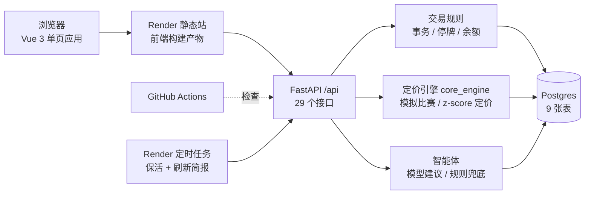
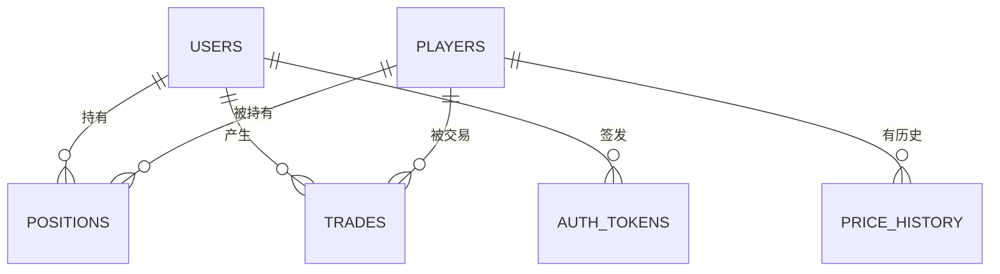

PlayerStock

CS2 虚拟选手股交易系统

看懂比赛，从持有起。

  只用信用点 · 不能充值 / 提现 / 兑换
  16 名选手 · 8 支战队
  智能体只给建议，不替人下单

  有请下一组 ｜ 王泽棠（D）· 倪颢容（A）· 胡德昊（B）· 刘宏（C） 
  软件新技术创新实践课程 · 2026-11 · 结课项目审查

  <a class="pdf-link" href="./playerstock_defense.pdf">📄 下载完整材料 PDF</a>

<!--
【10 秒】老师们好，我们是「有请下一组」，项目叫 PlayerStock。一句话说：用信用点买卖 CS2 选手股，价格跟着比赛表现走。
-->

---

01 产品设计 · 1.1 使命、口号和目标用户

# 让观众的判断变成一条能回看的价格曲线

  

    

      
使命

      
看比赛时觉得某位选手状态好，就能用信用点买一点，事后对照价格看自己判断得准不准。

    

    

      
口号

      
看懂比赛，从持有起。

      
不提「赚」「赢」「翻倍」，和博彩划清界线。

    

  

  

    
目标用户

    <ul class="clean">
      <li><b>CS2 观众</b>：对选手有自己的看法，但没地方验证</li>
      <li><b>想体验交易的人</b>：想练手，不想担真钱的风险</li>
      <li><b>学编程和数据的同学</b>：想看一个能跑通的完整项目</li>
    </ul>
    
不面向：想靠它赚钱的人、未成年人、真钱竞猜用户

  

<!--
【30 秒】我们想做的事很简单：看比赛时你觉得某个选手状态好，就用信用点买一点，过几轮回来看价格，就知道自己看得准不准。口号是「看懂比赛，从持有起」，里面故意没有赚钱、翻倍这类词。用户主要是三类：CS2 观众、想体验交易的人，还有学编程的同学。
-->

---

01 产品设计 · 1.1 差异化、获客与团队

# 和现有产品比，我们交易的是选手的表现

| 维度     | 赛事竞猜     | 电竞养成游戏   | 模拟炒股       | PlayerStock           |
| ------ | -------- | -------- | ---------- | --------------------- |
| 买的是什么  | 比赛结果     | 策划定的数值   | 公司股票       | 单个选手的身价               |
| 价格怎么来  | 盘口赔率     | 数值表      | 真实行情       | 比赛表现驱动，连续、可回测         |
| 涨跌有没有原因 | 没有       | 没有       | 部分有        | 每次变价都写明原因             |
| 钱的风险   | 真钱       | 虚拟       | 虚拟         | 全程信用点，没有出口            |

  

怎么找到第一批用户

赛前预告、赛后发涨跌复盘；先在校园电竞社群和 B 站找人试用。

  

为什么是我们四个

A 前端交互、B 交易与部署、C 定价与回测、D 智能体与测试，四段正好连成一条链。

<!--
【30 秒】跟竞猜比，我们买的不是输赢，是某个选手的身价；跟模拟炒股比，价格来自比赛表现，而且每次涨跌都写了原因。全程只有信用点，没有充值和提现。第一批用户打算从校园电竞社群找，赛后发涨跌复盘。我们四个人各管一段，正好连成一条完整链路。
-->

---

01 产品设计 · 1.2 产品定义

# 我们在做什么

对于<b>关注 CS2 选手、又想体验虚拟交易的观众</b>，他们想知道选手表现怎么变成价格，并亲手验证自己的判断。 
PlayerStock 是一个<b>以 CS2 职业选手为标的的虚拟股交易网站</b>，提供行情、买卖、持仓、走势和智能体建议。 
不同于只报比分的资讯站和只交易公司股票的模拟盘，我们把「选手表现 → 价格 → 你的判断」这条线做了出来。

  

    
一条用户故事

    
作为一个看 CS2 比赛的观众，我想在比赛结束后马上买入我觉得被低估的选手，这样就能验证我是不是比解说更早看出来。

    
共 7 条，每条都写了验收条件（user_stories.md）

  

  

    
形态与边界

    <ul class="clean">
      <li>网页应用，桌面和手机都能用</li>
      <li>初始 5000 信用点，单个选手最多持有 50 股</li>
      <li>不登录就用公共演示账户，也能注册私人账号</li>
      <li>不充值、不提现、不兑换、不给赔率、不自动交易</li>
    </ul>
  

<!--
【35 秒】产品定义按课程模板写成了三句：给谁用、他们想要什么、我们和别人哪里不同。举一条用户故事：看完比赛，我想马上买入一个我觉得被低估的选手，验证自己是不是比解说先看出来。边界也写死了：不充值、不提现、不给赔率，智能体也不会替你下单。
-->

---

02 产品设计应用的原则

# 五条原则，每条都对应一个真实决定

| 原则       | 我们做的决定                              | 在哪里能核对                      |
| -------- | ----------------------------------- | --------------------------- |
| 先解决真问题   | 只做「看得懂、能验证」，砍掉充值、撮合盘口和第三方登录         | `problem_definition.md` 不做清单  |
| 让选择收敛    | 定价只有一条公式；智能体只输出 6 个固定字段             | `pricing_model.md`、`api_contract.md` |
| 能复用就不重写  | 用成熟的 FastAPI、SQLAlchemy；图表自己画，不引大库   | `architecture.md`             |
| 能量化才算验收  | 测试数、覆盖率、单次涨跌上限、接口耗时都给数字            | `test_report.md`              |
| 先机器后人工   | CI 4 个 job 先拦，人工评审只看设计               | `ci.yml`、`CodeReview.md`        |

被问「真按原则做了吗」，可以顺着右边一列直接翻文档。

<!--
【35 秒】这五条原则不是套话，每条都能对上一个具体决定。比如「让选择收敛」：定价只有一条公式，智能体只输出六个固定字段；「先机器后人工」：CI 先跑完四道检查，人工评审只看设计。右边那一列是文档位置，老师想核对可以直接翻。
-->

---

03 产品实现 · 3.1 用户体验设计

# 一屏看完行情，详情页直接下单

  

    

      
      
市场页：顶部一行简报，下面 3 列选手卡

    

    <ul class="clean" v-click>
      <li>进来先看简报：谁涨最多、谁停牌</li>
      <li>桌面一屏 6 张卡，只放价格和涨跌</li>
      <li>筛选、排序、返回后状态都保留</li>
    </ul>
  

  

    

      
      
详情页：价格曲线、智能体建议、下单面板

    

    <ul class="clean" v-click>
      <li>看走势、看建议、下单在同一页</li>
      <li>手机端底部四个标签切换主页面</li>
      <li>浅色 / 深色主题，文字对比度全部达标</li>
    </ul>
  

<!--
【30 秒】左边是市场页，进来先看一行简报，下面是选手卡，桌面上一屏能看六张。右边是详情页，价格曲线、智能体建议和买卖按钮放在同一页，不用来回跳。手机上用底部四个标签切换，浅色深色两套主题都做了对比度检查。
-->

---

03 产品实现 · 3.2 技术选型

# 技术选型：够用、稳定、我们熟

| 层    | 选型与版本（完整版本表见 README）                                         | 为什么选它          |
| ---- | ------------------------------------------------------------ | -------------- |
| 前端   | Vue 3.5 · Vue Router 5 · Vite 8 · TypeScript 6 · Vitest 4    | 轻量、构建快、有类型检查   |
| 后端   | Python 3.12 · FastAPI 0.161 · SQLAlchemy 2.1 · Pydantic 2    | 自动生成接口文档，校验省事  |
| 数据   | 本地 SQLite，线上 Render Postgres                                 | 本地不用配置，线上数据不丢  |
| 智能体  | DeepSeek API（OpenAI 兼容协议）+ 规则版兜底                            | 便宜、响应快，坏了能退回规则 |
| 部署   | Render：静态站 + 后端服务 + 定时任务 + Postgres                         | 免费、自带 HTTPS    |
| 质量   | GitHub Actions · ruff · oxlint · eslint · vue-tsc · pytest   | 每次提交自动检查       |

只有六天，所以挑的都是组里有人用过、能当天上线的工具。

<!--
【20 秒】只有六天，我们挑的都是组里用过的东西。前端 Vue 加 TypeScript，后端 FastAPI，本地用 SQLite，线上用 Postgres。智能体接 DeepSeek，模型出问题就退回规则版。部署全放在 Render 上。
-->

---

03 产品实现 · 3.3 代码仓库与协作

# 代码仓库与协作

github.com/July75-bit/Innovation ｜ develop 分支 ｜ 529 次提交，其中 386 次非合并（统计至 2026-11-26）

  

    
每人提交次数（git shortlog，含合并提交）

    <table class="mt-2">
      <tbody>
      <tr><td>D 王泽棠</td><td>236</td><td>B 胡德昊</td><td>116</td></tr>
      <tr><td>C 刘宏</td><td>103</td><td>A 倪颢容</td><td>74</td></tr>
      </tbody>
    </table>
    
B 有两个提交身份（July75-bit 60 + Hu De Hao 56），合并计数。

  

  

    

任务和缺陷

GitHub Issues + Projects 看板；14 条缺陷各建一个 Issue，全部关闭。

    

自动检查

每次 push 跑 4 个 job：冲突标记、后端、前端、交付物；幻灯片另有一条流水线发布到 GitHub Pages。

  

<!--
【20 秒】代码在 GitHub，日常提交都进 develop 分支，到今天一共 529 次提交。每人的次数在左边，B 有两个提交身份，我们合在一起算。任务和缺陷用 Issues 和看板管，每次 push 都会自动跑四道检查。
-->

---

03 产品实现 · 3.4 生命周期中遇到的问题

# 六个真实踩过的坑

| 阶段  | 问题                    | 原因                          | 怎么解决的                    |
| --- | --------------------- | --------------------------- | ------------------------ |
| 部署  | 重新部署后数据全没了            | 免费实例是临时磁盘，SQLite 文件跟着丢      | 线上改用 Postgres，启动时检查并告警    |
| 部署  | 线上启动报找不到 psycopg       | SQLAlchemy 2.1 换了默认驱动        | 连接串统一补成 psycopg2，并加了测试   |
| 联调  | 线上前端所有请求被跨域拦掉         | CORS 来源没配，或多写了尾斜杠           | 自动去尾斜杠，漏配时告警             |
| 智能体 | 首页简报直接显示模型返回的 JSON    | 模型输出没清洗就展示                  | 后端清洗 + 前端兜底，加回归测试        |
| 上线  | 第一次打开要等 33.6 秒        | 免费实例闲置 15 分钟就休眠             | 定时任务保活 + 骨架屏 + 失败自动重试一次  |
| 审查  | 赛后结算接口没有口令，谁都能改价      | 当初只当内部接口，没加校验               | 改为必须带运维口令，补了 4 条测试       |

每个问题修完都补了测试或检查，同样的错不会悄悄再来一次。

<!--
【35 秒】这六个都是真踩过的。最典型的是第一个：Render 免费实例是临时磁盘，一重新部署 SQLite 就清空了，我们才换成 Postgres。最后一条是结课前自查发现的：赛后结算接口没有口令，理论上谁都能改价，现在已经改成必须带口令。每个问题修完都补了测试。
-->

---

03 产品实现 · 3.5.1 系统架构与基础设施

# 系统架构

  

三个服务

静态站、后端服务、定时任务，都在 Render 新加坡区

  

价格和建议分开

价格和交易由程序按规则算，智能体只读数据、给建议

  

出问题能查

健康检查接口、运行日志、每次智能体调用都有记录

<!--
【30 秒】浏览器加载 Vue 页面，所有请求打到 FastAPI。后面分三块：交易规则、定价引擎、智能体，数据都存在 Postgres 的九张表里。关键的一点是价格和交易由程序按规则算，智能体只读数据、给建议，碰不到钱。线上一共三个服务，都部署在 Render。
-->

---

03 产品实现 · 3.5.3 算法

# 价格怎么算

  

    
定价公式

    
P′ = max(1.0, P × (1 + 0.15 · S))

    
新价格 = 原价格 ×（1 + 0.15 × 表现分），最低 1 个信用点

    <ul class="clean mt-2">
      <li>表现分 S：这一轮得分和他自己最近 5 场比，算 z-score，压到 −1 到 1</li>
      <li>单次涨跌最多 ±20%</li>
      <li>本队这一轮在比赛，就整队停牌，不能买卖</li>
    </ul>
  

  

    

      
为什么和自己比

      
明星选手天天高分，跟全场比会一直涨。和自己的近况比，只有发挥超出平时才会涨。

    

    

      
每次变价都有原因

      
每个价格点都记一句原因，例如本轮得分和涨跌幅度，详情页能逐条看。

    

    
同样的输入一定算出同样的价格。100 个随机种子回测过，结果稳定。

  

<!--
【30 秒】价格只有一条公式：新价格等于原价格乘以一加零点一五倍的表现分，最低一个信用点。表现分是拿这一轮和选手自己最近五场比，所以明星选手不会一直涨，只有发挥超出平时才涨。每次变价都写了原因，我们也用一百个随机种子回测过，结果是稳定的。
-->

---

03 产品实现 · 3.5.3 智能体

# 智能体：会查数据、会分工，但不碰钱

  

工具调用

模型自己决定查什么：价格历史、账户持仓、建议股数。最多 3 轮。

  

多角色分析

分析师先看行情，风控再挑毛病，交易员最后给方案，后一步读前一步的结果。

  

人来拍板

建议旁边有「采纳 / 忽略」，点了只记录；真要买卖还得自己在面板确认。

  

    
护栏

    <ul class="clean">
      <li>输出固定 6 个字段，动作和风险等级只能取规定的值</li>
      <li>工具全部只读，唯一会写的是审计记录</li>
      <li>没密钥、超时 20 秒、格式不对：自动改用规则版，页面不报错</li>
    </ul>
  

  

    
数据与边界

    <ul class="clean">
      <li>每次请求现查数据库，不靠模型记忆</li>
      <li>每次调用、采纳都有记录，可以回查</li>
      <li>没有接 RAG 和跨会话记忆：数据量小，用 SQL 就够</li>
    </ul>
  

<!--
【40 秒】智能体有三个特点。第一，会用工具：模型自己决定要查价格历史还是账户持仓，最多三轮。第二，会分工：分析师、风控、交易员依次过一遍。第三，人来拍板：采纳只是记一笔，买卖还要用户自己确认。护栏也很明确：输出固定六个字段，工具全是只读的，模型挂了自动换规则版，用户看不到报错。
-->

---

03 产品实现 · 3.5.4 数据库设计

# 九张表，交易一次写完

  

  

  

    

账号 · 市场 · 交易

users / auth_tokens、players / price_history、positions / trades

    

智能体审计

agent_traces / decision_logs / price_narratives，只记录，不碰业务表

    

一笔交易一个事务

扣钱、改持仓、写流水同时成功或同时撤销；扣款用「余额够才更新」的条件语句，两笔同时下单也不会超卖。

  

<!--
【25 秒】一共九张表，分账号、市场、交易和智能体审计四组。最重要的是交易：扣钱、改持仓、写流水放在一个事务里，要么全成，要么全撤。扣款用的是「余额够才更新」的条件语句，两笔单子同时进来也不会超卖。
-->

---

03 产品实现 · 3.5.5 接口与 3.5.6 前端设计

# 接口和前端

  

| 分组  | 能做什么          | 例子                       |
| --- | ------------- | ------------------------ |
| 行情  | 选手列表、详情、价格历史  | GET /api/players         |
| 交易  | 买入、卖出、持仓、流水   | POST /api/trades/buy |
| 账号  | 注册、登录、退出、删号   | POST /api/auth/login     |
| 智能体 | 建议、简报、决策、审计记录 | GET /api/analysis/\{id\} |
| 运维  | 健康检查、重灌数据     | GET /api/health          |

  

  

    
前端怎么搭的

    <ul class="clean">
      <li>8 个页面，路由切换带过渡动画</li>
      <li>不用状态库：几个组合函数就够</li>
      <li>价格曲线和资产曲线用 SVG 自己画</li>
      <li>颜色、间距全部走设计令牌，深浅主题一套代码</li>
      <li>请求带缓存和失败重试，慢的时候先出骨架屏</li>
    </ul>
  

出错统一返回中文提示和错误码；在线接口文档：playerstock-backend-mdlk.onrender.com/docs

<!--
【25 秒】后端一共二十九个接口，分五组，左边每组举一个例子，所有接口都能在在线文档里直接试。前端八个页面，没有用状态库，图表是自己用 SVG 画的，颜色和间距统一走设计令牌，所以深浅两套主题是同一份代码。
-->

---

03 产品实现 · 3.6 软件质量

# 质量靠自动检查兜底

  

350

后端测试

单元 295 · 集成 22 · 评测 33

  

186

前端测试

Vitest，23 个测试文件

  

98%

核心覆盖率

app + core_engine；含智能体 94%

  

4

CI 检查

冲突标记、后端、前端、交付物

  

3.6.1 运行时的保障

    <ul class="clean">
      <li>日志：请求和报错都落文件，线上也能直接看</li>
      <li>异常：统一错误码 + 中文提示，不把堆栈给用户</li>
      <li>校验：入参出参都过 Pydantic</li>
      <li>并发：事务 + 条件更新，专门测了同时卖出</li>
    </ul>
  

  

3.6.2 代码规范

    <ul class="clean">
      <li>Python：ruff 查真实缺陷和圈复杂度（上限 10）</li>
      <li>前端：oxlint + eslint 零警告，vue-tsc 类型检查</li>
      <li>CI 只检查不自动改，有问题就红</li>
    </ul>
  

<!--
【30 秒】后端三百五十条测试，前端一百八十六条，核心模块覆盖率百分之九十八，把智能体也算上是百分之九十四。运行时有日志、统一错误码、参数校验和并发保护。代码规范交给工具：ruff 查缺陷和复杂度，前端零警告，CI 只检查不自动改，有问题就直接变红。
-->

---

03 产品实现 · 3.7 代码统计

# 代码统计

  

| 类型          | 文件数 | 行数     |
| ----------- | --- | ------ |
| Python      | 113 | 17,113 |
| Vue         | 21  | 8,998  |
| TypeScript  | 49  | 6,412  |
| CSS / HTML  | 7   | 2,052  |
| 代码合计        | 190 | 34,575 |
| Markdown 文档 | 76  | 9,449  |

  

  

    

模块

前端 8 个页面、12 个组件；后端 11 个路由模块、8 个智能体模块、1 个定价引擎。

    
<b>AI 辅助</b> AI 帮忙写了部分测试和文档；交易事务、定价公式和接口契约由组员自己写、互相评审。

  

<!--
【15 秒】按文件类型统计，代码大约三万四千行，文档九千多行。AI 帮我们写了部分测试和文档，但交易、定价和接口这些核心部分是组员自己写、互相审过的。
-->

---

验收 · 测试与容量

# 用户测试、智能体评测和压测

  

32 / 33

用户测试检查表

1 项部分通过；另有两组互测，各 33 题

  

16 / 16

线上真模型评测

6 个字段全部合规，P95 3.39 秒

  

11 / 11

红队测试

提示注入、越权、伪造来源都被拦下

  

38 次/秒

只读接口压测

约 190 人同时在线，0 错误；瓶颈是免费实例

说清边界：比赛数据是模拟的，所以没有评估真实比赛的预测准确率。证据在 docs/acceptance/（147 张截图）。

<!--
【25 秒】用户测试检查表 33 项，32 项通过，1 项部分通过。线上真模型评测 16 次，字段全部合规，最慢的百分之五也在 3.4 秒内。红队 11 条全拦下。压测每秒 38 次请求，大概能撑 190 人同时在线，瓶颈是免费实例。比赛数据是模拟的，所以我们不评估预测准不准。
-->

---

演示

# 现场演示（约 2 分钟）

  

01 市场页

看简报、选手卡和停牌状态

  

02 详情页

看价格曲线、涨跌原因和智能体建议

  

03 买入

买 2 股，余额、持仓、流水一起变

  

04 个人页

看资产曲线和交易统计

  

05 兜底

停牌选手买不了；模型不可用时显示规则版

  

06 回到市场

结束演示

网络不稳时先刷新只读页面，还不行就放备用录屏。

<!--
【5 秒】下面切到网页，从市场页进一位选手，看建议，买两股，再看持仓和流水。
-->

---

结课审查

# 谢谢，请老师指导

  

    
在线演示

    
playerstock-frontend-mdlk.onrender.com

  

  

    
源码仓库

    
github.com/July75-bit/Innovation

  

  

    
完整材料

    
july75-bit.github.io/Innovation/playerstock_defense.pdf

  

有请下一组 · 王泽棠（D）· 倪颢容（A）· 胡德昊（B）· 刘宏（C）　｜　2026-11

<!--
【结束】我们的汇报就到这里，在线演示、源码和 PDF 的地址都在这一页。谢谢各位老师。
-->
