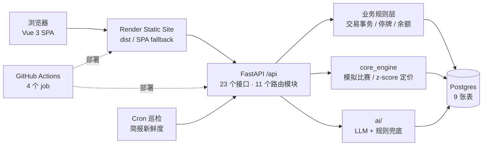
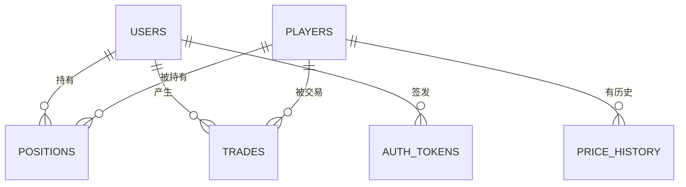

PlayerStock

虚拟选手股交易模拟

把「眼力」变成一条可交易、可解释的价格曲线

  看懂比赛，从持有起
  纯信用点 · 不可充值 / 提现 / 兑换
  16 名选手 · 8 支战队
  AI 只给建议

  有请下一组 ｜ 王泽棠（D）· 倪颢容（A）· 胡德昊（B）· 刘宏（C） 
  软件创新工程实践 · 2026-11 · 15 分钟（8′ 介绍 + 2′ 演示 + 5′ 问答）

  <a class="pdf-link" href="./playerstock_defense.pdf">📄 下载答辩 PDF</a>

<!--
【15 秒】各位老师好，我们是「有请下一组」，作品是 PlayerStock：用信用点交易 CS2 职业选手虚拟股，
把观众对选手的判断变成一条可交易、可解释、没有真实资金风险的价格曲线。
接下来 8 分钟讲产品与实现，2 分钟现场演示，5 分钟回答提问。
-->

---
layout: two-cols
---

01 产品设计 · 1.1 使命 / 口号 / 策略

# 让判断力变成可解释的价格曲线

  
使命 Mission

  

    让每一位电竞观众，都能把自己的判断变成一条看得懂、可验证、零风险的价格曲线。
  

  
边界：纯信用点，不可充值 / 提现 / 兑换；不面向未成年人推广

  

    
三条可验证原则

    <ul class="clean">
      <li><b>可解释</b>：每次价格变动都能拆出原因，不允许黑箱涨跌</li>
      <li><b>可验证</b>：判断对不对，由价格历史与回测给出证据</li>
      <li><b>零风险</b>：投入的是判断力与注意力，不是钱</li>
    </ul>
  

::right::

  

目标用户

CS2 赛事观众 · 想体验交易但不愿担资金风险的人 · 计算机/数据分析学习者；不做「想靠它赚钱的人」。

  

如何获得用户

赛事节点（Major / IEM / BLAST）× 内容化涨跌日报 × 校园电竞社群；现场投屏演示是第一批种子。

  

团队优势

4 人能力互补、边界不重叠：前端 / 后端与交易引擎 / 定价与数据 / 智能体·测试·部署；确定性骨架 + 智能体肌肉。

  <b>差异化：</b>不跟竞品比「人多」，比「可解释 + 零真实资金」——交易选手价值（vs 猜胜负）、机器人可解释（vs 黑箱）、零真实货币（vs 竞猜/预测市场）。

<!--
【40 秒】使命和口号：看懂比赛，从持有起。目标用户是看 CS 比赛、对选手有判断、但不想用真钱的人。
没有推广预算，只靠赛事节点、内容化日报和校园社群。团队 4 人能力互补。
与竞品比，差异是标的（选手价值）、可解释、零真实资金。
-->

---
layout: default
---

01 产品设计 · 1.2 产品定义 / 用户故事

# 一个纯虚拟、可解释的选手股市场

对于想在观赛时参与「判断」的 CS 观众，PlayerStock 是一个纯信用点、可解释的选手股交易市场；
它把选手的赛场表现变成可交易、可追溯、可归因的价格曲线；不同于赛事竞猜和模拟炒股，
我们不涉及任何真实资金，并且每条涨跌都能拆解原因。

解决的问题：判断无处验证 · 价格变化是黑箱 · 决策门槛高

  

交易新手

打开首页 60 秒内知道「现在该不该买」

行情卡 + AI 建议直接给结论，理由可展开

验收：首笔交易 ≤ 60 秒

  

行情玩家

点开选手，看懂价格为什么涨 / 跌

价格曲线 + 每条变动的 reason + AI 归因

验收：每条变动都有 reason

  

演示者 / 老师

断网、无 API Key 也能完成交易闭环

规则兜底 source=rule_fallback，接口仍 200

验收：无 Key 仍返回 200

  5000 信用点开局16 名选手 / 8 支战队
  11 个价格历史点0 充值 / 0 提现 / 0 兑换

<!--
【40 秒】一句话定义产品；三个用户故事对应新手、行情玩家、演示者，每个都带验收。
规模是 16 名选手、8 支战队、每人 11 个价格点；5000 信用点开局，全部虚拟不可兑换。
-->

---
layout: default
---

02 产品设计应用的原则

# 五条原则，对应五个可被验证的取舍

  

01

需求原则

先回答「该不该买」

首屏给结论（BUY/SELL/HOLD + 风险），证据按需展开，不堆术语。

落地：详情页第一屏是建议卡，工具调用/审计默认收起。

  

02

信息原则

一屏完成行情 → 建议 → 下单

市场页 3 列卡片，详情页左侧图表、右侧交易；不来回跳。

落地：市场 → 详情 → 交易面板，三步内完成一单。

  

03

简化原则

纸感、低密度、可读

暖纸色 + 1px 细边；正文 16px；一屏 6 张选手卡；去除玻璃和高饱和装饰。

落地：行高 1.7、深浅色一键切换、移动端下滑隐藏顶栏。

  

04

系统原则

确定性骨架 + 智能体肌肉

交易/定价/结算由确定性代码完成；LLM 只建议，失败自动降级，市场照常运行。

落地：AI 失败 200 + source=rule_fallback，交易/行情不受影响。

05

审核 / 合规原则

零真实资金 + 只读 AI

0 充值 / 0 提现 / 0 兑换；AI 不下单、不改余额，每次调用留审计 trace。

落地：README + 页面双处合规声明；AI 只读红线写进接口契约。

<!--
【35 秒】设计原则不是背条文，而是每个原则对应一个取舍：先给结论、一屏完成、纸感低密度、
确定性骨架让 LLM 挂了也能交易、合规零真实资金。
-->

---
layout: two-cols
---

03 产品实现 · 3.1 用户体验设计

# 界面：让数据和判断同时可读

市场页：一行简报 + 筛选 + 3 列选手卡（一屏 6 张）

- 首屏先给结论，不堆技术词
- 一屏 6 张卡，3 列对齐
- 筛选/排序/搜索不跳页

::right::

详情页：价格曲线 / AI 建议 / 交易同屏

- 左侧看曲线与归因，右侧直接下单
- 移动端 4 Tab + 顶栏头像，下滑隐藏顶栏
- 深浅色快捷切换、骨架屏、慢加载提示

<!--
【35 秒】桌面市场一屏 6 张卡，简报先给结论；详情页左边价格历史，右边 AI 建议和交易；
移动端底部 4 个导航 + 顶栏头像，下滑隐藏顶栏，深浅色一键切换。全部按可读、低密度做减法。
-->

---
layout: default
---

03 产品实现 · 3.2 技术选型

# 轻量、可复现、团队真正 Hold 得住

| 层 | 选型与版本（完整版本表在 README） | 为什么选它 |
| --- | --- | --- |
| 前端 | Vue 3.5.44 · Vue Router 5.4 · Vite 8.3 · TS 6.0 · Vitest 4.1 | 轻量 SPA、类型安全、构建快；前端同学可独立维护 |
| 后端 | Python 3.12 · FastAPI 0.161 · SQLAlchemy 2.1 · Pydantic 2.14 | 自动 OpenAPI 文档、路由清晰、事务可控 |
| 数据 | 本地 SQLite / 线上 Render Postgres（psycopg2） | 本地零配置；线上持久化；一套 ORM 双环境复用 |
| AI | DeepSeek API（OpenAI 兼容）+ rule_fallback | 自然语言理由 + 规则兜底；无 Key/超时/坏 JSON 都降级 200 |
| 部署 | Render：Static Site + Web Service + Cron + Postgres | 免费、HTTPS、Blueprint 可复现；回滚路径清晰 |
| 质量工具 | GitHub Actions · ruff · oxlint · eslint · vue-tsc · pytest | 合并门禁 4 个 job；本地与 CI 同口径 |

原则：不选「简历上最响」的框架，选团队 6 天内能交付、能测试、能部署、能讲清楚的技术。

引用来源：Vue / FastAPI / SQLAlchemy / Vite 官方仓库与文档；DeepSeek 官方 API 文档；版本号与链接见 README / requirements。

<!--
【30 秒】技术选型一条原则：轻量、可复现、团队 Hold 得住。前端 Vue3+Vite，后端 FastAPI + SQLAlchemy，
线上 Postgres，AI 用 DeepSeek 并保留规则兜底；部署交给 Render + GitHub Actions。
-->

---
layout: default
---

03 产品实现 · 3.3 代码仓库与协作

# 444 次提交、5 位贡献者、4 道 CI 门禁

github.com/July75-bit/Innovation ｜ 部署分支 develop ｜ 共 444 次提交（315 次非合并）

  

    
提交分布（GitHub Pulse / git shortlog，含合并提交）

    <table class="mt-2">
      <tbody>
      <tr><td>D 王泽棠</td><td>186</td><td>A 倪颢容</td><td>74</td></tr>
      <tr><td>B 胡德昊</td><td>114</td><td>C 刘宏</td><td>70</td></tr>
      </tbody>
    </table>
    
B 的两个本地 GitHub 身份已合并统计（July75-bit / Hu De Hao）。

  

  

    

协作与项目管理

GitHub Issues / Projects 做任务与 Kanban；14 条缺陷逐条建 Issue 并关闭；提交信息统一 type(scope): 说明 + 验证；小团队互审。

    

CI 4 个 job（每次 push 自动跑）

仓库卫生（冲突标记）→ 后端 ruff + pytest → 前端 eslint + vitest + build → 交付物完整性

  

证据：Pulse 提交截图、Issue #22–#35、CI run 记录都在仓库/答辩材料里。

<!--
【25 秒】仓库在 GitHub 的 July75-bit/Innovation，develop 是部署分支，共 444 次提交、315 次非合并。
四个人都有持续提交；B 的两个本地 GitHub 身份已合并统计。协作靠 Issues/Projects，CI 4 个 job 每次 push 自动跑。
-->

---
layout: default
---

03 产品实现 · 3.4 生命周期问题复盘

# 6 个真实问题：每个都有原因、修复和验证

| 问题 | 原因 | 解决办法（都已验证） |
| --- | --- | --- |
| 部署后数据全丢 | 免费实例临时盘 + SQLite | 迁 Render Postgres；连接串归一化；启动检测到 SQLite 打警告 |
| 线上启动 No module psycopg | SQLAlchemy 2.1 默认驱动变更 | 统一补 +psycopg2；6 条单测守 URL 归一化 |
| 前端全站 CORS 失败 | CORS_ORIGINS 未填 / 带尾斜杠 | 精确 origin + rstrip("/")；线上实测恢复 |
| 简报把模型 JSON 透传 | 模型输出未做白名单清洗 | 后端清洗 + 前端兜底；新增 4 条测试 |
| CI 后端 14 秒红 | ruff C901 圈复杂度 11 > 10 | 拆成 6 个 helper，复杂度降回阈值内 |
| 首次打开 33.6 秒 | Render 免费实例 15 分钟休眠 | 保温 cron + 骨架屏 + GET 重试 + 慢加载提示 |

复盘不是「踩坑列表」：每个问题都补了测试、监控或文档，避免同类问题再发生。

<!--
【40 秒】挑 6 个真实问题：数据全丢（SQLite 临时盘→Postgres）、psycopg 驱动、CORS、模型输出透传、
CI 圈复杂度、冷启动。每个都说明原因和修复；修复后都有测试或线上验证。
-->

---
layout: default
---

03 产品实现 · 3.5 概要设计

# 系统架构：前后端分离 + 确定性交易内核

  

部署

Render：Static + Web + Cron + Postgres；Blueprint 可复现

  

可观测性

/api/logs · /api/debug/db · health 探针 · 简报新鲜度

  

关键取舍

AI 是旁路：只读建议，不参与交易；交易/定价是确定性代码

<!--
【35 秒】架构分四层：前端 SPA、FastAPI 路由、确定性业务内核（core_engine + 规则层）、数据库；
AI 是旁路，只读建议不参与交易。部署是 Render 四件套：静态站、Web Service、Cron、Postgres。
-->

---
layout: two-cols
---

03 产品实现 · 3.5.3 算法与 AI

# 价格可拆解，建议可回落

  
定价模型：每条涨跌都能拆成一句话

  
P′ = max(1.0, P × (1 + 0.15 · S))

  
S = clamp(z / 3.0, −1, 1)　｜　单次变动 |Δ| ≤ 20%

  <ul class="clean mt-2">
    <li>比赛表现用 z-score 标准化，避免强队恒涨、弱队恒跌</li>
    <li>0.15 权重 + 1.0 地板价 + ±20% 熔断，保证可解释、不失控</li>
    <li>每条 price_history 必须带 reason：现场可逐条归因</li>
  </ul>

::right::

  
AI 智能体：只给建议，永不改余额

  

    感知行情分析师风控交易员人点采纳审计
  

  
DeepSeek API（OpenAI 兼容）+ 20s 超时；无 Key / 超时 / 非法 JSON → source=rule_fallback，接口仍 200。

  
契约固定 6 字段：player_id / action / reason / risk_level / source / disclaimer。 
   L4 评测：<b>16/16 走真模型、契约完整率 100%、P95 3.39s</b>（门禁 10s）。

<b>为什么不直接让模型定价？—— 确定性优先，智能体做增强</b> 
规则版：稳定、零成本、可复现；LLM 版：自然语言理由、多角色视角。两者混合：模型失败自动回落，交易与行情不受影响；
评测只评「契约 / 可核性 / 合规 / 边界诚实」，不宣称预测准确率。

<!--
【40 秒】定价用 z-score + 线性映射，单次涨跌不超过 20%，每条价格都有 reason，现场能拆。
AI 是旁路：分析师→风控→交易员，人在环、留审计；DeepSeek 挂了走规则兜底，接口仍 200。我们不给模型定价权。
-->

---
layout: default
---

03 产品实现 · 3.5.4 数据库设计

# 9 张表：交易可追溯，AI 可审计

| 分组 | 表 | 关键的不可变 / 一致性设计 |
| --- | --- | --- |
| 账号 | users / auth_tokens | 余额与初始本金；令牌 30 天、可撤销 |
| 市场 | players / price_history | 价格历史只追加；每条 reason 必填 |
| 交易 | positions / trades | 流水只追加、带 balance_after；持仓唯一(user, player) |
| 智能体 | agent_traces / decision_logs / price_narratives | 每次调用/采纳/归因都留审计，只读业务 |

  

交易一致性

余额、持仓、流水在同一事务里写；并发下单用行锁/条件更新；14 条交易规则测试 + 并发测试。

  

为什么不用缓存/队列？

课程量级不需要；优先保证「数据可追溯 + 事务正确」。

完整 E-R 图与字段见 database_design.md §1（Mermaid）。

<!--
【25 秒】数据库 9 张表，分账号、市场、交易、智能体四组。两个关键设计：交易流水只追加并记录 balance_after；
持仓唯一约束 + 同一事务写余额/持仓/流水。AI 的调用、采纳、归因都落审计表，业务表只读。
-->

---
layout: default
---

03 产品实现 · 3.5.5 接口设计

# 23 个接口，统一契约与错误码

| 分组 | 接口示例 | 契约要点 |
| --- | --- | --- |
| 行情 | GET /api/players · /api/players/{id} · /api/players/{id}/prices | 列表 / 详情 / 价格历史（按 ts 升序） |
| 交易 | GET /api/account · /api/account/history · POST /api/trades/buy \| sell | 余额/资产曲线；买卖返回余额与流水 |
| 身份 | POST /api/auth/register \| login \| logout · GET /api/auth/me | PBKDF2 + 不透明令牌；30 天有效 |
| AI | GET /api/analysis/{id} · /api/agent/decision \| brief \| panel \| tools | 6 字段契约；只读；失败 200 + rule_fallback |
| 运维 | GET /api/health · /api/debug/db · /api/logs | 健康检查 / 只读自检 / 运行日志 |

  
<b>在线文档：</b>https://playerstock-backend-mdlk.onrender.com/api/docs FastAPI 自动生成 OpenAPI / Swagger，可直接试调。

  

工程约定：GET 失败自动重试 1 次（网络/502/503/504）；POST 绝不重试；统一错误码 + 中文 message；敏感字段永不返回。

<!--
【20 秒】接口总共 23 个，分行情、交易、身份、AI、运维五组。FastAPI 自动生成 Swagger，老师现场可以打开 /api/docs 试调。
GET 可以安全重试一次，POST 永不重试，避免重复下单。
-->

---
layout: default
---

03 产品实现 · 3.6 软件质量

# 质量不是「跑通过」，是每次都跑、跑得出来

  

330

后端测试

pytest（6 条 live 默认排除）

  

182

前端测试

Vitest / 22 个文件

  

98%

核心覆盖率

app + core_engine，1956 语句 / 45 未覆盖

  

4

CI 门禁 job

卫生 / 后端 / 前端 / 交付物

  

质量控制与保证方法（3.6.1）

    <ul class="clean">
      <li>日志：/api/logs 保留最近运行日志，关键路径记录请求/错误摘要</li>
      <li>异常：统一 ApiError + 错误码，前端可识别并给出中文提示</li>
      <li>契约：Pydantic schema 校验入参/出参；AI 6 字段固定契约</li>
      <li>并发：下单用事务 + 条件更新；有专门的并发测试</li>
      <li>降级：LLM / 网络 / 冷启动都有兜底路径，不阻塞交易</li>
    </ul>
  

  

质量工具（3.6.2）

    <table>
      <tbody>
      <tr><td>ruff（E/F/C901）</td><td>Python 规范 + 圈复杂度，CI 与本地同版本 0.17.4</td></tr>
      <tr><td>oxlint / eslint</td><td>前端规范；diff marker、硬编码色也有守卫</td></tr>
      <tr><td>vue-tsc</td><td>类型检查进 build，类型错误直接挂 CI</td></tr>
      <tr><td>Vitest / pytest</td><td>单元 + 集成 + 评测 + 并发；每次 push 跑</td></tr>
      <tr><td>GitHub Actions</td><td>4 个 job 全绿才部署；44 秒级反馈</td></tr>
      </tbody>
    </table>
  

<!--
【30 秒】质量用数字说话：后端 330、前端 182，核心覆盖率 98%；CI 4 个 job 全绿才部署。
除了测试，还有日志、统一异常、契约校验、事务并发和降级路径；工具链和 CI 同口径。
-->

---
layout: default
---

03 产品实现 · 3.7 代码统计

# 代码量不是目标，结构清楚才是

| 语言 | 文件数 | 行数 |
| --- | --- | --- |
| Python | 109 | 16,391 |
| Vue | 20 | 8,835 |
| TypeScript | 47 | 6,350 |
| CSS | 3 | 782 |
| HTML | 3 | 1,083 |
| Markdown（文档） | 71 | 12,452 |

  

模块数（3.7）

前端：8 个视图、9 个组件、7 个 composable、22 个测试文件； 后端：11 个路由模块、9 个 AI 模块、4 个 core_engine 模块、9 张表。

  
<b>AI Vibe coding 与团队编写的比例</b> 未做逐行归因，不编造百分比。AI 参与：代码建议、测试生成、文档整理；核心交易/定价/权限逻辑由成员编写并互审；所有提交经 CI 与代码评审，来源可追溯。

可执行代码合计约 33,000 行；文档约 12,000 行（63 份 md）。

<!--
【15 秒】可执行代码约 3.3 万行，文档约 1.2 万行；前端 8 视图/9 组件，后端 11 路由模块/9 AI 模块。
AI 参与建议、测试和文档，核心逻辑人工编写并互审，所有提交有 CI 和评审。
-->

---
layout: default
---

验收 · 测试与容量

# 用户测试 + 智能体评测 + 压测，三条证据链

  

33 项

用户测试表

32 通过 / 1 部分通过

对话/状态/错误/边界逐项实测，截图留痕

  

16/16

AI 契约评测

source=llm 100% · P95 3.39s

6 字段完整率 100%，合规/可核性全过

  

11/11

红队用例

提示注入 / 越权 / 伪造来源

全部守住，审计日志可追

  

38 req/s

只读压测

≈190 人同时在线 · 0 错误

瓶颈是免费档 0.1 vCPU，不是代码

诚实说明：交叉用户测试样本较小；没有真实赛事数据与真实资金，因此不宣称预测准确率或长期留存。这些是课程作品的边界，不是隐藏项。

证据索引：docs/acceptance/evidence（146 张截图）· test_report.md · agent_eval_report.md · load_test_report.md

<!--
【20 秒】三条证据链：33 项用户测试（32 通过/1 部分）、AI 契约 16/16、红队 11/11、压测 38 req/s、190 并发 0 错误。
同时诚实说明边界：交叉测试双向各 33 题（我方测 Tome 9/17/6/1；他组测我方 28/4/0/1，属材料评审）、无真实赛果、不做准确率承诺。
-->

---
layout: default
---

演示与问答

# 2 分钟现场演示：一条完整的判断→交易→复盘

  

01 市场

简报先给结论，3 列选手卡看涨跌与停牌

  

02 详情

价格曲线 + AI 建议（理由/风险/来源）+ 停牌提示

  

03 下单

买入 2 股：余额、持仓、流水同屏变化；停牌被规则拦住

  

04 复盘

持仓/流水核对；个人页看资产曲线、交易统计、深浅色切换

  

05 兜底

断网/无 Key：AI 走 rule_fallback，行情和交易仍可用

  

06 结束

回到市场，确认演示数据干净、可重复

演示期间不切窗口、不输入敏感信息；失败预案：刷新只读页 / 放录屏 / 用本机备份。

<!--
【5 秒】下面用 2 分钟演示一条完整链路：市场→详情→买入→复盘，再补一个停牌拦截和 AI 降级；演示期间不切窗口。
-->

---
layout: default
---

演示与问答

# 5 分钟问答 · 最可能被问到的 4 个问题

  

“这不就是赌博 / 竞猜吗？”

不接入真钱、无充值提现兑换；定位是观赛判断与工程练习，合规声明在 README 与页面。

  

“AI 乱说怎么办？”

AI 只读建议、6 字段契约 + 规则兜底；每次调用留 trace，不写余额、不下单。

  

“4 个人 6 天怎么分工？”

A 前端 / B 后端与交易引擎 / C 定价与数据 / D AI·测试·部署·文档；接口契约第 1 天锁定。

  

“系统挂了还能演示吗？”

交易/定价是确定性代码；AI 有 rule_fallback，冷启动有保温 + 重试 + 骨架屏。

谢谢，欢迎提问。

<!--
【5 分钟】回答时先给结论、再给证据，最后承认边界：交叉测试双向各 33 题（Tome 9/17/6/1；他组测我方 28/4/0/1，材料评审）、无真实赛果、不做预测准确率承诺。
-->
