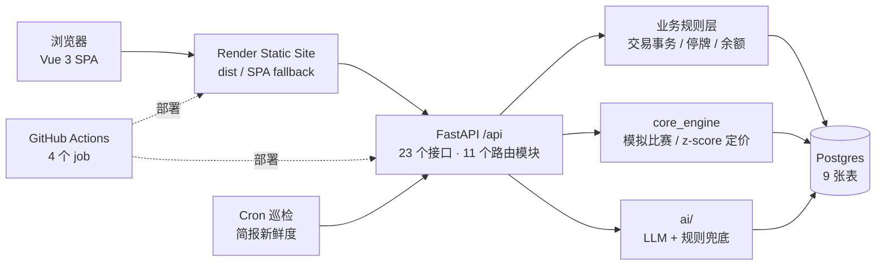
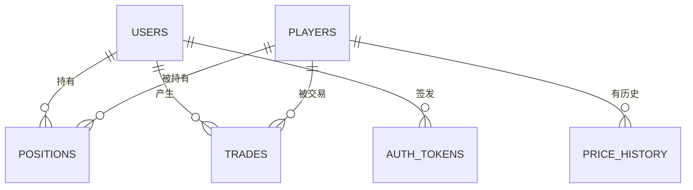

PlayerStock

CS2 虚拟选手股交易系统

用虚拟信用点交易选手表现，涨跌与赛场数据挂钩

  纯积分制 · 无充值 / 提现 / 兑换
  16 名选手 · 8 支战队
  AI 辅助分析（不代客下单）

  有请下一组 ｜ 王泽棠（D）· 倪颢容（A）· 胡德昊（B）· 刘宏（C） 
  软件新技术创新实践课程 · 2026-11 · 结课项目审查

  <a class="pdf-link" href="./playerstock_defense.pdf">📄 下载完整材料 PDF</a>

<!--
【15 秒】老师们好，我们是「有请下一组」，今天汇报的项目是 PlayerStock，一个用虚拟信用点模拟 CS2 选手交易的系统。接下来会按产品定位、系统设计与实现、现场演示以及测试证据四个部分来介绍。
-->

---
layout: default
---

01 产品设计 · 1.1 定位与分工

# 围绕 CS 赛事的虚拟交易与复盘工具

  

    
核心定位

    
面向 CS 赛事观众，用免费积分验证对选手状态的判断，不涉及真钱交易。

    
纯信用点，不可充值 / 提现 / 兑换

    

      
三个基本约束

      <ul class="clean">
        <li><b>有归因</b>：每次价格变动附带对应场次原因</li>
        <li><b>可追溯</b>：保留完整历史价格曲线与交易流水</li>
        <li><b>零资金风险</b>：仅消耗虚拟积分，无真实资金流转</li>
      </ul>
    

  

  

    

目标用户

关注 CS 比赛、对选手发挥有个人判断的普通观众。

    

冷启动思路

结合 Major / IEM / BLAST 赛程节点、日常涨跌复盘及校园社群推广。

    

团队分工

4 人各自负责独立模块：前端交互 / 后端与交易 / 定价与数据 / AI、测试与部署。

  

<!--
【20 秒】先介绍下定位：这是一个针对 CS 观众的虚拟交易工具，不碰真钱，只用信用点。核心特点是每次涨跌都有数据归因和历史曲线可以对照。推广上主要跟着三大赛事节点走，团队四个人分别负责前端、后端交易、定价数据以及 AI 与测试部署。
-->

---
layout: default
---

01 产品设计 · 1.2 核心玩法

# 一个纯积分驱动的选手行情市场

选手赛场表现优于预期则股价上涨，低于预期则下跌；用户通过看行情、分析原因、买卖持仓来验证判断。

  

快速决策

首页简报直接给出市场风向与买卖参考

  

归因复盘

点开选手详情，对照历史曲线看涨跌原因

  

离线可用

断网或无 API Key 时自动切换规则引擎，交易照常运行

  5000 初始信用点16 名选手 / 8 支战队
  11 个价格历史点0 充值 / 0 提现 / 0 兑换

<!--
【30 秒】核心流程很直接：看行情、做买卖、查持仓和流水。首页简报帮新手快速看结论，详情页给有复盘需求的用户看历史曲线和变价原因；同时为了保证答辩和日常测试稳定，即使没有大模型 Key 也能靠本地规则正常运行。数据规模目前是 8 支战队、16 名选手，初始 5000 信用点。
-->

---
layout: default
---

02 设计取舍

# 开发过程中的五项工程约束

  

01

结论前置

首页直接给出当前行情判断

减少多层跳转，需要看具体数据时再展开。

  

02

单屏闭环

同屏完成看曲线、读建议与下单

避免在详情页和交易页之间反复切换。

  

03

信息降噪

控制单屏卡片数量与字号

桌面端一屏展示 6 张选手卡，突出核心涨跌幅。

  

04

核心写死

定价与撮合用确定性代码，AI 仅做旁路

外部模型异常时，不影响正常买卖。

05

权限隔离

无真钱流转，AI 无交易写入权限

AI 模块只读行情并输出建议文本，不触碰账户余额与下单接口。

<!--
【30 秒】设计上我们定了五条边界：首页结论前置、详情页单屏完成交易闭环、页面控制信息密度；最关键的是把定价和交易规则做成确定性代码，AI 只作为只读旁路提供分析建议，不拥有下单或修改余额的权限。
-->

---
layout: default
---

03 产品实现 · 3.1 界面设计

# 界面实现：市场总览与详情交易

  

    

      
      
市场页：顶部简报 + 条件筛选 + 3 列选手卡

    

    <ul class="clean" v-click>
      <li>顶部展示市场简报与整体趋势</li>
      <li>一屏 6 张卡片，3 列栅格对齐</li>
      <li>支持站内直接筛选与排序，无需跳页</li>
    </ul>
  

  

    

      
      
详情页：历史曲线 + AI 分析 + 下单面板

    

    <ul class="clean" v-click>
      <li>左侧看价格走势，右侧直接买入/卖出</li>
      <li>移动端适配 4 个底部 Tab 及顶栏入口</li>
      <li>支持深色 / 浅色主题切换</li>
    </ul>
  

<!--
【30 秒】页面主要分为市场总览和选手详情两块。市场页顶部是简报，下面三列放选手卡片，筛选排序都在当前页完成；详情页左边放价格曲线，右边把 AI 建议和下单表单放在一起，手机端也做了 4-Tab 适配和深浅色切换。
-->

---
layout: default
---

03 产品实现 · 3.2 技术选型

# 技术选型：以稳定和开发效率为主

| 层    | 选型与版本（完整版本表见 README）                                         | 选型考量               |
| ---- | ------------------------------------------------------------ | ------------------ |
| 前端   | Vue 3.5 · Vue Router 5.4 · Vite 8.3 · TS 6.0 · Vitest 4.1    | 轻量、构建快、类型检查完善      |
| 后端   | Python 3.12 · FastAPI 0.161 · SQLAlchemy 2.1 · Pydantic 2.14 | 接口文档自动生成、路由组织清晰    |
| 数据   | 本地 SQLite / 线上 Render Postgres（psycopg2）                     | 本地零配置调试，线上持久化存储    |
| AI   | DeepSeek API（OpenAI 兼容）+ rule_fallback                       | 生成自然语言分析，异常时降级本地规则 |
| 部署   | Render：Static Site + Web Service + Cron + Postgres           | 支持免费托管、HTTPS 与复现   |
| 质量工具 | GitHub Actions · ruff · oxlint · eslint · vue-tsc · pytest   | 4 个 CI job 门禁把关    |

选型以团队熟悉度和 6 天开发周期内可稳定上线为准。

<!--
【25 秒】技术栈没有追特别偏门的方案，主要考虑 6 天内能写完、测完并上线。前端用 Vue 3 加 TypeScript，后端 FastAPI 配 SQLAlchemy，数据库本地用 SQLite、线上迁到了 Postgres；AI 接了 DeepSeek 并带本地规则兜底，部署和流水线用 Render 和 GitHub Actions。
-->

---
layout: default
---

03 产品实现 · 3.3 代码仓库与协作

# 502 次提交、4 位贡献者、4 道 CI 门禁

github.com/July75-bit/Innovation ｜ develop ｜ 502 次提交（363 次非合并）

  

    
提交分布（GitHub Pulse / git shortlog，含合并提交）

    <table class="mt-2">
      <tbody>
      <tr><td>D 王泽棠</td><td>197</td><td>A 倪颢容</td><td>74</td></tr>
      <tr><td>B 胡德昊</td><td>114</td><td>C 刘宏</td><td>81</td></tr>
      </tbody>
    </table>
  

  

    

任务管理

使用 GitHub Issues + Projects 跟踪进度，14 条缺陷均建有对应 Issue。

    

CI 检查

包含健康检查、后端、前端及交付物共 4 个 job，每次 push 自动触发。

  

<!--
【20 秒】代码托管在 GitHub，主部署分支是 develop，累计 502 次提交，四位成员都有实质提交记录。日常用 Issues 和 Projects 跟踪需求与缺陷，每次 push 都会跑完 4 个 CI 检查。
-->

---
layout: default
---

03 产品实现 · 3.4 问题复盘

# 开发与部署中的 6 个典型问题

| 问题                     | 根因                     | 解决方案（已验证）           |
| ---------------------- | ---------------------- | ------------------ |
| 部署后数据重置                | 免费实例使用临时磁盘 + SQLite    | 迁移至 Postgres 并规范连接串 |
| 线上启动报 No module psycopg | SQLAlchemy 2.1 驱动变更    | 补充 psycopg2 依赖及单测  |
| 前端全站接口 CORS 失败         | CORS_ORIGINS 缺失或含尾斜杠   | 精确配置 origin 并线上验证  |
| 简报直接透传模型 JSON          | 未对大模型返回文本做清洗           | 增加后端清洗与前端兜底解析      |
| CI 后端检查报错              | ruff C901 圈复杂度 11 > 10 | 拆分为 6 个独立 helper 函数 |
| 首次访问耗时 33.6 秒          | 免费实例闲置 15 分钟后自动休眠      | 增加 Cron 保活 + 骨架屏 + 重试 |

以上问题均已补充对应的单元测试、监控检查或部署文档。

<!--
【35 秒】列了 6 个上线前后遇到比较典型的问题：比如免费实例用 SQLite 重启丢数据、SQLAlchemy 驱动报错、CORS 配置尾斜杠、模型原始 JSON 漏到前端、圈复杂度超标以及冷启动 33 秒。每个问题解决后都补了对应测试或保活机制。
-->

---
layout: default
---

03 产品实现 · 3.5 概要设计

# 系统架构与模块划分

  

部署架构

Render 四件套组合，支持 Blueprint 一键复现

  

可观测性

请求日志、健康检查接口、定时巡检简报状态

  

架构解耦

交易与定价基于确定性规则，AI 仅作旁路建议

<!--
【30 秒】整体架构分四层：Vue 前端、FastAPI 网关层、确定性的交易与定价内核、以及 Postgres 数据库。AI 模块放在旁路，只读数据、不参与交易结算。线上通过 Render 四件套部署。
-->

---
layout: default
---

03 产品实现 · 3.5.3 算法与 AI

# 定价公式与 AI 辅助链路

  

    
价格计算规则

    
P′ = max(1.0, P × (1 + 0.15 · S))

    
新价格 = 原价格 ×（1 + 0.15 × 表现分），底价 1.0

    <ul class="clean mt-2">
      <li>表现分衡量本轮相对历史均值的偏离，避免强队单边无限上涨</li>
      <li>单次涨跌幅限制在 ±20% 以内，防止极端波动</li>
      <li>每次调价必须写入归因说明，详情页可查</li>
    </ul>
  

  

    

      
AI 分析链路（仅输出建议）

      
流程：读取行情 → 分析师 → 风控 → 交易员 → 用户手动确认采纳，全程落库审计。

      
调用 DeepSeek 接口设 20 秒超时；无 Key、超时或格式异常时自动回退本地规则模板。

      
输出固定 6 个字段；线上 16/16 校验通过，P95 延迟 3.39 秒。

    

    

      <b>为何不由 AI 直接定价？</b> 
      确定性公式计算稳定、零调用成本；且能保证外部模型不可用时交易主流程不受影响。
    

  

<!--
【40 秒】定价用的是一套确定性公式，根据选手本轮相对于自身均值的表现分来调价，单轮涨跌幅卡在正负 20%，最低 1 块，每次变动都附带原因。AI 这边走分析师、风控、交易员三个角色生成建议，最终由用户决定是否采纳，全程记录审计日志；如果模型超时或无 Key，会自动切到规则兜底。
-->

---
layout: default
---

03 产品实现 · 3.5.4 数据库设计

# 9 张数据表：账本一致性与审计留痕

| 分组  | 表名                                              | 关键设计                                     |
| --- | ----------------------------------------------- | ---------------------------------------- |
| 账号  | users / auth_tokens                             | 记录余额与初始本金；Token 有效期 30 天且支持主动撤销          |
| 市场  | players / price_history                         | 价格历史仅追加写入；reason 归因字段非空                  |
| 交易  | positions / trades                              | 流水只追加并记录 balance_after；持仓按(user, player)唯一 |
| 智能体 | agent_traces / decision_logs / price_narratives | 记录每次调用、采纳与归因，业务表只读                       |

  

  

    

事务一致性

余额扣减、持仓更新与流水写入置于同一事务，含 14 条交易单测。

    

架构取舍

当前并发量有限，暂不引入缓存或消息队列，优先保证账本数据准确。

  

<!--
【25 秒】数据库共 9 张表，分为账号、市场、交易和智能体审计四组。重点在于流水表只追加不修改、带交易后余额快照，并且余额、持仓和流水在同一个数据库事务里完成。目前量级不大，没有上缓存或异步队列，优先保一致性。
-->

---
layout: default
---

03 产品实现 · 3.5.5 接口设计

# 前后端接口契约：23 个端点

| 分组  | 功能范围            | 接口示例                     |
| --- | --------------- | ------------------------ |
| 行情  | 选手列表、详情查询、历史价格  | GET /api/players         |
| 交易  | 账户资产、买入、卖出、持仓流水 | POST /api/trades/buy     |
| 身份  | 注册、登录、注销、账号删除   | POST /api/auth/login     |
| AI  | 个股建议、市场简报、决策记录  | GET /api/analysis/\{id\} |
| 运维  | 健康检查、数据库自检、日志查询 | GET /api/health          |

统一响应包装格式与中文错误提示，Swagger 在线文档可直接调试：playerstock-backend-mdlk.onrender.com/api/docs

<!--
【20 秒】前后端一共定义了 23 个接口，按行情、交易、身份、AI 和运维五组划分。返回结构统一包装，异常情况直接返回中文提示，部署在 Render 的 /api/docs 可以直接调测。
-->

---
layout: default
---

03 产品实现 · 3.6 软件质量

# 测试覆盖与质量保障

  

335

后端测试

pytest，默认跳过 live 用例

  

186

前端测试

Vitest / 23 个测试文件

  

98%

核心覆盖率

app + core_engine 模块

  

4

CI 门禁 job

健康、后端、前端、交付物

  

工程保障措施

    <ul class="clean">
      <li>日志：/api/logs 记录请求链路与异常堆栈</li>
      <li>异常：全局统一错误码，前端友好提示</li>
      <li>契约：Pydantic 严格校验入参与出参</li>
      <li>并发：数据库事务 + 条件更新防超卖</li>
      <li>降级：针对 LLM 超时、断网、冷启动做兜底</li>
    </ul>
  

  

自动化工具链

    <table>
      <tbody>
      <tr><td>ruff</td><td>代码规范与圈复杂度检查</td></tr>
      <tr><td>oxlint / eslint</td><td>前端静态检查与冲突标记守卫</td></tr>
      <tr><td>vue-tsc</td><td>构建阶段强制类型检查</td></tr>
      <tr><td>Vitest / pytest</td><td>覆盖单元、集成、评测与并发场景</td></tr>
      <tr><td>GitHub Actions</td><td>4 个 job 全绿后触发自动部署</td></tr>
      </tbody>
    </table>
  

<!--
【25 秒】质量方面，后端有 335 条 pytest，前端 186 条 Vitest，核心业务模块覆盖率在 98%。工程上做了全局异常码、Pydantic 契约校验、并发防超卖和多层降级策略，CI 4 个 job 全部通过才会触发部署。
-->

---
layout: default
---

03 产品实现 · 3.7 代码统计

# 代码规模与工程统计

| 语言           | 文件数 | 行数     |
| ------------ | --- | ------ |
| Python       | 111 | 16,790 |
| Vue          | 21  | 8,992  |
| TypeScript   | 49  | 6,410  |
| CSS          | 4   | 969    |
| HTML         | 3   | 1,082  |
| Markdown（文档） | 70  | 8,270  |

  

模块规模

前端包含 8 个视图、12 个组件；后端包含 11 个路由模块、9 个 AI 模块。

  
<b>团队协作与 AI 辅助</b> 未对代码做逐行归因统计。开发中使用 AI 辅助编写部分测试用例与文档，核心交易逻辑与架构均由团队手写并互相 Review。

<!--
【15 秒】整个仓库可执行代码大约 3.4 万行，另有 70 份约 8,300 行的项目文档。开发过程中有用 AI 辅助生成部分测试用例和文档初稿，核心的交易和架构代码都是团队成员手写并交叉 Review 的。
-->

---
layout: default
---

验收 · 测试与容量

# 验收证据：用户测试、AI 评测与压测

  

33 项

用户验收测试

32 通过 / 1 部分通过

覆盖交互流程、状态流转、异常与边界

  

16/16

AI 输出契约评测

source=llm 100% · P95 3.39s

6 个字段完整度与合规校验均通过

  

11/11

安全红队测试

提示注入 / 越权 / 伪造来源

全部拦截，并有对应审计记录

  

38 req/s

只读接口压测

≈190 人同时在线 · 0 错误

当前瓶颈在于免费托管实例规格

当前局限：交叉测试双向样本各 33 题，规模有限；系统采用模拟赛事数据，暂不评估对真实比赛结果的预测准确率。

证据索引：docs/acceptance/evidence（147 张截图）· test_report.md · agent_eval_report.md · load_test_report.md

<!--
【20 秒】验收部分有三组实测数据：33 项用户测试通过 32 项、部分通过 1 项；AI 接口 16 次结构化校验全部通过，P95 延迟 3.39 秒；红队测试 11 项全部拦截；只读压测达到每秒 38 请求且零报错。需要说明的是目前交叉测试样本量还较小，且数据源为模拟赛事，暂不涉及真实赛果预测准确率。
-->

---
layout: default
---

演示

# 现场演示路径（约 2 分钟）

  

01 市场页

查看顶部简报与 3 列选手行情、停牌状态

  

02 详情页

查看历史价格曲线、AI 建议与停牌提示

  

03 买入下单

模拟买入 2 股，验证余额、持仓与流水同步更新

  

04 资产复盘

进入个人页查看资产曲线与成交统计

  

05 降级演示

验证停牌拦截与无 Key 时的规则兜底

  

06 复位

返回市场页，保持演示环境状态干净

演示过程中不切换窗口；若遇网络波动则刷新只读页面或切换备用录屏。

<!--
【5 秒】下面进入两分钟的现场演示，依次展示市场总览、详情分析、买入成交、个人复盘，以及停牌拦截和 AI 降级兜底。
-->

---
layout: default
---

结课审查

# 谢谢，请老师指导

  

    
在线演示

    
playerstock-frontend-mdlk.onrender.com

  

  

    
源码仓库

    
github.com/July75-bit/Innovation

  

  

    
完整材料

    
站点内 /playerstock_defense.pdf

  

有请下一组 · 王泽棠（D）· 倪颢容（A）· 胡德昊（B）· 刘宏（C）　｜　2026-11

<!--
【结束】以上是 PlayerStock 的整体汇报，页面上留有在线演示地址、源码仓库和完整文档入口，请各位老师批评指正。
-->
