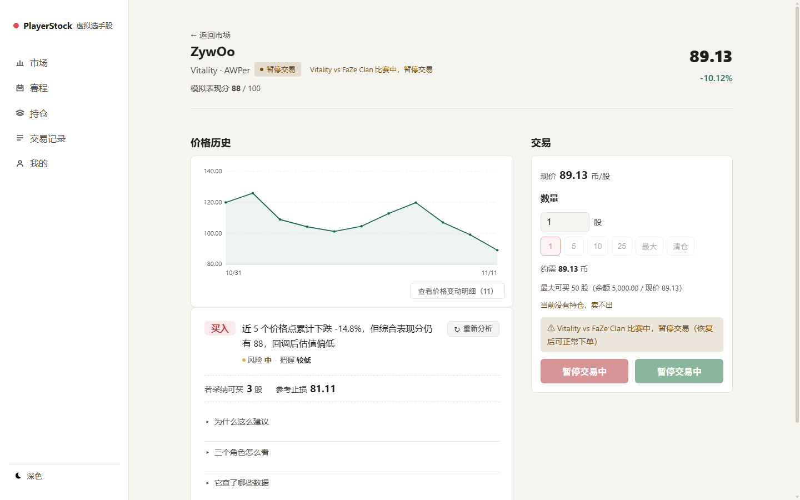
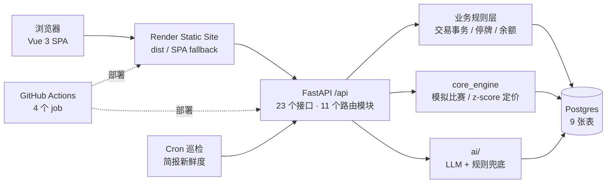
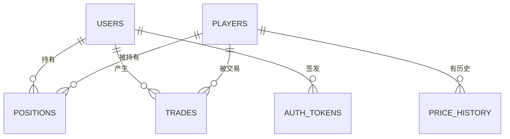

PlayerStock

虚拟选手股交易模拟

把「眼力」变成一条可交易、可解释的价格曲线

  看懂比赛，从持有起
  纯信用点 · 不可充值 / 提现 / 兑换
  16 名选手 · 8 支战队
  AI 只给建议

  有请下一组 ｜ 王泽棠（D）· 倪颢容（A）· 胡德昊（B）· 刘宏（C） 
  软件创新工程实践 · 2026-11 · 结课项目审查

  <a class="pdf-link" href="./playerstock_defense.pdf">📄 下载完整材料 PDF</a>

<!--
【15 秒】各位老师好，我们是「有请下一组」，作品是 PlayerStock：用信用点交易 CS2 职业选手的虚拟股。一句话，把观众对选手的判断变成一条看得懂、能验证、不花真钱的价格曲线。接下来先讲产品和设计，再看两分钟演示，最后是证据链。
-->

---
layout: default
---

01 产品设计 · 1.1 使命 / 口号 / 策略

# 让判断力变成可解释的价格曲线

  

    
使命 Mission

    
让每个看比赛的人，都能把判断变成一条看得懂、能验证、不花钱的价格曲线。

    
边界：纯信用点，不可充值 / 提现 / 兑换；不面向未成年人推广

    

      
三条可验证原则

      <ul class="clean">
        <li><b>可解释</b>：每次涨跌都能说出原因</li>
        <li><b>可验证</b>：判断对错看历史价格</li>
        <li><b>零风险</b>：投入的是判断力与注意力，不是钱</li>
      </ul>
    

  

  

    

目标用户

看 CS 比赛、对选手有判断、但不想用真钱的人。

    

如何获得用户

赛事节点（Major/IEM/BLAST）+ 每日涨跌内容 + 校园电竞社群。

    

团队优势

4 人分工不重叠：前端 / 后端与交易 / 定价与数据 / AI·测试·部署。

  

<b class="accent">差异化：</b>不比人多，比三件事——交易选手价值、涨跌能解释、不碰真钱。

<!--
【20 秒】先看使命和口号：看懂比赛，从持有起。目标用户是看 CS 比赛、对选手有判断、但不想用真钱的人。我们没有推广预算，靠赛事节点、内容化日报和校园社群慢慢做；团队四个人分工不重叠。跟竞品比，我们比的是标的、可解释、零真实资金，不是比人多。
-->

---
layout: default
---

01 产品设计 · 1.2 产品定义 / 用户故事

# 一个纯虚拟、可解释的选手股市场

给看 CS 比赛的人一个纯信用点、能解释的选手股市场：选手表现变成可交易的价格，每条涨跌都有原因。不做竞猜，不碰真钱。

解决的问题：判断无处验证 · 价格变化是黑箱 · 决策门槛高

  

交易新手

打开首页 60 秒内知道「现在该不该买」

首页直接给结论，理由可展开

  

行情玩家

点开选手，看懂价格为什么涨 / 跌

价格曲线 + 每条变动的原因

  

演示者 / 老师

断网、无 API Key 也能完成交易闭环

AI 走规则兜底，接口仍 200

  5000 信用点开局16 名选手 / 8 支战队
  11 个价格历史点0 充值 / 0 提现 / 0 兑换

<!--
【35 秒】一句话定义：对想在观赛时参与判断的 CS 观众，PlayerStock 是一个纯信用点、可解释的选手股市场。它把选手表现变成可交易、可追溯的价格，每条涨跌都能拆出原因。三个用户故事对应新手、行情玩家、演示者，每个都有验收标准。规模是 16 名选手、8 支战队、每人 11 个价格点，5000 信用点开局，全部虚拟、不可兑换。
-->

---
layout: default
---

02 产品设计应用的原则

# 五条原则，对应五个可被验证的取舍

  

01

需求原则

先回答「该不该买」

首屏给结论（买/卖/观望 + 风险），证据按需展开。

  

02

信息原则

一屏完成行情 → 建议 → 下单

市场 3 列卡，详情左图右交易，不来回跳。

  

03

简化原则

纸感、低密度、可读

暖纸色、细边、正文 16px；一屏 6 张卡，去玻璃。

  

04

系统原则

确定性骨架 + 智能体肌肉

交易/定价由确定性代码完成；LLM 只建议，挂了自动降级。

05

审核 / 合规原则

零真实资金 + 只读 AI

0 充值/提现/兑换；AI 不下单，每次调用留审计。

<!--
【35 秒】这一页不讲条文，讲五个取舍：先给结论、一屏完成、纸感低密度、确定性骨架让 LLM 挂了也能交易、合规零真实资金。每个原则后面都跟了落地方式。
-->

---
layout: default
---

03 产品实现 · 3.1 用户体验设计

# 界面：让数据和判断同时可读

  

    

      
      
市场页：一行简报 + 筛选 + 3 列选手卡

    

    <ul class="clean" v-click>
      <li>首屏先给结论，不堆技术词</li>
      <li>一屏 6 张卡，3 列对齐</li>
      <li>筛选/排序/搜索不跳页</li>
    </ul>
  

  

    

      
      
详情页：价格曲线 + AI 建议 + 交易同屏

    

    <ul class="clean" v-click>
      <li>左侧看曲线与归因，右侧直接下单</li>
      <li>手机 4 个 Tab，顶栏头像入口</li>
      <li>深浅色一键切换，骨架屏与慢加载提示</li>
    </ul>
  

<!--
【35 秒】界面就是这样：桌面市场一屏 6 张卡，简报先给结论；详情页左边价格历史，右边 AI 建议和交易；移动端底部 4 个导航加顶栏头像。左右两块都是先图后要点，节奏一致。
-->

---
layout: default
---

03 产品实现 · 3.2 技术选型

# 轻量、可复现、团队真正 Hold 得住

| 层 | 选型与版本（完整版本表在 README） | 为什么选它 |
| --- | --- | --- |
| 前端 | Vue 3.5 · Vue Router 5.4 · Vite 8.3 · TS 6.0 · Vitest 4.1 | 轻、快、类型安全 |
| 后端 | Python 3.12 · FastAPI 0.161 · SQLAlchemy 2.1 · Pydantic 2.14 | 自动文档、路由清晰 |
| 数据 | 本地 SQLite / 线上 Render Postgres（psycopg2） | 本地零配置、线上持久化 |
| AI | DeepSeek API（OpenAI 兼容）+ rule_fallback | 能说人话，挂了走规则兜底 |
| 部署 | Render：Static Site + Web Service + Cron + Postgres | 免费、HTTPS、可复现 |
| 质量工具 | GitHub Actions · ruff · oxlint · eslint · vue-tsc · pytest | 4 个 job 门禁，CI 同口径 |

原则：不选简历上最响的，选 6 天能交付、能测试、能部署、能讲清楚的。

引用来源：Vue / FastAPI / SQLAlchemy / Vite 官方文档；DeepSeek 官方 API 文档；版本号见 README / requirements。

<!--
【30 秒】技术选型只有一个原则：轻量、可复现、团队真正 Hold 得住。前端 Vue 3 + Vite，后端 FastAPI + SQLAlchemy，线上 Postgres；AI 用 DeepSeek 并保留规则兜底；部署交给 Render 和 GitHub Actions。
-->

---
layout: default
---

03 产品实现 · 3.3 代码仓库与协作

# 466 次提交、5 位贡献者、4 道 CI 门禁

github.com/July75-bit/Innovation ｜ 部署分支 develop ｜ 共 466 次提交（334 次非合并）

  

    
提交分布（GitHub Pulse / git shortlog，含合并提交）

    <table class="mt-2">
      <tbody>
      <tr><td>D 王泽棠</td><td>197</td><td>A 倪颢容</td><td>74</td></tr>
      <tr><td>B 胡德昊</td><td>114</td><td>C 刘宏</td><td>81</td></tr>
      </tbody>
    </table>
    
B 的两个本地 GitHub 身份已合并统计（July75-bit / Hu De Hao）。

  

  

    

协作与项目管理

Issues + Projects 管任务；14 条缺陷都建了 Issue；提交统一格式，互相审。

    

CI 4 个 job（每次 push 自动跑）

卫生 → 后端 ruff+pytest → 前端 eslint+vitest+build → 交付物检查

  

证据：Pulse 提交截图、Issue #22–#35、CI run 记录都在仓库/材料里。

<!--
【25 秒】仓库在 GitHub 的 July75-bit/Innovation，develop 是部署分支，一共 466 次提交、334 次非合并。四个人都有持续提交，B 的两个 GitHub 身份已经合并统计。协作靠 Issues 和 Projects，CI 4 个 job 每次 push 自动跑。
-->

---
layout: default
---

03 产品实现 · 3.4 生命周期问题复盘

# 6 个真实问题：每个都有原因、修复和验证

| 问题 | 原因 | 解决办法（都已验证） |
| --- | --- | --- |
| 部署后数据全丢 | 免费实例临时盘 + SQLite | 迁 Postgres，连接串归一化 |
| 线上启动 No module psycopg | SQLAlchemy 2.1 驱动变了 | 补 psycopg2，加单测 |
| 前端全站 CORS 失败 | CORS_ORIGINS 未填 / 带尾斜杠 | 精确 origin，线上验证 |
| 简报把模型 JSON 透传 | 模型输出没清洗 | 后端清洗，前端兜底 |
| CI 后端 14 秒红 | ruff C901 圈复杂度 11 > 10 | 拆成 6 个 helper |
| 首次打开 33.6 秒 | 免费实例 15 分钟休眠 | 保温 cron + 骨架屏 + 重试 |

每个问题都补了测试、监控或文档，别再踩同一个坑。

<!--
【40 秒】挑了 6 个真实问题：数据全丢（SQLite 临时盘换成 Postgres）、psycopg 驱动、CORS、模型输出透传、CI 圈复杂度、冷启动。每个都说清原因和修复，修复后都有测试或线上验证。
-->

---
layout: default
---

03 产品实现 · 3.5 概要设计

# 系统架构：前后端分离 + 确定性交易内核

  

部署

Render：Static + Web + Cron + Postgres；Blueprint 可复现

  

可观测性

/api/logs · /api/debug/db · health 探针 · 简报新鲜度

  

关键取舍

AI 是旁路：只读建议，不参与交易；交易/定价是确定性代码

<!--
【35 秒】架构分四层：前端 SPA、FastAPI 路由、确定性业务内核（core_engine 加规则层）、数据库。AI 是旁路，只读建议，不参与交易。部署是 Render 四件套：静态站、Web Service、Cron、Postgres。
-->

---
layout: default
---

03 产品实现 · 3.5.3 算法与 AI

# 价格可拆解，建议可回落

  

    
定价模型：每条涨跌都能拆成一句话

    
P′ = max(1.0, P × (1 + 0.15 · S))

    
S = clamp(z / 3.0, −1, 1)　｜　单次变动 |Δ| ≤ 20%

    <ul class="clean mt-2">
      <li>用 z-score 标准化，避免强队恒涨</li>
      <li>0.15 权重 + 地板价 + ±20% 熔断</li>
      <li>每条价格都带 reason，现场能拆</li>
    </ul>
  

  

    

      
AI 智能体：只给建议，永不改余额

      

        感知行情分析师风控交易员人点采纳审计
      

      
DeepSeek API，20 秒超时；无 Key/超时/坏 JSON 都走规则兜底，接口仍 200。

      
契约固定 6 字段；L4 评测：<b>16/16 走真模型、契约完整率 100%、P95 3.39s</b>（门禁 10s）。

    

    

      <b>为什么不直接让模型定价？确定性优先，智能体做增强</b> 
      规则版稳定、零成本；LLM 版能说人话、多角色。模型失败自动回落，交易和行情不受影响。
    

  

<!--
【40 秒】定价用 z-score 加线性映射，单次涨跌不超过 20%，每条价格都带 reason，现场能拆。AI 是旁路：分析师到风控到交易员，人在环、留审计；DeepSeek 挂了走规则兜底，接口仍然 200。我们不给模型定价权。
-->

---
layout: default
---

03 产品实现 · 3.5.4 数据库设计

# 9 张表：交易可追溯，AI 可审计

| 分组 | 表 | 关键的不可变 / 一致性设计 |
| --- | --- | --- |
| 账号 | users / auth_tokens | 余额与初始本金；令牌 30 天、可撤销 |
| 市场 | players / price_history | 价格历史只追加；每条 reason 必填 |
| 交易 | positions / trades | 流水只追加、带 balance_after；持仓唯一(user, player) |
| 智能体 | agent_traces / decision_logs / price_narratives | 每次调用/采纳/归因都留审计，只读业务 |

  

  

  

    

交易一致性

余额、持仓、流水同一事务写；14 条交易测试 + 并发测试。

    

为什么不用缓存/队列？

课程量级不需要；优先保证「数据可追溯 + 事务正确」。

  

<!--
【25 秒】数据库 9 张表，分账号、市场、交易、智能体四组。两个关键设计：交易流水只追加，并记 balance_after；持仓唯一约束，余额、持仓、流水在同一事务里写。AI 的调用、采纳、归因都落审计表，业务表只读。
-->

---
layout: default
---

03 产品实现 · 3.5.5 接口设计

# 23 个接口，统一契约与错误码

| 分组 | 接口示例 | 契约要点 |
| --- | --- | --- |
| 行情 | GET /api/players · /api/players/\{id\} · /api/players/\{id\}/prices | 列表 / 详情 / 价格历史（按 ts 升序） |
| 交易 | GET /api/account · /api/account/history · POST /api/trades/buy \| sell | 余额/资产曲线；买卖返回余额与流水 |
| 身份 | POST /api/auth/register \| login \| logout · GET /api/auth/me | PBKDF2 + 不透明令牌；30 天有效 |
| AI | GET /api/analysis/\{id\} · /api/agent/decision \| brief \| panel \| tools | 6 字段契约；只读；失败 200 + rule_fallback |
| 运维 | GET /api/health · /api/debug/db · /api/logs | 健康检查 / 只读自检 / 运行日志 |

  
<b>在线文档：</b>https://playerstock-backend-mdlk.onrender.com/api/docs FastAPI 自动生成 OpenAPI / Swagger，可直接试调。

  

GET 失败自动重试 1 次；POST 不重试；统一错误码；敏感字段不返回。

<!--
【20 秒】接口一共 23 个，分行情、交易、身份、AI、运维五组。FastAPI 自动生成 Swagger，老师现场可以打开 /api/docs 试调。GET 可以安全重试一次，POST 绝不重试，避免重复下单。
-->

---
layout: default
---

03 产品实现 · 3.6 软件质量

# 质量：每次都跑，跑得出来才算数

  

333

后端测试

pytest（6 条 live 默认排除）

  

182

前端测试

Vitest / 22 个文件

  

98%

核心覆盖率

app + core_engine，1956 语句 / 45 未覆盖

  

4

CI 门禁 job

卫生 / 后端 / 前端 / 交付物

  

质量控制与保证方法

    <ul class="clean">
      <li>日志：/api/logs 记录请求和错误</li>
      <li>异常：统一错误码，前端能提示</li>
      <li>契约：Pydantic 校验入参出参</li>
      <li>并发：事务 + 条件更新，有测试</li>
      <li>降级：LLM/网络/冷启动都有兜底</li>
    </ul>
  

  

质量工具

    <table>
      <tbody>
      <tr><td>ruff</td><td>规范 + 圈复杂度，CI 同版本</td></tr>
      <tr><td>oxlint / eslint</td><td>前端规范，冲突标记也有守卫</td></tr>
      <tr><td>vue-tsc</td><td>类型检查进 build</td></tr>
      <tr><td>Vitest / pytest</td><td>单元/集成/评测/并发</td></tr>
      <tr><td>GitHub Actions</td><td>4 个 job 全绿才部署</td></tr>
      </tbody>
    </table>
  

<!--
【30 秒】质量用数字说话：后端 333 条、前端 182 条，核心覆盖率 98%；CI 4 个 job 全绿才部署。除了测试，还有日志、统一异常、契约校验、事务并发和降级路径，工具链和 CI 同口径。
-->

---
layout: default
---

03 产品实现 · 3.7 代码统计

# 代码量不是目标，结构清楚才是

| 语言 | 文件数 | 行数 |
| --- | --- | --- |
| Python | 109 | 16,391 |
| Vue | 20 | 8,835 |
| TypeScript | 47 | 6,350 |
| CSS | 3 | 782 |
| HTML | 3 | 1,083 |
| Markdown（文档） | 71 | 12,452 |

  

模块数

前端 8 视图 / 9 组件；后端 11 路由 / 9 AI 模块 / 9 张表。

  
<b>AI 与团队编写的比例</b> 没做逐行归因，不编百分比。AI 参与建议、测试和文档；核心逻辑人工写并互审，提交都有 CI 和评审。

可执行代码合计约 33,000 行；文档约 12,000 行（65 份 md）。

<!--
【15 秒】可执行代码约 3.3 万行，文档约 1.2 万行。前端 8 个视图、9 个组件；后端 11 个路由模块、9 个 AI 模块。AI 参与建议、测试和文档，核心逻辑人工写并互审，所有提交都有 CI 和评审。
-->

---
layout: default
---

验收 · 测试与容量

# 用户测试 + 智能体评测 + 压测，三条证据链

  

33 项

用户测试表

32 通过 / 1 部分通过

对话/状态/错误/边界逐项实测，截图留痕

  

16/16

AI 契约评测

source=llm 100% · P95 3.39s

6 字段完整率 100%，合规/可核性全过

  

11/11

红队用例

提示注入 / 越权 / 伪造来源

全部守住，审计日志可追

  

38 req/s

只读压测

≈190 人同时在线 · 0 错误

瓶颈是免费档 0.1 vCPU，不是代码

边界：交叉测试双向各 33 题、样本仍小；没有真实赛事数据，不吹预测准确率，也不承诺长期留存。

证据索引：docs/acceptance/evidence（147 张截图）· test_report.md · agent_eval_report.md · load_test_report.md

<!--
【20 秒】三条证据链：33 项用户测试（32 通过、1 部分通过）、AI 契约 16/16、红队 11/11；压测 38 req/s、190 并发、0 错误。说清边界：交叉测试双向各 33 题，我方测 Tome 9/17/6/1，他组测我方 28/4/0/1；没有真实赛事数据，所以不吹准确率。
-->

---
layout: default
---

演示

# 2 分钟现场演示：一条完整的判断→交易→复盘

  

01 市场

简报给结论，3 列卡看涨跌和停牌

  

02 详情

价格曲线 + AI 建议 + 停牌提示

  

03 下单

买 2 股：余额、持仓、流水同时变

  

04 复盘

个人页看资产曲线和交易统计

  

05 兜底

断网/无 Key 也能交易

  

06 结束

回到市场，数据干净可重复

演示期间不切窗口、不输入敏感信息；失败预案：刷新只读页 / 放录屏 / 用本机备份。

<!--
【5 秒】下面用 2 分钟演示一条完整链路：市场、详情、买入、复盘，再补一个停牌拦截和 AI 降级。演示期间不切窗口。
-->

---
layout: default
---

结课审查

# 谢谢，请老师指导

  

    
在线演示

    
playerstock-frontend-mdlk.onrender.com

  

  

    
源码仓库

    
github.com/July75-bit/Innovation

  

  

    
完整材料

    
站点内 /playerstock_defense.pdf

  

有请下一组 · 王泽棠（D）· 倪颢容（A）· 胡德昊（B）· 刘宏（C）　｜　2026-11

<!--
【结束】最后一页不列问题清单：这是给老师做结课审查的材料，不是答辩培训。谢谢老师，页面留三个入口：在线演示、仓库、完整材料 PDF，随时可以点开看。
-->
