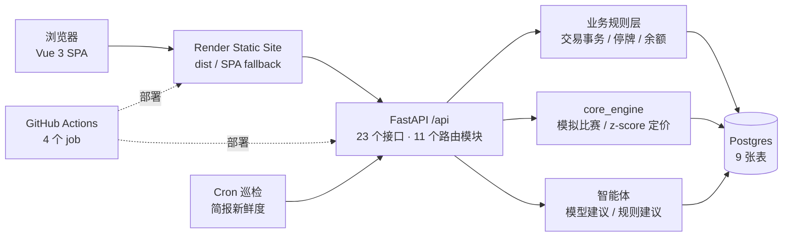
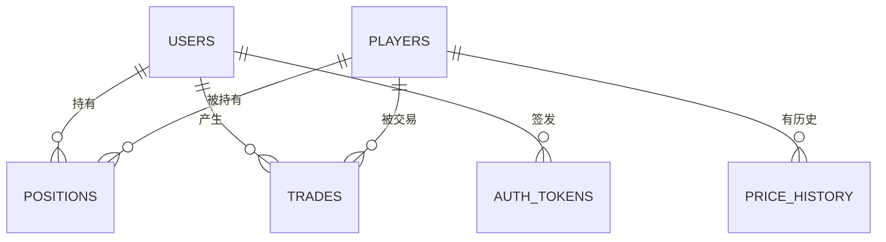

PlayerStock

CS2 虚拟选手股交易系统

用信用点买卖 CS2 选手股，价格随模拟比赛表现变化

  纯积分制 · 无充值 / 提现 / 兑换
  16 名选手 · 8 支战队
  智能体查行情、给建议

  有请下一组 ｜ 王泽棠（D）· 倪颢容（A）· 胡德昊（B）· 刘宏（C） 
  软件新技术创新实践课程 · 2026-11 · 结课项目审查

  <a class="pdf-link" href="./playerstock_defense.pdf">📄 下载完整材料 PDF</a>

<!--
【15 秒】老师们好，我们是有请下一组。这是 PlayerStock。我们用模拟比赛给 CS2 选手股定价，大家可以用信用点买卖，也可以看看智能体为什么给出某条建议。
-->

---
layout: default
---

01 产品设计 · 1.1 定位与分工

# 给 CS 观众的模拟交易工具

  

    
产品定位

    
看 CS 比赛时觉得某位选手状态好，可以用信用点试试自己的判断。

    
纯信用点，不可充值 / 提现 / 兑换

    

      
价格和交易都能回查

      <ul class="clean">
        <li><b>涨跌有原因</b>：点开价格曲线就能看</li>
        <li><b>交易有记录</b>：买卖记录随时能查</li>
        <li><b>只用信用点</b>：不能充值、提现或兑换</li>
      </ul>
    

  

  

    

目标用户

关注 CS 比赛、对选手发挥有个人判断的普通观众。

    

怎么让观众知道

大赛期间分享涨跌复盘，先在校园电竞社群找人试用。

    

团队分工

4 人各自负责独立模块：前端交互 / 后端与交易 / 定价与数据 / AI、测试与部署。

  

<!--
【20 秒】我们想做的是一个看比赛时能顺手用的工具。你看好一位选手，可以用信用点试试，再从价格曲线和交易记录回头看判断。四位同学分别负责前端、后端交易、定价数据，以及智能体、测试和部署。
-->

---
layout: default
---

01 产品设计 · 1.2 核心玩法

# 用信用点怎么买卖选手股

系统按模拟比赛表现更新价格。用户看行情、决定买卖，再回头看自己的判断准不准。

  

先看行情

首页简报列出涨跌和停牌选手

  

再看原因

点开选手详情，对照历史曲线看涨跌原因

  

模型不可用时

后端仍可用时，按规则给建议，买卖照常

  5000 初始信用点16 名选手 / 8 支战队
  11 个价格历史点0 充值 / 0 提现 / 0 兑换

<!--
【30 秒】进入市场先看简报，再点进一位选手看他的价格和涨跌原因。你可以决定买卖，也可以先观望。成交后，持仓和流水会更新。演示数据有 16 名选手、8 支战队，初始余额是 5000 信用点。
-->

---
layout: default
---

02 设计取舍

# 我们做了哪五个设计决定

  

01

先看简报

打开首页就能看到市场变化

想看细节再展开。

  

02

同页完成

选手详情页就能看走势和买卖

价格、建议和买卖按钮放在一起。

  

03

先看关键数据

选手卡突出价格和涨跌

桌面端一屏能看 6 张卡。

  

04

按规则算价

价格和交易都按代码里的规则处理

模型服务出问题，买卖照常。

05

权限隔离

买卖由用户自己确认

智能体可以查行情和给建议。账户余额随实际成交更新。

<!--
【30 秒】首页先给简报，具体数据想看再展开。进到详情页，价格、建议和买卖放在一起。定价和交易都由代码按规则执行，模型出问题时，用户仍能买卖。
-->

---
layout: default
---

03 产品实现 · 3.1 界面设计

# 市场页和选手详情页

  

    

      
      
市场页：顶部简报 + 条件筛选 + 3 列选手卡

    

    <ul class="clean" v-click>
      <li>先看市场简报</li>
      <li>一屏 6 张卡片，3 列栅格对齐</li>
      <li>筛选和排序在当前页完成</li>
    </ul>
  

  

    

      
      
详情页：历史曲线 + 智能体建议 + 下单面板

    

    <ul class="clean" v-click>
      <li>左侧看价格走势，右侧直接买入/卖出</li>
      <li>手机底部可切换四个主页面</li>
      <li>支持深色 / 浅色主题切换</li>
    </ul>
  

<!--
【30 秒】左边是市场页，能直接筛选、排序。右边是选手详情，价格曲线、智能体建议和买卖都在这里。手机端也可以用底部导航切换页面，并切换深浅色。
-->

---
layout: default
---

03 产品实现 · 3.2 技术选型

# 我们用了哪些技术

| 层    | 选型与版本（完整版本表见 README）                                         | 为什么选它               |
| ---- | ------------------------------------------------------------ | ------------------ |
| 前端   | Vue 3.5 · Vue Router 5.4 · Vite 8.3 · TS 6.0 · Vitest 4.1    | 轻量、构建快、类型检查完善      |
| 后端   | Python 3.12 · FastAPI 0.161 · SQLAlchemy 2.1 · Pydantic 2.14 | 接口文档自动生成、路由组织清晰    |
| 数据   | 本地 SQLite / 线上 Render Postgres（psycopg2）                     | 本地零配置调试，线上持久化存储    |
| AI   | DeepSeek API（OpenAI 兼容）+ rule_fallback                       | 生成自然语言分析，异常时降级本地规则 |
| 部署   | Render：Static Site + Web Service + Cron + Postgres           | 支持免费托管、HTTPS 与复现   |
| 质量工具 | GitHub Actions · ruff · oxlint · eslint · vue-tsc · pytest   | 4 个 CI job 门禁把关    |

我们选了团队熟悉、六天内能做完并上线的工具。

<!--
【25 秒】我们只有六天，所以选了组里熟悉的技术。前端用 Vue 和 TypeScript，后端用 FastAPI。本地用 SQLite 调试，线上用 PostgreSQL 存数据。智能体接 DeepSeek，服务放在 Render。
-->

---
layout: default
---

03 产品实现 · 3.3 代码仓库与协作

# 四个人怎么一起开发

github.com/July75-bit/Innovation ｜ develop ｜ 522 次提交（379 次非合并，统计至 b4674b5）

  

    
提交分布（git shortlog，含合并提交）

    <table class="mt-2">
      <tbody>
      <tr><td>D 王泽棠</td><td>229</td><td>A 倪颢容</td><td>74</td></tr>
      <tr><td>B 胡德昊</td><td>116</td><td>C 刘宏</td><td>103</td></tr>
      </tbody>
    </table>
  

  

    

任务管理

使用 GitHub Issues + Projects 跟踪进度，14 条缺陷均建有对应 Issue。

    

CI 检查

包含健康检查、后端、前端及交付物共 4 个 job，每次 push 自动触发。

  

<!--
【20 秒】代码放在 GitHub，日常合到 develop。统计到这版前一条提交，四位成员一共 522 次提交，里面有 379 次非合并提交。任务和缺陷用 Issues 和 Projects 跟踪。
-->

---
layout: default
---

03 产品实现 · 3.4 问题复盘

# 开发和上线时遇到的 6 个问题

| 问题                     | 根因                     | 解决方案（已验证）           |
| ---------------------- | ---------------------- | ------------------ |
| 部署后数据重置                | 免费实例使用临时磁盘 + SQLite    | 迁移至 Postgres 并规范连接串 |
| 线上启动报 No module psycopg | SQLAlchemy 2.1 驱动变更    | 补充 psycopg2 依赖及单测  |
| 前端全站接口 CORS 失败         | CORS_ORIGINS 缺失或含尾斜杠   | 精确配置 origin 并线上验证  |
| 简报直接透传模型 JSON          | 未对大模型返回文本做清洗           | 增加后端清洗与前端兜底解析      |
| CI 后端检查报错              | ruff C901 圈复杂度 11 > 10 | 拆分为 6 个独立 helper 函数 |
| 首次访问耗时 33.6 秒          | 免费实例闲置 15 分钟后自动休眠      | 增加 Cron 保活 + 骨架屏 + 重试 |

修完后，我们补了测试、监控检查或部署说明。

<!--
【35 秒】上线时碰到了一个典型问题：Render 免费实例的磁盘是临时的，重启后 SQLite 数据就没了，因此迁到了 PostgreSQL。另一个问题是首页把模型返回的 JSON 直接显示出来，我们在后端清理文本，前端也加了处理。其他四个问题可以看这张表。
-->

---
layout: default
---

03 产品实现 · 缺陷跟踪

# 14 条缺陷怎么跟踪

GitHub Issues #22–#35 ｜ P0 3 条 · P1 5 条 · P2 6 条 ｜ 均已关闭

  

    
P0 · 3 条

    
#22 并发超卖、重复入账 #29 线上数据库驱动起不来 #33 CORS 未配，整站失败

  

  

    
P1 · 5 条

    
#23 买入校验顺序反了 #24 清仓触发约束报 500 #26 定价文案污染历史 #27 停牌选手仍被改价 #31 GBK 控制台测试报错

  

  

    
P2 · 6 条

    
#25 得分被拼两遍 #28 reason 超长写库失败 #30 WAL 文件误入仓库 #32 /market 刷新白屏 #34 测试日期炸弹 #35 脚本写死绝对路径

  

可以按编号回查问题和处理过程。#36、#37 另记注册账号的问题。

<!--
【20 秒】这页列的是 GitHub 上编号 22 到 35 的 14 条缺陷，都已关闭。比如第 22 条是并发卖出会造成超卖和重复入账。按编号能看到问题和处理过程。
-->

---
layout: default
---

03 产品实现 · 3.5 概要设计

# 系统各部分怎么连起来

  

部署架构

前端、后端和定时任务部署在 Render

  

怎么查运行状态

查请求日志、健康接口和简报更新时间

  

价格和建议分开

程序算价格和处理交易，智能体给建议

<!--
【30 秒】浏览器访问 Vue 页面，前端再通过 FastAPI 取数据或下单。规则层负责定价和交易，数据库保存结果。智能体读取所需数据，生成建议和分析记录。
-->

---
layout: default
---

03 产品实现 · 3.5.3 算法与 AI

# 选手股的价格怎么算

  

    
价格计算规则

    
P′ = max(1.0, P × (1 + 0.15 · S))

    
新价格 = 原价格 ×（1 + 0.15 × 表现分），底价 1.0

    <ul class="clean mt-2">
      <li>表现分比较选手这一轮和自己过去的表现</li>
      <li>单次涨跌有 ±20% 的上限</li>
      <li>每次调价的原因都能在详情页查到</li>
    </ul>
  

  

    

      
智能体怎么看价格

      
看价格历史和涨跌原因，给出买入、卖出或观望的建议。

      
决策卡会结合账户余额和持仓，估算建议买卖数量。

      
用户可以采纳或忽略建议，下单时再单独确认。

    

    

      <b>为什么不让智能体直接定价？</b> 
      同样的输入算出同样的价格。模型服务出问题，定价和交易照常。
    

  

<!--
【40 秒】我们用选手这一轮的表现和他平时的表现对比，再按公式更新价格。最低是 1 个信用点，还有单次涨跌上限。每次变价都会附上原因，智能体可以用这些信息解释行情。
-->

---
layout: default
---

03 产品实现 · 3.5.3 智能体设计

# 智能体怎么查数据、给建议

决策卡先生成建议，再按余额和持仓算计划。多角色分析和工具调用各有自己的入口。

  

任务编排

多角色分析按分析师、风控、交易员的顺序走，后一步会读前一步的结果。

  

工具调用

模型可查最近价格、读演示账户快照、算建议股数，最多跑 3 轮。

  

护栏

基础建议校验 6 个字段。工具只查数据和做计算，采纳只记录选择。

模型没返回可用结果时

模型单次调用默认等 20 秒。基础建议遇到缺密钥、超时或格式错误时，会改用规则版。

决策卡和工具演示都有 trace_id，可以回查结果。

<!--
【30 秒】决策卡先给方向，再用账户数据估算仓位。还有两个入口可以单独看：多角色分析按分析师、风控、交易员依次往下走，工具演示让模型自己选查什么，最多三轮。基础建议会检查字段，模型出问题时走规则版。点采纳只是记下选择。
-->

---
layout: default
---

03 产品实现 · 3.5.3 智能体设计

# 智能体从哪里取数，记住了什么

  

记忆

本次请求临时整理所需数据。调用、采纳和归因可回查，简报有短时缓存。

  

领域数据与规则

行情和价格历史从关系库取，定价、停牌和仓位规则写在代码里。

  

当前用 SQL 取数

数据量小，所需字段明确。当前未接入 RAG、知识图谱或跨会话偏好记忆。

  

以后怎么扩展

RAG 找历次复盘，知识图谱核对选手和战队关系，偏好记忆补上用户关注点。

当前可以回查建议和采纳记录。用户历史选择暂未用于生成下一次建议。

<!--
【25 秒】每次请求临时取当前需要的数据，业务规则在代码里。调用、采纳和价格归因会留下记录，简报会短时缓存。目前没有 RAG、知识图谱或跨会话偏好记忆。将来如果加，分别用来查复盘、核对关系和保留关注点。
-->

---

03 产品实现 · 3.5.4 数据库设计

# 9 张表分别存什么

| 分组  | 表名                                              | 关键设计                                     |
| --- | ----------------------------------------------- | ---------------------------------------- |
| 账号  | users / auth_tokens                             | 记录余额与初始本金；Token 有效期 30 天且支持主动撤销          |
| 市场  | players / price_history                         | 价格历史仅追加写入；reason 归因字段非空                  |
| 交易  | positions / trades                              | 流水只追加并记录 balance_after；持仓按(user, player)唯一 |
| 智能体 | agent_traces / decision_logs / price_narratives | 记录每次调用、采纳与归因，业务表只读                       |

  

  

    

一笔交易一起写

余额、持仓和流水在同一个事务里更新。

    

方便对账

流水记下成交后的余额，可以逐笔核对。

  

<!--
【25 秒】九张表里，账号和市场数据各有自己的表。下单时，余额、持仓和流水在一次事务里更新，流水还会记下交易后的余额。智能体的分析和采纳另有记录。
-->

---
layout: default
---

03 产品实现 · 3.5.5 接口设计

# 前后端用哪些接口

| 分组  | 功能范围            | 接口示例                     |
| --- | --------------- | ------------------------ |
| 行情  | 选手列表、详情查询、历史价格  | GET /api/players         |
| 交易  | 账户资产、买入、卖出、持仓流水 | POST /api/trades/buy     |
| 身份  | 注册、登录、注销、账号删除   | POST /api/auth/login     |
| AI  | 个股建议、市场简报、决策记录  | GET /api/analysis/\{id\} |
| 运维  | 健康检查、数据库自检、日志查询 | GET /api/health          |

常见错误会给中文提示。在线接口文档可直接试用：playerstock-backend-mdlk.onrender.com/docs

<!--
【20 秒】接口按行情、交易、身份、智能体和运维分组。比如买入和查行情走不同接口。想看每个接口接收和返回什么，可以打开 Swagger。
-->

---
layout: default
---

03 产品实现 · 3.6 软件质量

# 提交代码后会做哪些检查

  

335

后端测试

pytest，默认跳过 live 用例

  

186

前端测试

Vitest / 23 个测试文件

  

98%

核心覆盖率

app + core_engine 模块

  

4

CI 检查

健康、后端、前端、交付物

  

常见问题怎么处理

    <ul class="clean">
      <li>日志记录接口请求和报错，便于排查</li>
      <li>异常：全局统一错误码，前端友好提示</li>
      <li>契约：Pydantic 严格校验入参与出参</li>
      <li>并发：数据库事务 + 条件更新防超卖</li>
      <li>降级：针对 LLM 超时、断网、冷启动做兜底</li>
    </ul>
  

  

自动化工具链

    <table>
      <tbody>
      <tr><td>ruff</td><td>代码规范与圈复杂度检查</td></tr>
      <tr><td>oxlint / eslint</td><td>检查前端代码写法</td></tr>
      <tr><td>vue-tsc</td><td>构建阶段强制类型检查</td></tr>
      <tr><td>Vitest / pytest</td><td>覆盖单元、集成、评测与并发场景</td></tr>
      <tr><td>GitHub Actions</td><td>检查仓库、前后端和交付材料</td></tr>
      </tbody>
    </table>
  

<!--
【25 秒】后端跑 pytest，前端跑 Vitest。GitHub Actions 里也有代码检查和构建。举个例子，我们用同一事务和条件更新防止两笔卖单同时把持仓扣成负数。
-->

---
layout: default
---

03 产品实现 · 3.7 代码统计

# 仓库里有多少代码

| 语言           | 文件数 | 行数     |
| ------------ | --- | ------ |
| Python       | 111 | 16,790 |
| Vue          | 21  | 8,992  |
| TypeScript   | 49  | 6,410  |
| CSS          | 4   | 969    |
| HTML         | 3   | 1,082  |
| Markdown（文档） | 70  | 8,270  |

  

模块规模

前端包含 8 个视图、12 个组件；后端包含 11 个路由模块、9 个 AI 模块。

  
<b>团队协作与 AI 辅助</b> 按 Git 作者统计，含合并提交。D 229、B 116、C 103、A 74。AI 帮忙写部分测试和文档，核心交易代码由团队编写、互相评审。

<!--
【15 秒】表里按文件类型统计代码行数和文档。成员贡献按 Git 提交作者统计，胡德昊的两个作者身份合并计数。AI 参与了部分测试和文档，核心交易代码由团队编写和评审。
-->

---
layout: default
---

验收 · 测试与容量

# 我们测了什么，结果怎么样

  

33 项

用户验收测试

32 通过 / 1 部分通过

测了日常操作、错误提示和边界情况

  

16/16

AI 输出契约评测

source=llm 100% · P95 3.39s

6 个字段完整度与合规校验均通过

  

11/11

安全红队测试

提示注入 / 越权 / 伪造来源

全部拦截，并有对应审计记录

  

38 req/s

只读接口压测

≈190 人同时在线 · 0 错误

当前瓶颈在于免费托管实例规格

两组互测各 33 题。赛事数据是模拟的，未评估真实比赛预测准确率。

证据索引：docs/acceptance/evidence（147 张截图）· test_report.md · agent_eval_report.md · load_test_report.md

<!--
【20 秒】用户测试 33 项，32 项全过，1 项部分通过。智能体的六字段校验通过了 16 次线上测试，11 项红队用例都通过。只读压测测到每秒约 38 次请求，没有报错。我们用的是模拟赛果，暂未评估真实比赛预测。
-->

---
layout: default
---

演示

# 现场演示（约 2 分钟）

  

01 市场页

查看顶部简报与 3 列选手行情、停牌状态

  

02 详情页

查看历史价格曲线、智能体建议与停牌提示

  

03 买入下单

模拟买入 2 股，验证余额、持仓与流水同步更新

  

04 资产复盘

进入个人页查看资产曲线与成交统计

  

05 降级演示

验证停牌拦截与无 Key 时的规则兜底

  

06 回到市场

回到行情列表，结束演示

演示过程中不切换窗口；若遇网络波动则刷新只读页面或切换备用录屏。

<!--
【5 秒】接下来现场看一遍行情、智能体建议和买入，再检查持仓和流水。
-->

---
layout: default
---

结课审查

# 谢谢，请老师指导

  

    
在线演示

    
playerstock-frontend-mdlk.onrender.com

  

  

    
源码仓库

    
github.com/July75-bit/Innovation

  

  

    
完整材料

    
站点内 /playerstock_defense.pdf

  

有请下一组 · 王泽棠（D）· 倪颢容（A）· 胡德昊（B）· 刘宏（C）　｜　2026-11

<!--
【结束】我们的汇报到这里。在线演示、源码和 PDF 都在这页。谢谢各位老师。
-->
