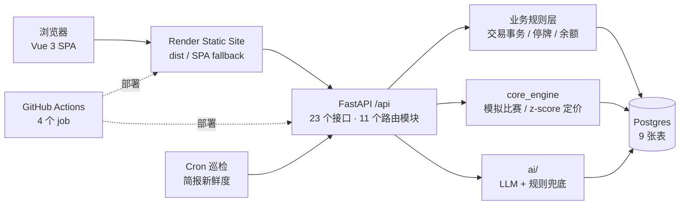
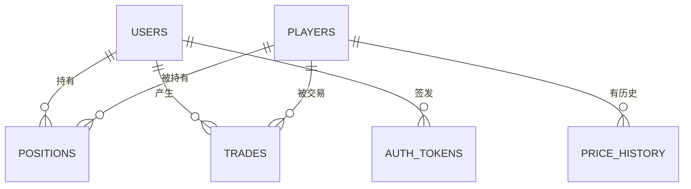

PlayerStock

虚拟选手股交易模拟

把「眼力」变成一条可交易、可解释的价格曲线

  看懂比赛，从持有起
  纯信用点 · 不可充值 / 提现 / 兑换
  16 名选手 · 8 支战队
  AI 只给建议

  有请下一组 ｜ 王泽棠（D）· 倪颢容（A）· 胡德昊（B）· 刘宏（C） 
  软件新技术创新实践课程 · 2026-11 · 结课项目审查

  <a class="pdf-link" href="./playerstock_defense.pdf">📄 下载完整材料 PDF</a>

<!--
【15 秒】老师们好，我们是「有请下一组」，作品叫 PlayerStock：用信用点交易 CS2 选手的虚拟股。说白了，就是把你对选手的判断，变成一条看得懂、能验证、不用真钱的价格曲线。先讲产品，再看两分钟演示，最后给证据。
-->

---
layout: default
---

01 产品设计 · 1.1 使命 / 口号 / 策略

# 让判断力变成可解释的价格曲线

  

    
使命 Mission

    
让看比赛的人，把判断变成一条看得懂、能验证、不花钱的价格曲线。

    
纯信用点，不可充值 / 提现 / 兑换

    

      
三条可验证原则

      <ul class="clean">
        <li><b>可解释</b>：每次涨跌都能说出原因</li>
        <li><b>可验证</b>：判断对错看历史价格</li>
        <li><b>零风险</b>：投入的是判断力与注意力，不是钱</li>
      </ul>
    

  

  

    

目标用户

看 CS 比赛、对选手有判断、但不想用真钱的人。

    

如何获得用户

赛事节点（Major/IEM/BLAST）+ 每日涨跌内容 + 校园电竞社群。

    

团队优势

4 人分工不重叠：前端 / 后端与交易 / 定价与数据 / AI·测试·部署。

  

<!--
【20 秒】先说我们是干嘛的：看懂比赛，从持有起。用户是看 CS 比赛、对选手有感觉、但不想花真钱的人。我们没推广预算，靠赛事、日报和校园社群慢慢来。四个人分工不重叠。
-->

---
layout: default
---

01 产品设计 · 1.2 产品定义 / 用户故事

# 一个虚拟的选手股市场

PlayerStock 就是一个用虚拟积分买卖电竞选手的市场：选手比赛打得好，价格就涨；打得差，价格就跌。

玩法就三步：看行情 → 买或卖 → 看持仓和流水。AI 在旁边给建议，但不替你下单。

  

看不懂行情的人

首页直接告诉你：现在该不该买

  

想验证判断的人

点开选手，看懂涨跌原因

  

上课演示的人

断网、没有 API Key，也能买卖

  5000 信用点开局16 名选手 / 8 支战队
  11 个价格历史点0 充值 / 0 提现 / 0 兑换

<!--
【35 秒】一句话：用虚拟积分买卖电竞选手。选手打得好价格就涨，打得差就跌。玩法就三步：看行情、买卖、看持仓和流水。三类用户各取所需：新手看结论，玩家看原因，演示看断网也能用。规模是 16 名选手、8 支战队、每人 11 个价格点，5000 信用点开局。
-->

---
layout: default
---

02 产品设计应用的原则

# 五条原则，五条做法

  

01

需求

先告诉用户该不该买

首页直接给结论，想看理由再展开。

  

02

信息

一屏做完：看行情、看建议、下单

不用来回切页面。

  

03

界面

干净、字够大、一眼能读懂

一屏放 6 张选手卡，不堆小字。

  

04

系统

交易和定价写死，AI 只给建议

AI 挂了，买卖照常。

05

合规

不碰真钱，AI 只能看不能动

0 充值 / 提现 / 兑换；AI 不下单、不改余额。

<!--
【35 秒】五条做法：先告诉用户该不该买；一屏做完看行情、建议、下单；界面干净字够大；交易和定价写死，AI 只建议；不碰真钱，AI 只能看。
-->

---
layout: default
---

03 产品实现 · 3.1 用户体验设计

# 界面：一屏看完，顺手就能下单

  

    

      
      
市场页：一行简报 + 筛选 + 3 列选手卡

    

    <ul class="clean" v-click>
      <li>首屏先给结论</li>
      <li>一屏 6 张卡，3 列对齐</li>
      <li>筛选排序不跳页</li>
    </ul>
  

  

    

      
      
详情页：价格曲线 + AI 建议 + 交易同屏

    

    <ul class="clean" v-click>
      <li>左边看曲线，右边下单</li>
      <li>手机 4 个 Tab，顶栏头像入口</li>
      <li>深浅色一键切</li>
    </ul>
  

<!--
【35 秒】界面就这样：桌面市场一屏 6 张卡，简报先给结论；详情页左边曲线，右边 AI 建议和下单；手机上 4 个 Tab。左右都是先看图、再看要点。
-->

---
layout: default
---

03 产品实现 · 3.2 技术选型

# 技术选型：够用、稳定

| 层    | 选型与版本（完整版本表在 README）                                         | 为什么选它             |
| ---- | ------------------------------------------------------------ | ----------------- |
| 前端   | Vue 3.5 · Vue Router 5.4 · Vite 8.3 · TS 6.0 · Vitest 4.1    | 轻、快、类型安全          |
| 后端   | Python 3.12 · FastAPI 0.161 · SQLAlchemy 2.1 · Pydantic 2.14 | 自动文档、路由清晰         |
| 数据   | 本地 SQLite / 线上 Render Postgres（psycopg2）                     | 本地零配置、线上持久化       |
| AI   | DeepSeek API（OpenAI 兼容）+ rule_fallback                       | 能说人话，挂了走规则兜底      |
| 部署   | Render：Static Site + Web Service + Cron + Postgres           | 免费、HTTPS、可复现      |
| 质量工具 | GitHub Actions · ruff · oxlint · eslint · vue-tsc · pytest   | 4 个 job 门禁，CI 同口径 |

原则：不追新，选我们 6 天能做完、能测、能上线的。

<!--
【30 秒】选型就一个原则：够用、稳定、我们熟。前端 Vue + Vite，后端 FastAPI + SQLAlchemy，线上 Postgres；AI 用 DeepSeek，留规则兜底；部署交给 Render 和 GitHub Actions。
-->

---
layout: default
---

03 产品实现 · 3.3 代码仓库与协作

# 502 次提交、4 位贡献者、4 道 CI 门禁

github.com/July75-bit/Innovation ｜ develop ｜ 502 次提交（363 次非合并）

  

    
提交分布（GitHub Pulse / git shortlog，含合并提交）

    <table class="mt-2">
      <tbody>
      <tr><td>D 王泽棠</td><td>197</td><td>A 倪颢容</td><td>74</td></tr>
      <tr><td>B 胡德昊</td><td>114</td><td>C 刘宏</td><td>81</td></tr>
      </tbody>
    </table>
      

  

    

协作

Issues + Projects 管任务，14 条缺陷都有 Issue。

    

CI 4 个 job

健康、后端、前端、交付物，每次 push 都跑。

  

<!--
【25 秒】仓库在 GitHub，develop 是部署分支，502 次提交、363 次非合并。四个人都在提交。协作靠 Issues 和 Projects，CI 4 个 job，每次 push 都跑。
-->

---
layout: default
---

03 产品实现 · 3.4 生命周期问题复盘

# 踩过的 6 个坑

| 问题                     | 原因                     | 解决办法（都已验证）         |
| ---------------------- | ---------------------- | ------------------ |
| 部署后数据全丢                | 免费实例临时盘 + SQLite       | 迁 Postgres，连接串归一化  |
| 线上启动 No module psycopg | SQLAlchemy 2.1 驱动变了    | 补 psycopg2，加单测     |
| 前端全站 CORS 失败           | CORS_ORIGINS 未填 / 带尾斜杠 | 精确 origin，线上验证     |
| 简报把模型 JSON 透传          | 模型输出没清洗                | 后端清洗，前端兜底          |
| CI 后端 14 秒红            | ruff C901 圈复杂度 11 > 10 | 拆成 6 个 helper      |
| 首次打开 33.6 秒            | 免费实例 15 分钟休眠           | 保温 cron + 骨架屏 + 重试 |

每个问题都补了测试、监控或文档，别再踩同一个坑。

<!--
【40 秒】挑了 6 个真踩过的坑：数据全丢、psycopg 驱动、CORS、模型输出没洗、CI 圈复杂度、冷启动。每个都说清原因和怎么修的，修完都有测试或线上验证。
-->

---
layout: default
---

03 产品实现 · 3.5 概要设计

# 系统架构：前后端分开，交易内核写死

  

部署

Render 四件套，Blueprint 能复现

  

可观测性

日志、健康检查、简报新鲜度

  

关键取舍

AI 只读建议，交易和定价是写死的代码

<!--
【35 秒】架构就四层：前端、FastAPI 接口、写死的交易内核、数据库。AI 是旁路，只读建议，不掺和交易。部署是 Render 四件套。
-->

---
layout: default
---

03 产品实现 · 3.5.3 算法与 AI

# 价格怎么算，AI 怎么建议

  

    
价格怎么变

    
P′ = max(1.0, P × (1 + 0.15 · S))

    
新价 = 旧价 ×（1 + 0.15 × 表现分），最低 1.0

    <ul class="clean mt-2">
      <li>表现分看这轮比平时好多少，强队不会一直涨</li>
      <li>一次最多涨跌 20%，不会一夜翻倍</li>
      <li>每次变价都写一句原因，点开就能看</li>
    </ul>
  

  

    

      
AI 只给建议，不动你的钱

      
流程：看行情 → 分析师 → 风控 → 交易员 → 你来点采纳，全程留审计。

      
接的是 DeepSeek，20 秒超时；没配 Key、超时或返回坏数据，就自动用规则版，页面照样能用。

      
6 个固定字段；线上 16/16 通过，P95 3.39 秒。

    

    

      <b>为什么不让 AI 定价？</b> 
      规则稳定、不花钱；AI 挂了，交易也不受影响。
    

  

<!--
【40 秒】价格怎么变：新价 = 旧价 ×（1 + 0.15 × 表现分），最低 1.0，一次最多涨跌 20%。每条价格都带原因，点开就能看。AI 这边走一遍分析师、风控、交易员，最后你点采纳，全程留审计；DeepSeek 挂了自动用规则版。我们不给 AI 定价权。
-->

---
layout: default
---

03 产品实现 · 3.5.4 数据库设计

# 9 张表：交易记录，AI 审计

| 分组  | 表                                               | 关键的不可变 / 一致性设计                           |
| --- | ----------------------------------------------- | ---------------------------------------- |
| 账号  | users / auth_tokens                             | 余额与初始本金；令牌 30 天、可撤销                      |
| 市场  | players / price_history                         | 价格历史只追加；每条 reason 必填                     |
| 交易  | positions / trades                              | 流水只追加、带 balance_after；持仓唯一(user, player) |
| 智能体 | agent_traces / decision_logs / price_narratives | 每次调用/采纳/归因都留审计，只读业务                      |

  

  

    

交易一致性

余额、持仓、流水一起写；14 条交易测试。

    

为什么不用缓存/队列？

这门课的量级不用缓存，先保证数据对得上。

  

<!--
【25 秒】数据库 9 张表，分账号、市场、交易、智能体。两个关键：流水只追加、记余额；余额、持仓、流水一个事务写完。AI 的调用、采纳、归因都落审计表，业务表只读。
-->

---
layout: default
---

03 产品实现 · 3.5.5 接口设计

# 前后端约定：23 个接口

| 分组  | 能做什么            | 一个例子                     |
| --- | --------------- | ------------------------ |
| 行情  | 看选手列表、选手详情、价格历史 | GET /api/players         |
| 交易  | 看账户、买入、卖出、持仓、流水 | POST /api/trades/buy     |
| 身份  | 注册、登录、退出、删号     | POST /api/auth/login     |
| AI  | 看建议、简报、决策记录     | GET /api/analysis/\{id\} |
| 运维  | 健康检查、数据库自检、日志   | GET /api/health          |

所有接口返回同一种格式，出错也给中文提示。在线文档可以直接试：playerstock-backend-mdlk.onrender.com/api/docs

<!--
【20 秒】前后端一共约定了 23 个接口，分五组：行情、交易、身份、AI、运维。所有接口返回同一种格式，出错也给中文提示。现场可以直接打开 /api/docs 试。
-->

---
layout: default
---

03 产品实现 · 3.6 软件质量

# 质量：每次提交都跑测试

  

335

后端测试

pytest，live 默认不跑

  

186

前端测试

Vitest / 23 个文件

  

98%

核心覆盖率

app + core_engine

  

4

CI 门禁 job

健康、后端、前端、交付物

  

质量控制与保证方法

    <ul class="clean">
      <li>日志：/api/logs 记请求和错误</li>
      <li>异常：统一错误码，前端能提示</li>
      <li>契约：Pydantic 校验入参出参</li>
      <li>并发：事务 + 条件更新，有测试</li>
      <li>降级：LLM、网络、冷启动都有兜底</li>
    </ul>
  

  

质量工具

    <table>
      <tbody>
      <tr><td>ruff</td><td>规范 + 圈复杂度，CI 同版本</td></tr>
      <tr><td>oxlint / eslint</td><td>前端规范，冲突标记也有守卫</td></tr>
      <tr><td>vue-tsc</td><td>类型检查进 build</td></tr>
      <tr><td>Vitest / pytest</td><td>单元/集成/评测/并发</td></tr>
      <tr><td>GitHub Actions</td><td>4 个 job 全绿才部署</td></tr>
      </tbody>
    </table>
  

<!--
【30 秒】质量拿数字说话：后端 335 条、前端 186 条，核心覆盖率 98%；CI 4 个 job 全绿才部署。除了测试，还有日志、统一错误码、契约校验和降级。
-->

---
layout: default
---

03 产品实现 · 3.7 代码统计

# 3.4 万行代码

| 语言           | 文件数 | 行数     |
| ------------ | --- | ------ |
| Python       | 111 | 16,790 |
| Vue          | 21  | 8,992  |
| TypeScript   | 49  | 6,410  |
| CSS          | 4   | 969    |
| HTML         | 3   | 1,082  |
| Markdown（文档） | 70  | 8,270  |

  

模块数

前端 8 视图 / 12 组件；后端 11 路由 / 9 AI 模块。

  
<b>AI 与团队编写的比例</b> 没做逐行归因，不编百分比。AI 帮忙写测试和文档；核心逻辑人工写、互相审。

可执行代码约 34,000 行；文档约 8,300 行（70 份 md）。

<!--
【15 秒】代码约 3.4 万行，文档约 8,300 行。前端 8 个视图 12 个组件，后端 11 个路由 9 个 AI 模块。AI 帮忙写测试和文档，核心逻辑人工写、互相审。
-->

---
layout: default
---

验收 · 测试与容量

# 三类证据：用户测试、AI 评测、压测

  

33 项

用户测试表

32 通过 / 1 部分通过

对话、状态、错误、边界都测了

  

16/16

AI 契约评测

source=llm 100% · P95 3.39s

6 个字段都全，合规也过

  

11/11

红队用例

提示注入 / 越权 / 伪造来源

全部守住，有审计日志

  

38 req/s

只读压测

≈190 人同时在线 · 0 错误

瓶颈是免费档，不是代码

边界：交叉测试双向各 33 题，样本还小；没有真实赛事数据，不吹准确率。

证据索引：docs/acceptance/evidence（147 张截图）· test_report.md · agent_eval_report.md · load_test_report.md

<!--
【20 秒】三类证据：33 项用户测试（32 过、1 部分过）、AI 契约 16/16、红队 11/11；压测 38 req/s、190 并发、0 错误。也说清楚：交叉测试样本还小，没有真实赛事数据，不吹准确率。
-->

---
layout: default
---

演示

# 现场演示：2 分钟从判断到下单

  

01 市场

简报给结论，3 列卡看涨跌和停牌

  

02 详情

价格曲线 + AI 建议 + 停牌提示

  

03 下单

买 2 股：余额、持仓、流水同时变

  

04 复盘

个人页看资产曲线和交易统计

  

05 兜底

断网/无 Key 也能交易

  

06 结束

回到市场，数据干净可重复

演示时不切窗口；卡了就刷新只读页或放录屏。

<!--
【5 秒】下面用两分钟走一遍：市场、详情、买入、复盘，再补一个停牌拦截和 AI 降级。演示时不切窗口。
-->

---
layout: default
---

结课审查

# 谢谢，请老师指导

  

    
在线演示

    
playerstock-frontend-mdlk.onrender.com

  

  

    
源码仓库

    
github.com/July75-bit/Innovation

  

  

    
完整材料

    
站点内 /playerstock_defense.pdf

  

有请下一组 · 王泽棠（D）· 倪颢容（A）· 胡德昊（B）· 刘宏（C）　｜　2026-11

<!--
【结束】最后一页不列问题：这是给老师做结课审查的材料。谢谢老师，页面上留了在线演示、仓库和完整材料三个入口，随时能点开看。
-->
