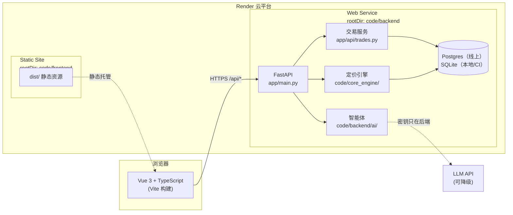
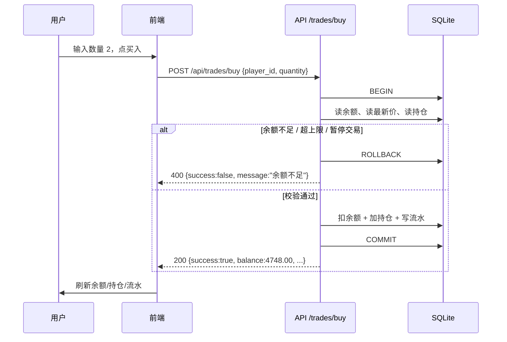
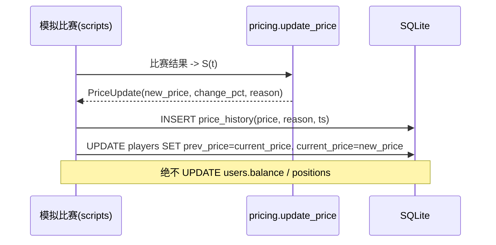
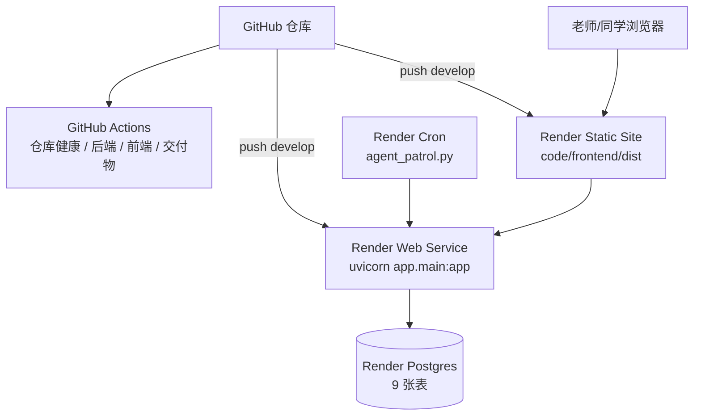

# 系统架构设计

> **负责人**：B + D ｜ **截止**：第 1 天初稿，第 6 天定稿 ｜ **状态**：✅ 已填写（第 2 天补「选型论证 + 未来 2 周新技术自学计划」，第 6 天补真实版本号）
> **对应课程指标**：#7 架构与详细设计、#9 架构设计说明；交付物要求"完整 readme.md：项目简介、**架构图**、运行方式"

## 1. 架构总览

## 2. 分层与模块职责

| 层 | 模块 | 职责 | 责任人 | 边界（不能做什么） |
| --- | --- | --- | --- | --- |
| 表现层 | `code/frontend/` | 页面渲染、交互、调接口、状态提示 | A | 不写死 API 地址、不改后端文件 |
| 接口层 | `app/api/` | 路由、参数校验、错误码、事务边界 | B | 不在路由里写算法 |
| 领域层 | `code/core_engine/`、`code/backend/ai/` | 纯计算：定价、信号、建议 | C、D | 不直接改用户余额/持仓 |
| 数据层 | `app/models/`、`app/core/` | ORM 模型、会话、配置 | B | 不包含业务规则 |
| 平台层 | Render / GitHub Actions | 部署、CI | D | 密钥只放环境变量 |

## 3. 关键数据流

### 3.1 交易流（第 3 天必须打通）

### 3.2 价格更新流

### 3.3 AI 分析流

见 `docs/algorithm/ai_agent_prompt.md` 第 5 节的失败处理链路图。

## 4. 技术选型与版本

| 组件 | 选型 | 版本 | 选它的理由 | 备选 |
| --- | --- | --- | --- | --- |
| 前端框架 | Vue 3 + TypeScript | **Vue 3.5.42 · TypeScript 6.0** | 官方脚手架自带 Router/Vitest/ESLint，上手快 | React |
| 构建 | Vite | **8.2.2** | 启动快、配置少 | — |
| 路由 | vue-router | **5.3.1** | 官方路由，配合 SPA rewrite | — |
| 后端 | FastAPI | **0.161.1**（Uvicorn 0.54.0） | 自动生成 Swagger，四人联调成本最低 | Express |
| ORM | SQLAlchemy 2.x | **2.1.6**（驱动 psycopg2-binary） | 事务控制明确 | — |
| 数据校验 | Pydantic / pydantic-settings | **2.14.1** | 声明式校验，省手写 | — |
| 数据库 | SQLite（本地/CI）/ Postgres（线上） | SQLite 3（Python 内置）· Render Postgres | 零运维，6 天够用；线上无持久盘故换 Postgres | PostgreSQL（线上持久化可选） |
| 测试 | pytest + httpx + Vitest | **9.1.1 / 0.28.1 / 4.1.11** | 与 FastAPI TestClient 配套 | — |
| 代码质量 | ruff + ESLint + oxlint + Pylint + complexipy | **0.17.4 / 10.10.0 / 1.82.0 / 4.1.3 / 8.3.0** | CI 门禁可复现 | — |
| 运行时 | Python | **3.13** 本机基线 · CI 3.12 · Render 3.12.6 | 锁文件在 3.13 下生成，CI 用 3.12 验证兼容 | — |
| CI | GitHub Actions | — | 免费、与仓库绑定 | — |
| 部署 | Render | — | 支持前后端分离 + 蓝图配置 | 阿里云/腾讯云 |

> ✅ 答辩要求"技术实现含框架及**版本号**"已落实：上表版本与 `code/frontend/package.json`、`code/backend/requirements.lock.txt`、`render.yaml` 一致，并同步进 `README.md`「技术栈」（汇报要求 3.2）。

## 5. 关键设计决策（ADR 简表）

| 决策 | 选择 | 放弃的方案 | 理由 |
| --- | --- | --- | --- |
| 定价模块位置 | `code/core_engine/`（同仓库、可 pip 安装） | 独立部署的定价服务 | 6 天版不引入第二个服务；后端通过 `sys.path` 注入 / `pip install -e` 导入，避免跨目录 import 失败 |
| 数据库 | 本地/CI 用 SQLite，线上用 Render Postgres | 纯 SQLite、纯 MySQL | SQLite 零运维、测试快；免费实例无持久盘、重启会丢数据，线上必须 Postgres（部署方案 B）；SQLAlchemy 一套模型双环境复用（见 `deployment.md` §3） |
| 智能体编排 | 同一进程内顺序调用：多角色分析（分析师 → 风控 → 交易员）+ 最多 3 轮只读工具调用 | LangGraph 等多智能体框架 | 流程固定、步骤少，用普通函数串起来更容易测试和降级；不引入额外依赖 |
| 真实赛事数据 | 模拟数据 + 适配器接口 | 直接接 SportScore | 接口可用性未知，模拟数据保证演示稳定 |
| 鉴权 | 演示账户 + **私人账号（PBKDF2-HMAC-SHA256 + 不透明令牌）** | JWT / OAuth 第三方登录 | 只用标准库就能做到「口令加盐散列 + 可撤销令牌」，引 JWT 库反而多一个依赖与过期时钟坑；第三方登录与课程目标无关 |
| 价格归因（score/S） | 写进 `price_history.reason`：`S=…` + 本轮得分（方案 A，2026-10-24；现由 C 在 `update_price` 生成「本轮得分 76.6，S=-1.00」，B 只透传） | 给 `price_history` 加 `score` 列 / 新建 `matches` 表（方案 B） | 6 天课程优先"可解释、可复现"：reason 文本直接服务详情页、AI 上下文与答辩，且**不改表、不改契约**；方案 B 要走契约 §6 变更流程 + 第 5 天 Postgres 迁移，风险高。精确复现靠 `simulate_match.py` 固定 seed 与 reason 里的得分对齐；结构化统计列入课程后 backlog（对应验收 `TC-110`） |

## 6. 部署拓扑

> 部署方案 B（2026-10-23 定案）：前端 Static Site + 后端 Web Service + 免费 Postgres。
> 免费实例**不能挂持久盘**，本地 SQLite 会随重启/部署丢失，因此线上必须用 Postgres；操作手册见 `deployment.md` §3。
