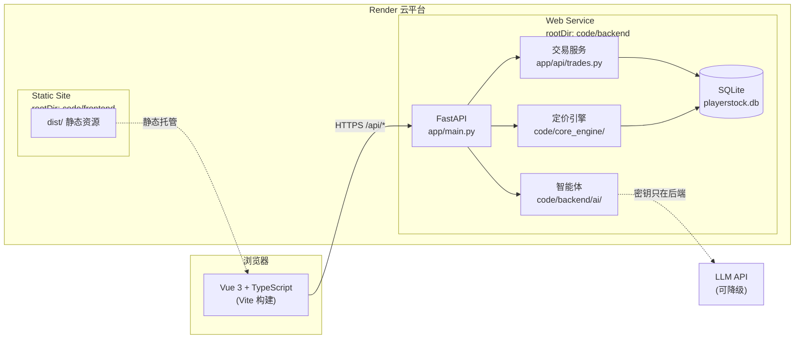
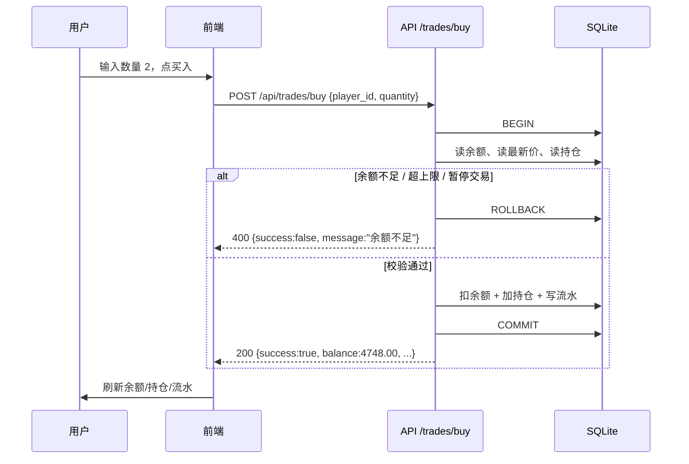
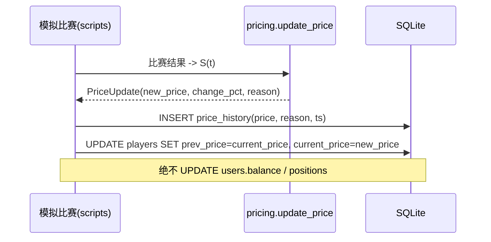
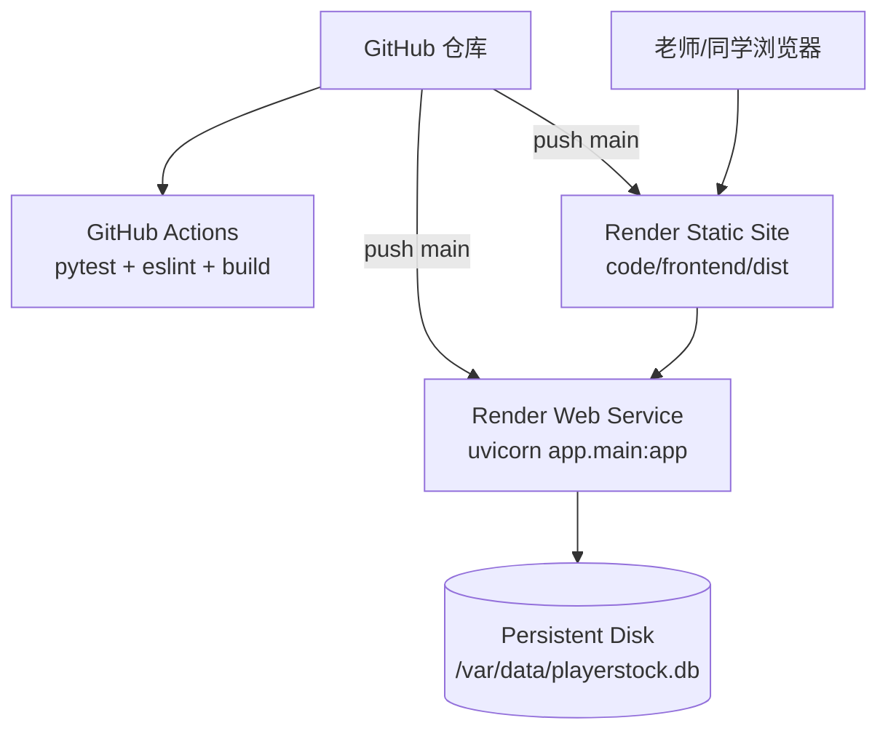

# 系统架构设计

> **负责人**：B + D ｜ **截止**：第 1 天初稿，第 6 天定稿 ｜ **状态**：✅ 已填写（第 6 天补真实版本号）
> **对应课程指标**：#7 架构与详细设计、#9 架构设计说明；交付物要求"完整 readme.md：项目简介、**架构图**、运行方式"

## 1. 架构总览

## 2. 分层与模块职责

| 层 | 模块 | 职责 | 责任人 | 边界（不能做什么） |
| --- | --- | --- | --- | --- |
| 表现层 | `code/frontend/` | 页面渲染、交互、调接口、状态提示 | A | 不写死 API 地址、不改后端文件 |
| 接口层 | `app/api/` | 路由、参数校验、错误码、事务边界 | B | 不在路由里写算法 |
| 领域层 | `code/core_engine/`、`code/backend/ai/` | 纯计算：定价、信号、建议 | C、D | 不直接改用户余额/持仓 |
| 数据层 | `app/models/`、`app/core/` | ORM 模型、会话、配置 | B | 不包含业务规则 |
| 平台层 | Render / GitHub Actions | 部署、CI | D | 密钥只放环境变量 |

## 3. 关键数据流

### 3.1 交易流（第 3 天必须打通）

### 3.2 价格更新流

### 3.3 AI 分析流

见 `docs/algorithm/ai_agent_prompt.md` 第 5 节的失败处理链路图。

## 4. 技术选型与版本

| 组件 | 选型 | 版本 | 选它的理由 | 备选 |
| --- | --- | --- | --- | --- |
| 前端框架 | Vue 3 + TypeScript | 见 `code/frontend/package.json` | 官方脚手架自带 Router/Vitest/ESLint，上手快 | React |
| 构建 | Vite | 同上 | 启动快、配置少 | — |
| 后端 | FastAPI | 见 `requirements.lock.txt` | 自动生成 Swagger，四人联调成本最低 | Express |
| ORM | SQLAlchemy 2.x | 同上 | 事务控制明确 | — |
| 数据库 | SQLite | 同上 | 零运维，6 天够用 | PostgreSQL（线上持久化可选） |
| 测试 | pytest + httpx | 同上 | 与 FastAPI TestClient 配套 | — |
| CI | GitHub Actions | — | 免费、与仓库绑定 | — |
| 部署 | Render | — | 支持前后端分离 + 蓝图配置 | 阿里云/腾讯云 |

> ⚠️ 答辩要求"技术实现含框架及**版本号**"，第 6 天必须把本表的"见…"替换成真实版本号。

## 5. 关键设计决策（ADR 简表）

| 决策 | 选择 | 放弃的方案 | 理由 |
| --- | --- | --- | --- |
| 定价模块位置 | `code/core_engine/`（同仓库、可 pip 安装） | 独立部署的定价服务 | 6 天版不引入第二个服务；后端通过 `sys.path` 注入 / `pip install -e` 导入，避免跨目录 import 失败 |
| 数据库 | SQLite | PostgreSQL | 6 天版零运维；线上若不挂持久盘再换 |
| 智能体编排 | 单智能体 | LangGraph 多智能体 DAG | 时间不够，单智能体已能体现"智能体肌肉" |
| 真实赛事数据 | 模拟数据 + 适配器接口 | 直接接 SportScore | 接口可用性未知，模拟数据保证演示稳定 |
| 鉴权 | 单演示账户 | JWT + 注册登录 | 不是课程考察重点 |

## 6. 部署拓扑

## 7. TODO

- [ ] B 第 1 天补全模块边界与数据表关系
- [ ] D 第 5 天补全部署拓扑的真实域名
- [ ] D 第 6 天把"见 requirements.lock.txt"替换成真实版本号
