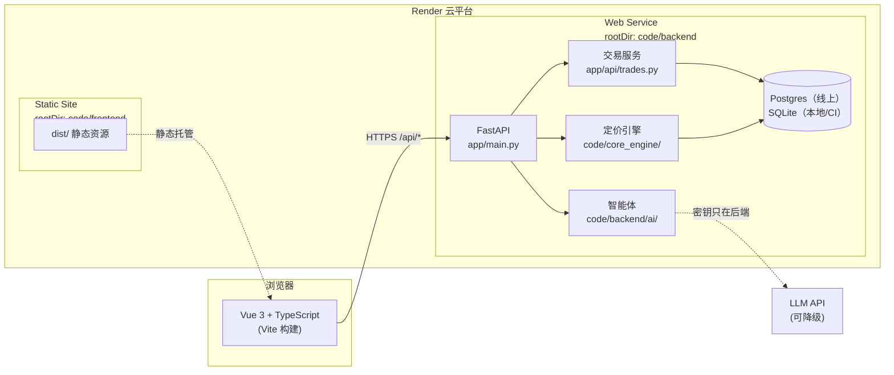
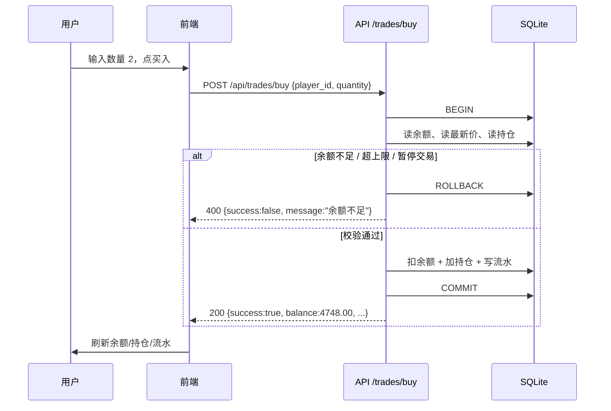
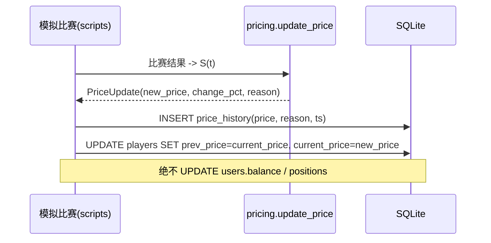
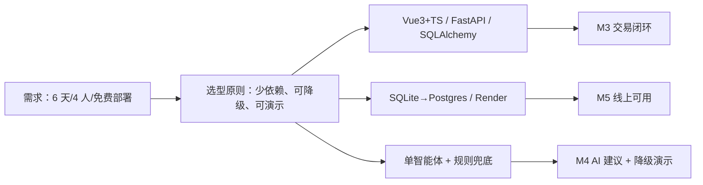
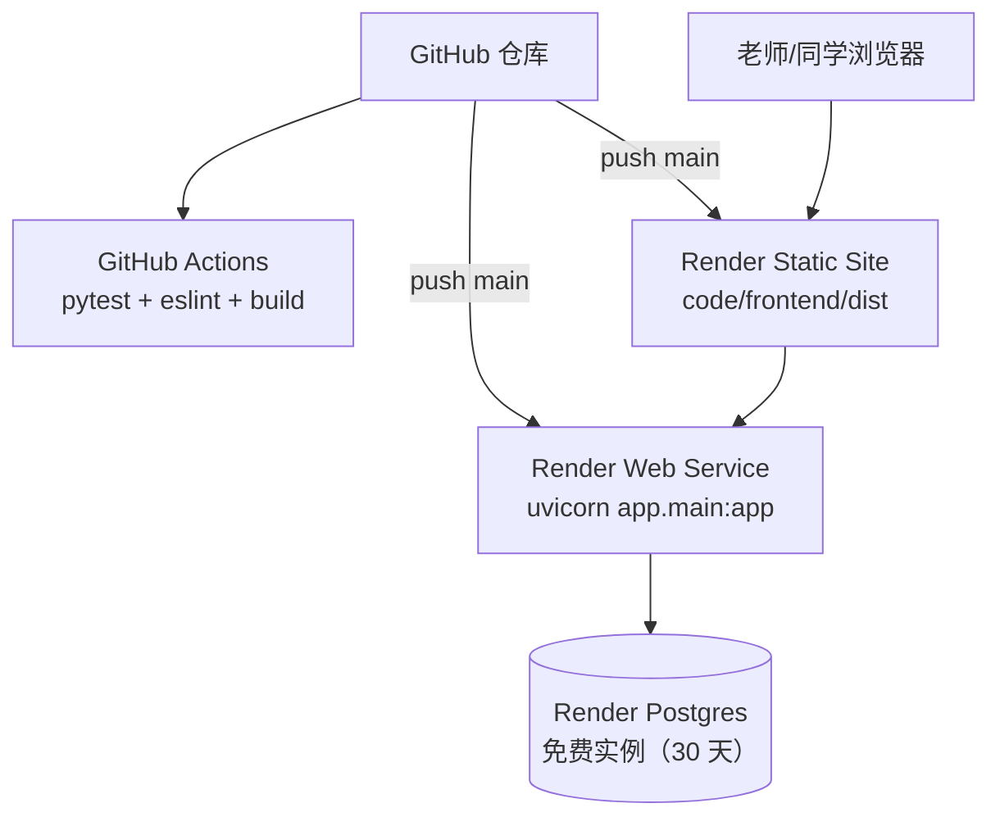

# 系统架构设计

> **负责人**：B + D ｜ **截止**：第 1 天初稿，第 6 天定稿 ｜ **状态**：✅ 已填写（第 2 天补「选型论证 + 未来 2 周新技术自学计划」，第 6 天补真实版本号）
> **对应课程指标**：#7 架构与详细设计、#9 架构设计说明；交付物要求"完整 readme.md：项目简介、**架构图**、运行方式"

## 1. 架构总览

## 2. 分层与模块职责

| 层 | 模块 | 职责 | 责任人 | 边界（不能做什么） |
| --- | --- | --- | --- | --- |
| 表现层 | `code/frontend/` | 页面渲染、交互、调接口、状态提示 | A | 不写死 API 地址、不改后端文件 |
| 接口层 | `app/api/` | 路由、参数校验、错误码、事务边界 | B | 不在路由里写算法 |
| 领域层 | `code/core_engine/`、`code/backend/ai/` | 纯计算：定价、信号、建议 | C、D | 不直接改用户余额/持仓 |
| 数据层 | `app/models/`、`app/core/` | ORM 模型、会话、配置 | B | 不包含业务规则 |
| 平台层 | Render / GitHub Actions | 部署、CI | D | 密钥只放环境变量 |

## 3. 关键数据流

### 3.1 交易流（第 3 天必须打通）

### 3.2 价格更新流

### 3.3 AI 分析流

见 `docs/algorithm/ai_agent_prompt.md` 第 5 节的失败处理链路图。

## 4. 技术选型与版本

| 组件 | 选型 | 版本 | 选它的理由 | 备选 |
| --- | --- | --- | --- | --- |
| 前端框架 | Vue 3 + TypeScript | 见 `code/frontend/package.json` | 官方脚手架自带 Router/Vitest/ESLint，上手快 | React |
| 构建 | Vite | 同上 | 启动快、配置少 | — |
| 后端 | FastAPI | 见 `requirements.lock.txt` | 自动生成 Swagger，四人联调成本最低 | Express |
| ORM | SQLAlchemy 2.x | 同上 | 事务控制明确 | — |
| 数据库 | SQLite | 同上 | 零运维，6 天够用 | PostgreSQL（线上持久化可选） |
| 测试 | pytest + httpx | 同上 | 与 FastAPI TestClient 配套 | — |
| CI | GitHub Actions | — | 免费、与仓库绑定 | — |
| 部署 | Render | — | 支持前后端分离 + 蓝图配置 | 阿里云/腾讯云 |

> ⚠️ 答辩要求"技术实现含框架及**版本号**"，第 6 天必须把本表的"见…"替换成真实版本号。

### 4.1 选型论证（决策标准与备选对比）

**决策标准**（按本课程 6 天工期加权）：① 四人是否已会（不允许现学两门新框架）；② 本地 / CI / 线上能否一致跑通；③ 部署成本与免费额度；④ 课程要求（自动接口文档、CI、可复现、可降级）。

| 决策点 | 我们的选择 | 主要备选 | 对比结论（为什么不是备选） |
| --- | --- | --- | --- |
| 前端 | Vue 3 + TypeScript + Vite | React + Vite、原生 JS | A 已有 Vue 基础；官方脚手架自带 Router/Vitest/ESLint，配置成本最低 → Vue |
| 后端 | FastAPI + Pydantic + SQLAlchemy 2.x | Express/Node、Flask | FastAPI 自动生成 Swagger，直接当接口文档与联调工具；Pydantic 把参数校验变成声明式，省手写校验 → FastAPI |
| 数据库 | SQLite（本地 / CI）→ Render Postgres（线上） | 纯 SQLite、MySQL | SQLite 零运维、测试快；免费实例无持久盘，线上必须 Postgres → 同一套 SQLAlchemy 模型双环境复用 |
| AI 集成 | 服务端单智能体 + 规则兜底（标准库 urllib、20s 超时） | 前端直连模型、LangGraph 多智能体 | 密钥只能在后端（课程硬要求）；单智能体已能体现"智能体肌肉"；兜底保证无密钥/断网也能演示 → 服务端单智能体 |
| 测试 | pytest + FastAPI TestClient（接口层）+ e2e 闭环 | 只做手工测试 | 课程要求 CI 可复现；TestClient 覆盖接口契约，e2e 覆盖"查行情→买入→持仓→卖出" → 自动化 |
| 部署 | Render 方案 B（Static Site + Web Service + 免费 Postgres） | 阿里云/腾讯云自建 | 免费、Git 推送自动部署、`render.yaml` 蓝图一键建服务，适合 6 天工期 → Render |
| 协作流程 | `develop` 日常提交 + `main` 可部署 + PR 模板 | `feat/*` 分支流 | 4 人 6 天，直接提交 `develop` 沟通成本更低（已定案，见 `project_management_plan.md` §8） → develop/main |

**结论**：全部选型以"6 天内四人能协同产出可演示、可部署的作品"为第一目标，不引入第二套语言、第二个服务或需要 GPU 的组件；所有关键技术都留了降级路径（AI→规则版、Postgres→SQLite、单智能体→纯规则）。

## 5. 关键设计决策（ADR 简表）

| 决策 | 选择 | 放弃的方案 | 理由 |
| --- | --- | --- | --- |
| 定价模块位置 | `code/core_engine/`（同仓库、可 pip 安装） | 独立部署的定价服务 | 6 天版不引入第二个服务；后端通过 `sys.path` 注入 / `pip install -e` 导入，避免跨目录 import 失败 |
| 数据库 | 本地/CI 用 SQLite，线上用 Render Postgres | 纯 SQLite、纯 MySQL | SQLite 零运维、测试快；免费实例无持久盘、重启会丢数据，线上必须 Postgres（部署方案 B）；SQLAlchemy 一套模型双环境复用（见 `deployment.md` §3） |
| 智能体编排 | 单智能体 | LangGraph 多智能体 DAG | 时间不够，单智能体已能体现"智能体肌肉" |
| 真实赛事数据 | 模拟数据 + 适配器接口 | 直接接 SportScore | 接口可用性未知，模拟数据保证演示稳定 |
| 鉴权 | 单演示账户 | JWT + 注册登录 | 不是课程考察重点 |
| 价格归因（score/S） | 写进 `price_history.reason`：`S=…` + 本轮模拟得分（方案 A，2026-10-24） | 给 `price_history` 加 `score` 列 / 新建 `matches` 表（方案 B） | 6 天课程优先"可解释、可复现"：reason 文本直接服务详情页、AI 上下文与答辩，且**不改表、不改契约**；方案 B 要走契约 §6 变更流程 + 第 5 天 Postgres 迁移，风险高。精确复现靠 `simulate_match.py` 固定 seed 与 reason 里的得分对齐；结构化统计列入课程后 backlog（对应验收 `TC-110`） |

## 6. 部署拓扑

> 部署方案 B（2026-10-23 定案）：前端 Static Site + 后端 Web Service + 免费 Postgres。
> 免费实例**不能挂持久盘**，本地 SQLite 会随重启/部署丢失，因此线上必须用 Postgres；操作手册见 `deployment.md` §3。

## 7. 未来 2 周新技术自学计划与 Milestone

> **对应课程要求**：第 2 天工作任务第 3 项 —— 技术方案调研报告需"列出团队在未来 2 周内需要学习的新技术（制定自学计划与 Milestone）"。
> 本项目按课程 6 天冲刺节奏执行：**第 3–6 天随做随学**，课程结束后的 1 周作为补课与迭代窗口；Milestone 编号与 `docs/mgmt/milestones.md` 的 M3–M6 对齐。

**团队现状（2026-10-24 实测）**：D 已掌握 Python/FastAPI 测试与 CI（第 1–2 天交付 AI 模块）；B 已完成后端 5 表 / 9 接口；**A（前端）与 C（定价）的本期技术栈尚未上手**，是本项目最大的学习风险（对应 `project_management_plan.md` R2/R3）。

| # | 新技术 / 能力 | 为什么需要 | 负责人 | 学习资源与方式 | 时间窗 | 对应 Milestone（可验收） |
| --- | --- | --- | --- | --- | --- | --- |
| 1 | Vue 3 + TypeScript + Vue Router 基础 | 市场/详情/持仓/流水/AI 卡 5 个页面 | A | Vue 官方文档 + 脚手架实战；以 `docs/software/prototype/index.html` 为视觉与交互基线 | 第 4 天 | **M4**：5 个页面可切换、数据来自真实接口、不写死地址 |
| 2 | SVG 折线图与加载/空/失败三态 | 价格历史图、网络异常体验 | A | MDN SVG + 原型中的内联图表实现 | 第 4 天 | **M4**：≥10 个点的折线图 + 拔网线显示失败态 |
| 3 | pytest 夹具与 FastAPI TestClient | 交易边界与集成测试持续回归 | B + D | 本仓 `tests/` 现有用例 + pytest 文档 | 第 3 天起（已在用） | **M3/M6**：全仓 `python -m pytest` 绿、e2e 闭环 |
| 4 | Render 部署与 Postgres 迁移 | 线上持久化（免费实例无磁盘） | D + B | `deployment.md` §3 操作手册 + Render 文档 | 第 5 天 | **M5**：公网 `/api/health` 可访问、重启后数据仍在 |
| 5 | GitHub Actions 排障（三 job） | 每次 push 自动回归 + 交付物完整性检查 | D | Actions 日志 + 本仓 `.github/workflows/ci.yml` | 第 5 天 | **M5**：main 推送后 CI 全绿（含产物检查） |
| 6 | LLM 输出校验与降级演练 | 答辩现场"拔密钥/脏输出"演示 | D | `ai_agent_prompt.md` §5 失败链路 + 注入假 client 练习 | 第 4 天 | **M4**：现场无密钥仍返回 `source=rule_fallback` |
| 7 | 交叉测试与演示脚本 | 第 6 天回归 + 两次彩排 | 全员 | `docs/acceptance/test_plan.md` §5 手工流程 | 第 6 天 | **M6**：完整流程 8+2+5 分钟、彩排 ≥2 次 |
| 8 | （课程结束后）真实赛事数据适配器 / 鉴权 | 作品继续迭代的备选方向 | 待定 | HLTV / 官方接口调研（先做合规评估，不抓受限数据） | 课程后 1 周 | 课程外 backlog：产出调研结论，不承诺本期实现 |

**学习风险与对策**：A、C 两环风险最高（R2/R3）。若第 4 天中午 A 的页面仍接不上真实接口，立即降级：C 先交付命令行定价、A 先用 mock 完成页面，第 5 天只保"交易闭环 + AI 建议 + 线上可访问"三条主线（预案见 `project_management_plan.md` R1/R2）。**每天晚验收时对照上表更新"是否按计划跟上"，滞后项当天下调范围，不把风险拖到第 6 天。**

## 8. TODO

- [ ] B 第 1 天补全模块边界与数据表关系
- [ ] D 第 5 天补全部署拓扑的真实域名
- [ ] D 第 6 天把"见 requirements.lock.txt"替换成真实版本号
- [ ] A 第 4 天按 `docs/software/prototype/` 实现 Vue 页面，并补 `docs/requirements/wireframes/` 截图
