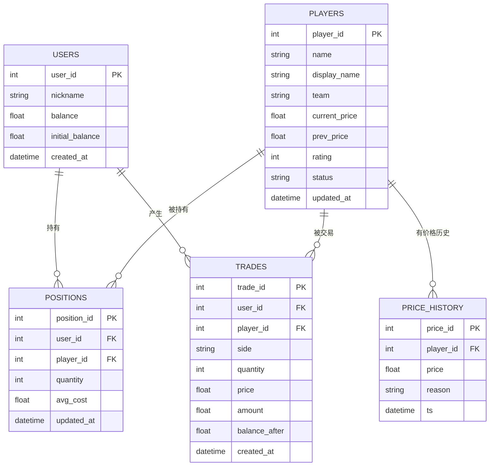

# 数据库设计说明

> **负责人**：B ｜ **截止**：第 1 天出表结构，第 6 天定稿 ｜ **状态**：⬜ 待填写
> **对应课程指标**：#7 数据设计；分工文档 B6"整理 API 文档和数据库设计说明"
> 答辩必问："为什么要这几张表？并发下怎么保证不超卖？"

## 1. 实体关系图

## 2. 表结构明细

### 2.1 `users` 账户

| 字段 | 类型 | 约束 | 说明 |
| --- | --- | --- | --- |
| `user_id` | INTEGER | PK, autoincrement | |
| `nickname` | VARCHAR(50) | NOT NULL | 演示账户可为 "demo" |
| `balance` | FLOAT | NOT NULL, default 5000 | 虚拟币余额，不可为负 |
| `initial_balance` | FLOAT | NOT NULL, default 5000 | 用于算收益率 |
| `created_at` | DATETIME | NOT NULL, default now | |

### 2.2 `players` 选手

| 字段 | 类型 | 约束 | 说明 |
| --- | --- | --- | --- |
| `player_id` | INTEGER | PK | |
| `name` | VARCHAR(50) | NOT NULL, UNIQUE | 英文/ID，如 Shadow |
| `display_name` | VARCHAR(50) | | 中文昵称，如 影刃 |
| `team` | VARCHAR(50) | | 虚拟战队 |
| `current_price` | FLOAT | NOT NULL, > 0 | 定价模块写入 |
| `prev_price` | FLOAT | NOT NULL | 用于算涨跌幅 |
| `rating` | INTEGER | 0–100 | 表现评分（C 维护） |
| `status` | VARCHAR(20) | NOT NULL, default 'trading' | `trading` / `suspended` |
| `updated_at` | DATETIME | NOT NULL | |

### 2.3 `positions` 持仓

| 字段 | 类型 | 约束 | 说明 |
| --- | --- | --- | --- |
| `position_id` | INTEGER | PK | |
| `user_id` | INTEGER | FK → users, NOT NULL | |
| `player_id` | INTEGER | FK → players, NOT NULL | |
| `quantity` | INTEGER | NOT NULL, ≥ 1 | 为 0 时删除行 |
| `avg_cost` | FLOAT | NOT NULL | 买入均价 |
| `updated_at` | DATETIME | NOT NULL | |

**唯一索引**：`UNIQUE(user_id, player_id)` —— 防止同一选手出现两行持仓。
**CHECK**：`quantity BETWEEN 1 AND 50`（与应用层校验双保险）。

### 2.4 `trades` 交易流水

| 字段 | 类型 | 约束 | 说明 |
| --- | --- | --- | --- |
| `trade_id` | INTEGER | PK | |
| `user_id` | INTEGER | FK → users, NOT NULL | |
| `player_id` | INTEGER | FK → players, NOT NULL | |
| `side` | VARCHAR(4) | NOT NULL, CHECK IN ('BUY','SELL') | |
| `quantity` | INTEGER | NOT NULL, ≥ 1 | |
| `price` | FLOAT | NOT NULL, > 0 | 成交时的价格快照 |
| `amount` | FLOAT | NOT NULL | `price × quantity` |
| `balance_after` | FLOAT | NOT NULL | 便于对账与回溯 |
| `created_at` | DATETIME | NOT NULL | |

**索引**：`INDEX(user_id, created_at DESC)` —— 流水页按时间倒序查询。

> 为什么存 `price` 快照？因为选手价格之后还会变，流水必须能独立追溯"当时多少钱成交的"。

### 2.5 `price_history` 价格历史

| 字段 | 类型 | 约束 | 说明 |
| --- | --- | --- | --- |
| `price_id` | INTEGER | PK | |
| `player_id` | INTEGER | FK → players, NOT NULL | |
| `price` | FLOAT | NOT NULL, > 0 | |
| `reason` | VARCHAR(200) | NOT NULL | 人类可读的涨跌原因（可解释性落点） |
| `ts` | DATETIME | NOT NULL | 升序查询 |

**索引**：`INDEX(player_id, ts)`。

## 3. 一致性规则（事务）

| 操作 | 必须同事务完成 | 失败处理 |
| --- | --- | --- |
| 买入 | 扣 `users.balance` + 更新/插入 `positions` + 插入 `trades` | 全回滚 |
| 卖出 | 加 `users.balance` + 减少/删除 `positions` + 插入 `trades` | 全回滚 |
| 价格更新 | 更新 `players.current_price/prev_price` + 插入 `price_history` | 全回滚 |

**C 的边界**：价格更新只写 `players` 和 `price_history`，**永不**碰 `users.balance` 与 `positions`。

## 4. 迁移与初始化

| 项 | 方案 |
| --- | --- |
| 建表 | 开发期 `Base.metadata.create_all()`（`app/core/database.py`） |
| 种子数据 | `python scripts/seed_db.py`（读 `data/seed_players.json`） |
| schema 迁移 | 6 天版不做 Alembic；若改表结构，删库重建 + 重新 seed，并在本文件记录 |
| 线上持久化 | 挂载 Persistent Disk 到 `/var/data`，`DATABASE_URL=sqlite:////var/data/playerstock.db` |

## 5. 变更记录

| 日期 | 变更 | 变更人 | 影响 |
| --- | --- | --- | --- |
| | 初版表结构 | B | A/C/D 确认字段名 |

## 6. TODO

- [ ] B 第 1 天：按本文建 models，跑通 `init_db()`
- [ ] B 第 2 天：补唯一索引与 CHECK 约束
- [ ] B 第 6 天：把实际表结构（`sqlite3 .schema` 输出）贴到附录，证明与文档一致
