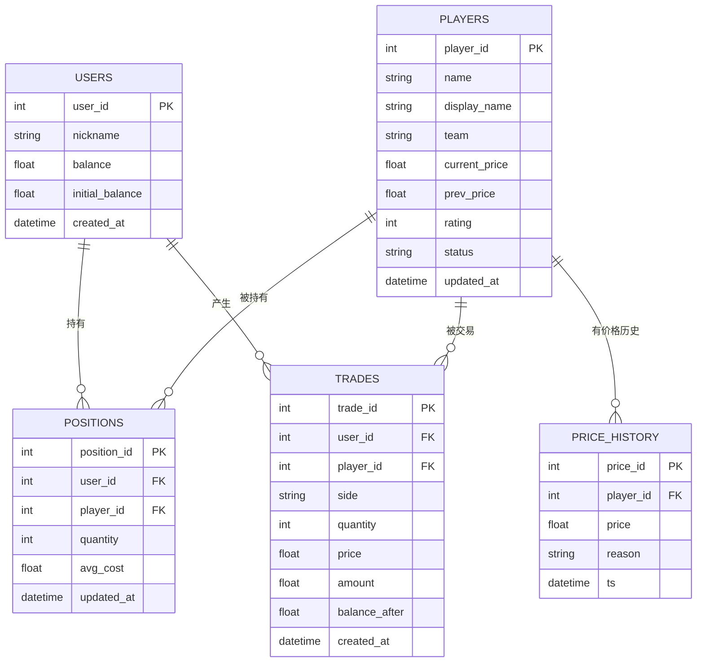

# 数据库设计说明

> **负责人**：B ｜ **截止**：第 1 天出表结构，第 6 天定稿 ｜ **状态**：✅ 已填写（第 6 天附实际 schema）
> **对应课程指标**：#7 数据设计；分工文档 B6"整理 API 文档和数据库设计说明"
> 答辩必问："为什么要这几张表？并发下怎么保证不超卖？"

## 1. 实体关系图



## 2. 表结构明细

### 2.1 `users` 账户

| 字段 | 类型 | 约束 | 说明 |
| --- | --- | --- | --- |
| `user_id` | INTEGER | PK, autoincrement | |
| `nickname` | VARCHAR(50) | NOT NULL | 演示账户可为 "demo" |
| `balance` | FLOAT | NOT NULL, default 5000 | 虚拟币余额，不可为负 |
| `initial_balance` | FLOAT | NOT NULL, default 5000 | 用于算收益率 |
| `created_at` | DATETIME | NOT NULL, default now | |

### 2.2 `players` 选手

| 字段 | 类型 | 约束 | 说明 |
| --- | --- | --- | --- |
| `player_id` | INTEGER | PK | |
| `name` | VARCHAR(50) | NOT NULL, UNIQUE | CS2 选手游戏内 ID（真实公开信息），如 ZywOo |
| `display_name` | VARCHAR(50) | | 展示名，真实选手暂无官方中文名时与 name 相同 |
| `team` | VARCHAR(50) | | 所属战队（真实公开信息），如 Vitality |
| `current_price` | FLOAT | NOT NULL, > 0 | 定价模块写入 |
| `prev_price` | FLOAT | NOT NULL | 用于算涨跌幅 |
| `role` | VARCHAR(20) | | 选手真实位置：AWPer / Entry / Rifler / IGL / Support / Lurker |
| `rating` | INTEGER | 0–100 | 本项目模拟综合表现分（C 维护），**不是 HLTV Rating 或任何官方统计** |
| `status` | VARCHAR(20) | NOT NULL, default 'trading' | `trading` / `suspended` |
| `updated_at` | DATETIME | NOT NULL | |

> 说明：`data/seed_players.json` 里的 `initial_price`（上市价）**不是本表字段**，落库时写成 `price_history` 的第一条记录（`reason = 初始价格`）。

### 2.2.1 实现说明（第 1 天补充）

- 金额字段（`balance` / `initial_balance` / `current_price` / `prev_price` / `price` / `amount` / `balance_after`）
  在 ORM 中用 `NUMERIC(12,2)`，`avg_cost` 用 `NUMERIC(12,4)`；SQLite 下仍按 REAL 存储，
  但应用层统一用 `Decimal` 计算，避免浮点误差。对外 JSON 仍是两位小数 `number`，契约不变。
- 种子数据会为每名选手写 `price_history` 第一条（`reason = 初始价格`）；若
  `current_price != initial_price`，再补一条当前价（`reason = 模拟比赛表现调整（种子数据…）`），
  保证前端折线图与 D 的 AI 输入都有可解释的历史点。

### 2.3 `positions` 持仓

| 字段 | 类型 | 约束 | 说明 |
| --- | --- | --- | --- |
| `position_id` | INTEGER | PK | |
| `user_id` | INTEGER | FK → users, NOT NULL | |
| `player_id` | INTEGER | FK → players, NOT NULL | |
| `quantity` | INTEGER | NOT NULL, ≥ 1 | 为 0 时删除行 |
| `avg_cost` | FLOAT | NOT NULL | 买入均价 |
| `updated_at` | DATETIME | NOT NULL | |

**唯一索引**：`UNIQUE(user_id, player_id)` —— 防止同一选手出现两行持仓。
**CHECK**：`quantity BETWEEN 1 AND 50`（与应用层校验双保险）。

### 2.4 `trades` 交易流水

| 字段 | 类型 | 约束 | 说明 |
| --- | --- | --- | --- |
| `trade_id` | INTEGER | PK | |
| `user_id` | INTEGER | FK → users, NOT NULL | |
| `player_id` | INTEGER | FK → players, NOT NULL | |
| `side` | VARCHAR(4) | NOT NULL, CHECK IN ('BUY','SELL') | |
| `quantity` | INTEGER | NOT NULL, ≥ 1 | |
| `price` | FLOAT | NOT NULL, > 0 | 成交时的价格快照 |
| `amount` | FLOAT | NOT NULL | `price × quantity` |
| `balance_after` | FLOAT | NOT NULL | 便于对账与回溯 |
| `created_at` | DATETIME | NOT NULL | |

**索引**：`INDEX(user_id, created_at DESC)` —— 流水页按时间倒序查询。

> 为什么存 `price` 快照？因为选手价格之后还会变，流水必须能独立追溯"当时多少钱成交的"。

### 2.5 `price_history` 价格历史

| 字段 | 类型 | 约束 | 说明 |
| --- | --- | --- | --- |
| `price_id` | INTEGER | PK | |
| `player_id` | INTEGER | FK → players, NOT NULL | |
| `price` | FLOAT | NOT NULL, > 0 | |
| `reason` | VARCHAR(200) | NOT NULL | 人类可读的涨跌原因（可解释性落点） |
| `ts` | DATETIME | NOT NULL | 升序查询 |

**索引**：`INDEX(player_id, ts)`。

## 3. 一致性规则（事务）

| 操作 | 必须同事务完成 | 失败处理 |
| --- | --- | --- |
| 买入 | 扣 `users.balance` + 更新/插入 `positions` + 插入 `trades` | 全回滚 |
| 卖出 | 加 `users.balance` + 减少/删除 `positions` + 插入 `trades` | 全回滚 |
| 价格更新 | 更新 `players.current_price/prev_price` + 插入 `price_history` | 全回滚 |

**C 的边界**：价格更新只写 `players` 和 `price_history`，**永不**碰 `users.balance` 与 `positions`。

### 3.1 并发下怎么保证不超卖（第 2 天）

只用"先 `SELECT` 判断、再 `UPDATE` 写入"是不够的：两个连接（多 worker / 多实例 /
多标签页）可以同时读到"持仓 3 股"，各自都判断"卖 2 股够"，最后卖掉 4 股、钱按 4 股
入账。第 2 天的实测复现：初始 5000.00 / 3 股，两条连接各卖 2 股后余额变成 5504.00，
而持仓还剩 1 股——凭空多卖了一股。

所以真正的判断必须交给数据库，写成**条件更新**，读出来的值只用来拼中文提示：

| 动作 | 语句里的守卫 | 守卫不成立时 |
| --- | --- | --- |
| 扣款 | `UPDATE users SET balance = balance - :amount WHERE user_id = :uid AND balance >= :amount` | `rowcount = 0` → 400 `INSUFFICIENT_BALANCE` |
| 加仓 | `UPDATE positions SET quantity = quantity + :n WHERE user_id = :uid AND player_id = :pid AND quantity + :n <= 50` | `rowcount = 0` → 400 `POSITION_LIMIT_EXCEEDED` |
| 减仓 | `UPDATE positions SET quantity = quantity - :n WHERE user_id = :uid AND player_id = :pid AND quantity > :n` | `rowcount = 0` 再试清仓 |
| 清仓 | `DELETE FROM positions WHERE user_id = :uid AND player_id = :pid AND quantity = :n` | `rowcount = 0` → 400 `INSUFFICIENT_POSITION` |

三条配套约定：

1. **加锁顺序一致**：买入先扣款、卖出先入账，都是先拿账户行、再动持仓行，
   两条路径不会互相死锁；
2. **减仓不写 0**：`positions.quantity` 有 `CHECK (quantity BETWEEN 1 AND 50)`，
   一次卖光走 `DELETE`，写成 0 会直接违反约束；
3. **失败即回滚**：任何一步守卫不成立都整体 rollback，钱和货一起回到原样，
   所以"先扣款后校验上限""先入账后校验持仓"不会留下半个交易。

`code/backend/app/api/trades.py` 里的进程内 `_trade_lock` 只是减少同进程的写冲突，
**不是**正确性的依据；正确性由上面四个条件更新保证（`tests/unit/test_trades_concurrency.py`
用两个独立连接稳定复现交错并逐条断言）。

### 3.2 价格更新落库：C 只算，B 写库（第 3 天定死）

第 3 天 09:40 对齐的结论，也是答辩"谁改价格"这一问的标准答案：

| 角色 | 职责 | 落点 |
| --- | --- | --- |
| C | 只算，不碰数据库：输入现价 + 表现信号 S(t)，输出 `PriceUpdate(new_price, change_pct, reason)` | `code/core_engine/pricing.py::update_price` |
| B | 只落库，不算公式：同一个事务里 `UPDATE players SET prev_price = current_price, current_price = 新价` + `INSERT price_history(price, reason, ts)` | `code/backend/app/core/price_update.py`、`scripts/update_prices.py` |

三条硬约定：

1. **`prev_price` 用 SQL 表达式赋值**（`prev_price = players.current_price`），取数据库
   那一刻的值，不依赖调用方读到的快照，与 §3.1 的条件更新同一个思路；
2. **一批一个事务**：任一选手的 `reason` 为空/超 200 字、新价 ≤ 0，整批回滚，不会出现
   "改了一半价格、写了一半历史"；
3. **永远只碰 `players` 与 `price_history`**：余额与持仓（含股数、均价）一动不动。
   市值 `position_value` / 总资产 `total_asset` 会随新价重估，这是"按市价计"的正常结果，
   不算改持仓——`tests/unit/test_price_update.py` 专门断言了这一点。

`scripts/update_prices.py` 的引擎选项：`pricing`（C 的正式公式，需 `--score`）、
`stub`（C 就绪前的临时规则，同日固定种子可复现）、`auto`（默认，未实现则回落）。
`stub` 与脚本里的 `_temporary_price_rule()` 是临时脚手架，C 接管后删掉即可，脚本行为不变。

## 4. 迁移与初始化

| 项 | 方案 |
| --- | --- |
| 建表 | 开发期 `Base.metadata.create_all()`（`app/core/database.py`） |
| 种子数据 | `python scripts/seed_db.py`（读 `data/seed_players.json`） |
| schema 迁移 | 6 天版不做 Alembic；若改表结构，删库重建 + 重新 seed，并在本文件记录 |
| 线上持久化 | 挂载 Persistent Disk 到 `/var/data`，`DATABASE_URL=sqlite:////var/data/playerstock.db` |

## 5. 变更记录

| 日期 | 变更 | 变更人 | 影响 |
| --- | --- | --- | --- |
| | 初版表结构 | B | A/C/D 确认字段名 |
| 第 1 天 | 按本文落成 ORM：5 张表 + `uq_positions_user_player` + `ck_positions_quantity_range` + 三条索引；金额改用 `NUMERIC(12,2)`（应用层 Decimal 计算，JSON 仍是两位小数）；SQLite 开启 `foreign_keys=ON` / WAL / `busy_timeout=5000` | B | 无接口字段变更；A/C/D 无需适配 |
| 第 2 天 | 交易写入改成"条件更新"（见 §3.1）：扣款/加仓/减仓/清仓四个动作的守卫写进 SQL 的 `WHERE`，用 `rowcount` 判断成败；清仓改为 `DELETE` 以免违反 `quantity >= 1` 的 CHECK；买入的校验顺序按契约 §4.7 改为"余额先于持仓上限" | B | 表结构与接口字段均无变更；`trades` / `positions` 语义不变，A/C/D 无需适配 |
| 第 3 天 | 价格更新落库（T3-01，见 §3.2）：新增 `app/core/price_update.py` + `scripts/update_prices.py`，`players.current_price/prev_price` 与 `price_history` 同事务写入；定死"C 只算、B 写库"。**表结构无变更** | B | 无字段变更；C 只需按 `PriceUpdate(new_price, change_pct, reason)` 返回，A 直接消费 `/prices` |

## 6. TODO

- [x] B 第 1 天：按本文建 models，跑通 `init_db()`
- [x] B 第 1 天：补唯一索引与 CHECK 约束（提前于 D2 完成）
- [ ] B 第 6 天：把实际表结构（`sqlite3 .schema` 输出）贴到附录，证明与文档一致
      —— 第 1 天已先贴一版实测结果，见 §7，第 6 天只做复核

## 7. 附录 A：第 1 天实测 `.schema`（`code/backend/playerstock.db`）

生成方式：

```powershell
# 有 sqlite3 命令行时
sqlite3 code/backend/playerstock.db ".schema"

# 没有 sqlite3 时用 Python（本次实际采用）
python -c "import sqlite3;print('\n'.join(r[0] for r in sqlite3.connect('code/backend/playerstock.db').execute('select sql from sqlite_master where sql is not null')))"
```

```sql
-- table: players
CREATE TABLE players (
	player_id INTEGER NOT NULL, 
	name VARCHAR(50) NOT NULL, 
	display_name VARCHAR(50), 
	team VARCHAR(50), 
	current_price NUMERIC(12, 2) NOT NULL, 
	prev_price NUMERIC(12, 2) NOT NULL, 
	role VARCHAR(20), 
	rating INTEGER NOT NULL, 
	status VARCHAR(20) DEFAULT 'trading' NOT NULL, 
	updated_at DATETIME NOT NULL, 
	PRIMARY KEY (player_id), 
	CONSTRAINT ck_players_current_price_positive CHECK (current_price > 0), 
	CONSTRAINT ck_players_prev_price_positive CHECK (prev_price > 0), 
	CONSTRAINT ck_players_rating_range CHECK (rating >= 0 AND rating <= 100), 
	UNIQUE (name)
);

-- table: positions
CREATE TABLE positions (
	position_id INTEGER NOT NULL, 
	user_id INTEGER NOT NULL, 
	player_id INTEGER NOT NULL, 
	quantity INTEGER NOT NULL, 
	avg_cost NUMERIC(12, 4) NOT NULL, 
	updated_at DATETIME NOT NULL, 
	PRIMARY KEY (position_id), 
	CONSTRAINT uq_positions_user_player UNIQUE (user_id, player_id), 
	CONSTRAINT ck_positions_quantity_range CHECK (quantity >= 1 AND quantity <= 50), 
	CONSTRAINT ck_positions_avg_cost_non_negative CHECK (avg_cost >= 0), 
	FOREIGN KEY(user_id) REFERENCES users (user_id) ON DELETE CASCADE, 
	FOREIGN KEY(player_id) REFERENCES players (player_id) ON DELETE CASCADE
);

-- table: price_history
CREATE TABLE price_history (
	price_id INTEGER NOT NULL, 
	player_id INTEGER NOT NULL, 
	price NUMERIC(12, 2) NOT NULL, 
	reason VARCHAR(200) NOT NULL, 
	ts DATETIME NOT NULL, 
	PRIMARY KEY (price_id), 
	CONSTRAINT ck_price_history_price_positive CHECK (price > 0), 
	FOREIGN KEY(player_id) REFERENCES players (player_id) ON DELETE CASCADE
);

-- table: trades
CREATE TABLE trades (
	trade_id INTEGER NOT NULL, 
	user_id INTEGER NOT NULL, 
	player_id INTEGER NOT NULL, 
	side VARCHAR(4) NOT NULL, 
	quantity INTEGER NOT NULL, 
	price NUMERIC(12, 2) NOT NULL, 
	amount NUMERIC(12, 2) NOT NULL, 
	balance_after NUMERIC(12, 2) NOT NULL, 
	created_at DATETIME NOT NULL, 
	PRIMARY KEY (trade_id), 
	CONSTRAINT ck_trades_side CHECK (side IN ('BUY', 'SELL')), 
	CONSTRAINT ck_trades_quantity_positive CHECK (quantity > 0), 
	CONSTRAINT ck_trades_price_positive CHECK (price > 0), 
	CONSTRAINT ck_trades_amount_non_negative CHECK (amount >= 0), 
	FOREIGN KEY(user_id) REFERENCES users (user_id) ON DELETE CASCADE, 
	FOREIGN KEY(player_id) REFERENCES players (player_id) ON DELETE CASCADE
);

-- table: users
CREATE TABLE users (
	user_id INTEGER NOT NULL, 
	nickname VARCHAR(50) NOT NULL, 
	balance NUMERIC(12, 2) NOT NULL, 
	initial_balance NUMERIC(12, 2) NOT NULL, 
	created_at DATETIME NOT NULL, 
	PRIMARY KEY (user_id), 
	CONSTRAINT ck_users_balance_non_negative CHECK (balance >= 0), 
	CONSTRAINT ck_users_initial_balance_non_negative CHECK (initial_balance >= 0)
);

-- index: ix_positions_player_id
CREATE INDEX ix_positions_player_id ON positions (player_id);

-- index: ix_positions_user_id
CREATE INDEX ix_positions_user_id ON positions (user_id);

-- index: ix_price_history_player_ts
CREATE INDEX ix_price_history_player_ts ON price_history (player_id, ts);

-- index: ix_trades_user_created
CREATE INDEX ix_trades_user_created ON trades (user_id, created_at);
```

自查结果：`players=8`、`price_history=15`、`users=1`、`positions=0`、`trades=0`（seed 后的干净状态）。
`positions` 唯一约束与 `quantity 1–50` CHECK、`trades(user_id, created_at)` 索引、
`price_history(player_id, ts)` 索引均已实际生成。

**第 2 天复核（2026-10-24）**：按本节命令重新生成 `code/backend/playerstock.db` 后，结果与上面逐条一致——
恰好 5 张表、4 条索引，`players=8`（价格 126.00 / 143.50 / 91.20 / 74.40 / 105.00 / 90.20 / 136.50 / 63.00，
其中 `sh1ro` 为 `suspended`）、`price_history=15`。表结构自第 1 天起**未变**，所以第 2 天的并发加固
（§3.1）只改写入方式，不改 schema，A/C/D 无需适配。
