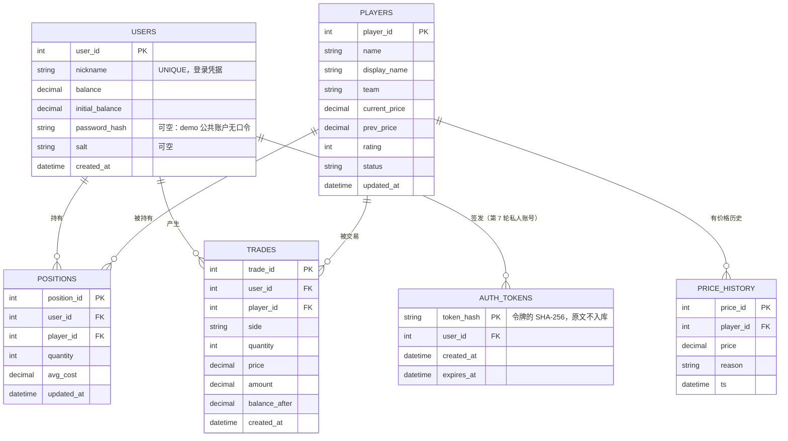

# 数据库设计说明

> **负责人**：B ｜ **截止**：第 1 天出表结构，第 6 天定稿 ｜ **状态**：✅ 已填写（第 6 天附实际 schema）
> **对应课程指标**：#7 数据设计；分工文档 B6"整理 API 文档和数据库设计说明"
> 答辩必问："为什么要这几张表？并发下怎么保证不超卖？"

## 1. 实体关系图



## 2. 表结构明细

### 2.1 `users` 账户

| 字段 | 类型 | 约束 | 说明 |
| --- | --- | --- | --- |
| `user_id` | INTEGER | PK, autoincrement | |
| `nickname` | VARCHAR(50) | NOT NULL, **UNIQUE** | 登录凭据；`demo` = 公共演示账户（第 7 轮起仍保留） |
| `balance` | NUMERIC(12,2) | NOT NULL, default 5000, CHECK ≥ 0 | 信用点余额，不可为负 |
| `initial_balance` | NUMERIC(12,2) | NOT NULL, default 5000, CHECK ≥ 0 | 用于算收益率 |
| `password_hash` | VARCHAR(255) | NULL | 第 7 轮新增：`pbkdf2_sha256$<迭代>$<盐>$<散列>`（`app/core/security.py`） |
| `salt` | VARCHAR(64) | NULL | 第 7 轮新增：每用户独立随机盐（hex） |
| `created_at` | DATETIME | NOT NULL, default now | |

**为什么口令列可空、不加 CHECK**：`demo` 是历史账户，按设计保留为**公共演示账户**——
未登录（不带 `Authorization`）时所有人共用它，它没有口令。
如果加 `CHECK (password_hash IS NOT NULL)`，已有那一行立刻变成非法数据，
线上 Postgres 上等于自找 500；"新账号必须有口令"这条规则放在接口层（`POST /api/auth/register`）。

**老库怎么补这两列**：`Base.metadata.create_all()` 只建缺失的表、不会给已有表加列，
所以 `app/core/database.py` 的 `_ensure_user_auth_columns()` 在启动时幂等地 `ALTER TABLE users ADD COLUMN`
（SQLite 与 Postgres 都走这一条）。不引 Alembic 是 6 天版的既定取舍，见 §4。

### 2.2 `players` 选手

| 字段 | 类型 | 约束 | 说明 |
| --- | --- | --- | --- |
| `player_id` | INTEGER | PK | |
| `name` | VARCHAR(50) | NOT NULL, UNIQUE | CS2 选手游戏内 ID（真实公开信息），如 ZywOo |
| `display_name` | VARCHAR(50) | | 展示名，真实选手暂无官方中文名时与 name 相同 |
| `team` | VARCHAR(50) | | 所属战队（真实公开信息），如 Vitality |
| `current_price` | NUMERIC(12,2) | NOT NULL, CHECK > 0 | 定价模块写入 |
| `prev_price` | NUMERIC(12,2) | NOT NULL, CHECK > 0 | 用于算涨跌幅 |
| `role` | VARCHAR(20) | | 选手真实位置：AWPer / Entry / Rifler / IGL / Support / Lurker |
| `rating` | INTEGER | NOT NULL, CHECK 0–100 | 本项目模拟综合表现分（C 维护），**不是 HLTV Rating 或任何官方统计** |
| `status` | VARCHAR(20) | NOT NULL, default 'trading' | `trading` / `suspended` |
| `updated_at` | DATETIME | NOT NULL | |

> 说明：`data/seed_players.json` 里的 `initial_price`（上市价）**不是本表字段**，落库时写成 `price_history` 的第一条记录（`reason = 初始价格`）。

### 2.3 `positions` 持仓

| 字段 | 类型 | 约束 | 说明 |
| --- | --- | --- | --- |
| `position_id` | INTEGER | PK | |
| `user_id` / `player_id` | INTEGER | FK，(user_id, player_id) UNIQUE | 一人一选手只有一行 |
| `quantity` | INTEGER | NOT NULL, CHECK 1–50 | 卖光时删行，不写 0 |
| `avg_cost` | NUMERIC(12,4) | NOT NULL, CHECK ≥ 0 | 加仓时按金额加权重算 |
| `updated_at` | DATETIME | NOT NULL | |

### 2.4 `trades` 流水（只追加）

| 字段 | 类型 | 约束 | 说明 |
| --- | --- | --- | --- |
| `trade_id` | INTEGER | PK | |
| `user_id` / `player_id` | INTEGER | FK；索引 (user_id, created_at) | |
| `side` | VARCHAR(4) | CHECK IN ('BUY','SELL') | |
| `quantity` | INTEGER | CHECK > 0 | |
| `price` / `amount` | NUMERIC(12,2) | price > 0，amount ≥ 0 | 成交价取下单时 `current_price` |
| `balance_after` | NUMERIC(12,2) | NOT NULL | 成交后余额，便于逐笔对账 |
| `created_at` | DATETIME | NOT NULL | |

### 2.5 `price_history` 价格历史（只追加）

| 字段 | 类型 | 约束 | 说明 |
| --- | --- | --- | --- |
| `price_id` | INTEGER | PK | |
| `player_id` | INTEGER | FK；索引 (player_id, ts) | |
| `price` | NUMERIC(12,2) | CHECK > 0 | |
| `reason` | VARCHAR(200) | NOT NULL | 涨跌原因，含本轮得分与 S |
| `ts` | DATETIME | NOT NULL | 比赛日；同一 (player_id, 轮次) 只落一次 |

### 2.6 `auth_tokens` 登录令牌

| 字段 | 类型 | 约束 | 说明 |
| --- | --- | --- | --- |
| `token_hash` | VARCHAR(64) | PK | 令牌原文的 SHA-256，库里不存原文 |
| `user_id` | INTEGER | FK | |
| `created_at` / `expires_at` | DATETIME | NOT NULL | 30 天有效；退出即删行 |

### 2.7–2.9 智能体审计表（只写审计，不碰业务表）

| 表 | 主要字段 | 用途 |
| --- | --- | --- |
| `agent_traces` | trace_id、mode、player_id、source、model、latency_ms、fallback_reason、input_digest、output_json | 每次智能体调用一行 |
| `decision_logs` | decision_id、user_id、player_id、advice_action、advice_source、decision、trace_id、note | 用户采纳 / 忽略建议的记录 |
| `price_narratives` | narrative_id、player_id、ts、narrative、source、model；(player_id, ts) UNIQUE | 价格点的文字归因缓存 |

## 3. 一致性规则（事务）

| 操作 | 必须同事务完成 | 失败处理 |
| --- | --- | --- |
| 买入 | 扣 `users.balance` + 更新/插入 `positions` + 插入 `trades` | 全回滚 |
| 卖出 | 加 `users.balance` + 减少/删除 `positions` + 插入 `trades` | 全回滚 |
| 价格更新 | 更新 `players.current_price/prev_price` + 插入 `price_history` | 全回滚 |

**C 的边界**：价格更新只写 `players` 和 `price_history`，**永不**碰 `users.balance` 与 `positions`。

### 3.1 并发下怎么保证不超卖（第 2 天）

只用"先 `SELECT` 判断、再 `UPDATE` 写入"是不够的：两个连接（多 worker / 多实例 /
多标签页）可以同时读到"持仓 3 股"，各自都判断"卖 2 股够"，最后卖掉 4 股、钱按 4 股
入账。第 2 天的实测复现：初始 5000.00 / 3 股，两条连接各卖 2 股后余额变成 5504.00，
而持仓还剩 1 股——凭空多卖了一股。

所以真正的判断必须交给数据库，写成**条件更新**，读出来的值只用来拼中文提示：

| 动作 | 语句里的守卫 | 守卫不成立时 |
| --- | --- | --- |
| 扣款 | `UPDATE users SET balance = balance - :amount WHERE user_id = :uid AND balance >= :amount` | `rowcount = 0` → 400 `INSUFFICIENT_BALANCE` |
| 加仓 | `UPDATE positions SET quantity = quantity + :n WHERE user_id = :uid AND player_id = :pid AND quantity + :n <= 50` | `rowcount = 0` → 400 `POSITION_LIMIT_EXCEEDED` |
| 减仓 | `UPDATE positions SET quantity = quantity - :n WHERE user_id = :uid AND player_id = :pid AND quantity > :n` | `rowcount = 0` 再试清仓 |
| 清仓 | `DELETE FROM positions WHERE user_id = :uid AND player_id = :pid AND quantity = :n` | `rowcount = 0` → 400 `INSUFFICIENT_POSITION` |

三条配套约定：

1. **加锁顺序一致**：买入先扣款、卖出先入账，都是先拿账户行、再动持仓行，
   两条路径不会互相死锁；
2. **减仓不写 0**：`positions.quantity` 有 `CHECK (quantity BETWEEN 1 AND 50)`，
   一次卖光走 `DELETE`，写成 0 会直接违反约束；
3. **失败即回滚**：任何一步守卫不成立都整体 rollback，钱和货一起回到原样，
   所以"先扣款后校验上限""先入账后校验持仓"不会留下半个交易。

`code/backend/app/api/trades.py` 里的进程内 `_trade_lock` 只是减少同进程的写冲突，
**不是**正确性的依据；正确性由上面四个条件更新保证（`tests/unit/test_trades_concurrency.py`
用两个独立连接稳定复现交错并逐条断言）。

# 本地仓库根目录（不是 code/backend）
$env:DATABASE_URL = "<External Database URL>"   # postgresql://... 含密码，别提交
python scripts/bootstrap_demo_data.py
```

表不用手动建：后端启动时 `init_db()` 会建；`bootstrap_demo_data.py` 也会先确保表存在。
脚本等价于 §4.1 的三条命令（内部就是顺序调用它们），跑完退出码 0 表示
「每名可交易选手 ≥10 个价格点」。只想补价格不动库时加 `--keep`；
想留一份明细加 `--json-out ./price_updates.json`。

> 免费 Postgres 的 External URL 有连接数限制（约 5 个并发），本地灌数时别同时开别的客户端。
> 用完后把 `$env:DATABASE_URL` 清掉（`Remove-Item Env:\DATABASE_URL`），免得本地跑测试连到线上库。

**两个坑（都已修，并有用例守着 `tests/unit/test_config_db_url.py`）**：

1. **驱动**：SQLAlchemy 2.1 起 `postgresql://` 默认解析到 psycopg **3**（包名 `psycopg`），
   而本项目依赖 `psycopg2-binary`。`config.py` 会把裸 `postgresql://` / `postgres://`
   补成 **`postgresql+psycopg2://`**，否则线上启动直接
   `ModuleNotFoundError: No module named 'psycopg'`（第 4 天部署预检实测）。
2. **临时磁盘**：Render 免费实例的文件系统是临时的，**必须用 Postgres**，
   否则每次重新部署/休眠后数据归零；`app/main.py` 在 Render 上检测到 SQLite 会打 WARNING。

**免费 Postgres 注意**：Render 免费库有约 30 天有效期（够答辩），到期前导出或升级；
连接串含密码，只能用 `sync: false` 在控制台填，绝不提交明文。

**上线后验收清单**：

| 检查 | 期望 |
| --- | --- |
| `GET /api/health` | `{"status":"ok"}` |
| `GET /api/players` | 8 条，字段与契约一致 |
| `GET /api/players/1/prices` | ≥10 个点、升序、带中文 `reason` |
| `POST /api/trades/buy` | 200，余额与持仓同步变化 |
| 重启服务后再查 | 数据仍在（Postgres 生效） |

# 有 sqlite3 命令行时
sqlite3 code/backend/playerstock.db ".schema"

# 没有 sqlite3 时用 Python（本次实际采用）
python -c "import sqlite3;print('\n'.join(r[0] for r in sqlite3.connect('code/backend/playerstock.db').execute('select sql from sqlite_master where sql is not null')))"
```

```sql
-- table: players
CREATE TABLE players (
	player_id INTEGER NOT NULL, 
	name VARCHAR(50) NOT NULL, 
	display_name VARCHAR(50), 
	team VARCHAR(50), 
	current_price NUMERIC(12, 2) NOT NULL, 
	prev_price NUMERIC(12, 2) NOT NULL, 
	role VARCHAR(20), 
	rating INTEGER NOT NULL, 
	status VARCHAR(20) DEFAULT 'trading' NOT NULL, 
	updated_at DATETIME NOT NULL, 
	PRIMARY KEY (player_id), 
	CONSTRAINT ck_players_current_price_positive CHECK (current_price > 0), 
	CONSTRAINT ck_players_prev_price_positive CHECK (prev_price > 0), 
	CONSTRAINT ck_players_rating_range CHECK (rating >= 0 AND rating <= 100), 
	UNIQUE (name)
);

-- table: positions
CREATE TABLE positions (
	position_id INTEGER NOT NULL, 
	user_id INTEGER NOT NULL, 
	player_id INTEGER NOT NULL, 
	quantity INTEGER NOT NULL, 
	avg_cost NUMERIC(12, 4) NOT NULL, 
	updated_at DATETIME NOT NULL, 
	PRIMARY KEY (position_id), 
	CONSTRAINT uq_positions_user_player UNIQUE (user_id, player_id), 
	CONSTRAINT ck_positions_quantity_range CHECK (quantity >= 1 AND quantity <= 50), 
	CONSTRAINT ck_positions_avg_cost_non_negative CHECK (avg_cost >= 0), 
	FOREIGN KEY(user_id) REFERENCES users (user_id) ON DELETE CASCADE, 
	FOREIGN KEY(player_id) REFERENCES players (player_id) ON DELETE CASCADE
);

-- table: price_history
CREATE TABLE price_history (
	price_id INTEGER NOT NULL, 
	player_id INTEGER NOT NULL, 
	price NUMERIC(12, 2) NOT NULL, 
	reason VARCHAR(200) NOT NULL, 
	ts DATETIME NOT NULL, 
	PRIMARY KEY (price_id), 
	CONSTRAINT ck_price_history_price_positive CHECK (price > 0), 
	FOREIGN KEY(player_id) REFERENCES players (player_id) ON DELETE CASCADE
);

-- table: trades
CREATE TABLE trades (
	trade_id INTEGER NOT NULL, 
	user_id INTEGER NOT NULL, 
	player_id INTEGER NOT NULL, 
	side VARCHAR(4) NOT NULL, 
	quantity INTEGER NOT NULL, 
	price NUMERIC(12, 2) NOT NULL, 
	amount NUMERIC(12, 2) NOT NULL, 
	balance_after NUMERIC(12, 2) NOT NULL, 
	created_at DATETIME NOT NULL, 
	PRIMARY KEY (trade_id), 
	CONSTRAINT ck_trades_side CHECK (side IN ('BUY', 'SELL')), 
	CONSTRAINT ck_trades_quantity_positive CHECK (quantity > 0), 
	CONSTRAINT ck_trades_price_positive CHECK (price > 0), 
	CONSTRAINT ck_trades_amount_non_negative CHECK (amount >= 0), 
	FOREIGN KEY(user_id) REFERENCES users (user_id) ON DELETE CASCADE, 
	FOREIGN KEY(player_id) REFERENCES players (player_id) ON DELETE CASCADE
);

-- table: users
CREATE TABLE users (
	user_id INTEGER NOT NULL, 
	nickname VARCHAR(50) NOT NULL, 
	balance NUMERIC(12, 2) NOT NULL, 
	initial_balance NUMERIC(12, 2) NOT NULL, 
	created_at DATETIME NOT NULL, 
	PRIMARY KEY (user_id), 
	CONSTRAINT ck_users_balance_non_negative CHECK (balance >= 0), 
	CONSTRAINT ck_users_initial_balance_non_negative CHECK (initial_balance >= 0)
);

-- index: ix_positions_player_id
CREATE INDEX ix_positions_player_id ON positions (player_id);

-- index: ix_positions_user_id
CREATE INDEX ix_positions_user_id ON positions (user_id);

-- index: ix_price_history_player_ts
CREATE INDEX ix_price_history_player_ts ON price_history (player_id, ts);

-- index: ix_trades_user_created
CREATE INDEX ix_trades_user_created ON trades (user_id, created_at);
```

自查结果：`players=8`、`price_history=15`、`users=1`、`positions=0`、`trades=0`（seed 后的干净状态）。
`positions` 唯一约束与 `quantity 1–50` CHECK、`trades(user_id, created_at)` 索引、
`price_history(player_id, ts)` 索引均已实际生成。

**最新复核（2026-11-21）**：按本节命令重新生成 `code/backend/playerstock.db` 后，结果为
**9 张表、9 条索引**（最初 5 张业务表之外，新增 `auth_tokens` / `agent_traces` / `decision_logs` / `price_narratives`）、
`players=16`（8 队 × 2）、`price_history=175`。表结构只在「账号体系」「智能体审计」两次迭代中**增量加表**，
既有列未改，所以第 2 天的并发加固（§3.1）与后续接口都无需数据迁移。
